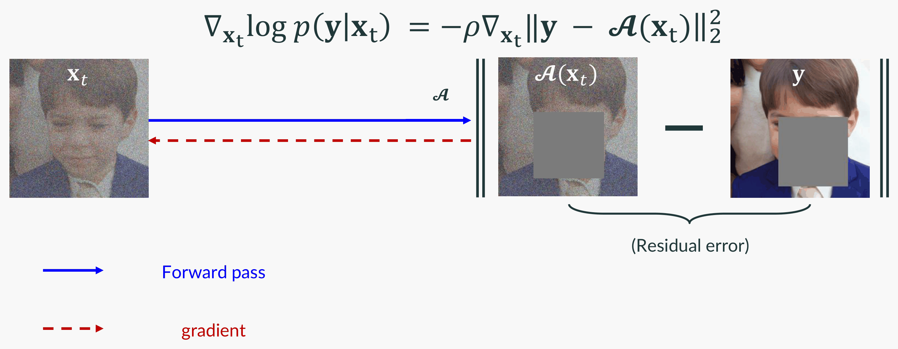

<!--
Lecture 09, slides 73-116 of `Part-4-Diffusion-Model-Theory.pptx`. The
instructor confirmed that range on 2026-10-30.

Base note: Kiet Nguyen, the only one of the four with no thin spot against
the lecture's topic list. Merged in: the generalization result
of slide 79 and the "is this part necessary?" picture of slide 84, which the
base note argues for but does not show, both rendered from the deck with
scripts/slide_figure.py; and the quantitative reading of slide 79, which no
note carried.

Declined: SDEdit and ILVR (slides 69-72), which are lecture 08's and are
written up in chapter 9; this chapter cites them rather than repeating them.

Three statements here disagree with the deck, each reached independently by
more than one scribe: the sign and the squaring of the posterior-mean
correction (slide 111), the constant in the Jensen bound, and the DDIM
contraction rate's coordinate system. Each disagreement is stated in the text
where it arises rather than silently resolved.

Slide numbers in the 99-110 range are deliberately absent from this chapter.
Two scribes independently numbered that stretch one higher than the deck file
now on disk, and until that is settled a slide number there would be a claim
the book cannot support. Numbers outside that range agree with the file and
are kept as provenance.
-->

## Overview {#sec-ip-overview}

This chapter treats inverse problems: recovering an image $\mathbf{x}_0$ from a measurement $\mathbf{y}$, such as a blurred photograph, a low-resolution image, an undersampled MRI scan or the magnitude of a Fourier transform. The Bayesian answer is to sample from the posterior $p(\mathbf{x}_0 \mid \mathbf{y})$, with a diffusion model as the prior. The previous chapter conditioned diffusion models in two ways: by training with the condition supplied to the network, as SR3 and latent diffusion do, and by steering a pretrained model at sampling time with a reference image, as SDEdit and ILVR do. Both put the condition in by hand. In an inverse problem, the forward operator that produces $\mathbf{y}$ is known instead. This chapter therefore uses *one* pretrained unconditional diffusion model as the prior and brings in the measurement only at sampling time, through the forward operator. No retraining is needed when the task changes. The chapter covers slides 73--116 of the lecture deck *Part 4 - Diffusion Model Theory* [@lecture-slides-diffusion]; references of the form "slide N" point to that deck.

The chapter follows three methods in historical order, each of which addresses a limitation of the one before.

1. **Score-MRI** [@chung2022scoremri] interleaves the reverse diffusion with a data-consistency step towards $\mathbf{y}$. It reconstructs accurately, but it needs thousands of steps.
2. **Come-Closer-Diffuse-Faster (CCDF)** [@chung2022ccdf] starts the reverse diffusion from a forward-diffused initial estimate instead of pure noise. A stochastic contraction argument shows that a short reverse path suffices, and that the better the initial estimate, the shorter the path.
3. **Diffusion posterior sampling (DPS)** [@chung2023dps] approximates the intractable likelihood of the noisy state through Tweedie's formula. It handles noisy and nonlinear measurements. Its geometry, shared with its predecessor, the manifold-constrained gradient (MCG) [@chung2022mcg], explains why it keeps samples near the data manifold.

After this chapter, the reader should be able to do the following.

- Explain why inverse problems are ill-posed and how a diffusion prior resolves the ambiguity.
- Describe score-MRI as a predictor-corrector sampler with data-consistency steps.
- State the CCDF algorithm, and prove its stochastic contraction and shortcut-path theorems.
- Derive the posterior SDE and explain why the likelihood of the noisy state is intractable.
- Derive the DPS update for Gaussian and Poisson noise, and bound the error of its approximation.
- Explain why Tweedie's denoiser acts as a projector onto the data manifold, and why DPS drops the projection step of MCG.

## Notation {#sec-ip-notation}

We follow the notation of the slides, which is that of the original papers; where this chapter departs from it, the text says so. Bold lower-case letters are vectors. The time index is continuous $t$ in the SDE sections and discrete $i \in \{0, \dots, N\}$ in the algorithmic sections.

| Symbol | Meaning |
|---|---|
| $\mathbf{x}_0 \in \mathbb{R}^d$ | clean image (unknown) |
| $\tilde{\mathbf{x}}_0$, $\tilde{\mathbf{x}}_i$ | in @sec-ccdf only: the clean image and its trajectory, while $\mathbf{x}_0$ there denotes the initial estimate |
| $\mathbf{y} \in \mathbb{R}^n$ | measurement |
| $\mathcal{A}$ | forward (measurement) operator, possibly nonlinear; written $A$ or $\boldsymbol{H}$ when linear |
| $\mathbf{n}$, $\sigma$ (or $\sigma_y$) | measurement noise and its standard deviation |
| $\mathbf{x}_t$, $\mathbf{x}_i$ | noisy diffusion state at time $t$ or step $i$ |
| $\alpha_i$, $\beta_i = 1-\alpha_i$, $\bar\alpha_i = \prod_{j\le i}\alpha_j$ | DDPM (VP) noise schedule |
| $\sigma_i$ | SMLD (VE) noise levels, increasing in $i$ |
| $a_i$, $b_i$ | forward marginal $\mathbf{x}_i = a_i \mathbf{x}_0 + b_i \mathbf{z}$, with $\mathbf{z} \sim \mathcal{N}(\mathbf{0}, \boldsymbol{I})$ |
| $\boldsymbol{s}_{\theta^*}(\mathbf{x}_t, t)$ | trained score network, $\approx \nabla_{\mathbf{x}_t} \log p_t(\mathbf{x}_t)$ |
| $\boldsymbol{\epsilon}_{\theta^*}$ | noise-prediction network, $\boldsymbol{s}_{\theta^*} = -\boldsymbol{\epsilon}_{\theta^*}/\sqrt{1-\bar\alpha_t}$ |
| $\hat{\mathbf{x}}_0 = \mathbb{E}[\mathbf{x}_0 \mid \mathbf{x}_t]$ | Tweedie (posterior-mean) denoised estimate, also written $\hat{\mathbf{x}}_{0\mid t}$ |
| $N$, $t_0$, $N' = t_0 N$ | total number of steps, CCDF start fraction, CCDF number of steps |
| $\boldsymbol{T}$, $\mathbf{b}$ | linear part and offset of the CCDF data-consistency map ($\boldsymbol{A}$ in @chung2022ccdf) |
| $\mathcal{M}$, $\mathcal{M}_t$ | clean data manifold and noisy data manifold at time $t$ |
| $\mathcal{P}_{\mathcal{M}}$, $\mathcal{P}_{\mathcal{M}}^{\perp}$ | orthogonal projectors onto $\mathcal{M}$ and its orthogonal complement |

: Notation used in this chapter. {#tbl-ip-notation}

## Inverse problems and the diffusion prior {#sec-inverse}

An imaging system maps an unknown object $\mathbf{x}_0$ to a measurement through a physical process $\mathcal{A}$ (optics, Fourier sampling, a blur kernel), and the detector adds noise [@chung2023dps, eq. (6)]:

$$
\mathbf{y} = \mathcal{A}(\mathbf{x}_0) + \mathbf{n}, \qquad \mathbf{y}, \mathbf{n} \in \mathbb{R}^n, \quad \mathbf{x}_0 \in \mathbb{R}^d .
$$ {#eq-forward-model}

@fig-inverse shows typical instances. Inpainting, super-resolution and deblurring are linear; phase retrieval and deblurring with a learned blur model are nonlinear.

![Linear (top) and nonlinear (bottom) inverse problems: in each pair, the measurement $\mathbf{y}$ is on the left and a diffusion-based reconstruction on the right. Reproduced from [@chung2023dps, Fig. 1].](figures/lec09/kietngt00-dps-fig1-overview.png){#fig-inverse width=90%}

Recovering $\mathbf{x}_0$ from $\mathbf{y}$ is *ill-posed*: the measurement alone does not determine a unique, stable answer. In particular, two problems arised from the inverse problem setup. First, there are usually fewer measurements than unknowns ($n < d$), so information is lost: inpainting discards pixels, super-resolution averages them, and accelerated MRI skips Fourier coefficients. Infinitely many images then explain $\mathbf{y}$ equally well. Second, even when $\mathcal{A}$ is invertible, inverting it can amplify the noise enormously. For a linear $A$, $A^{-1}\mathbf{y} = \mathbf{x}_0 + A^{-1}\mathbf{n}$. In directions that $A$ nearly erases, such as the fine details removed by a blur, $A^{-1}$ must multiply by a very large factor to restore the signal, and it multiplies the noise $\mathbf{n}$ by the same factor. Fitting the data alone, $\min_{\mathbf{x}} \|\mathbf{y} - \mathcal{A}(\mathbf{x})\|_2^2$, therefore cannot pick a good solution. The missing information must come from a *prior*: a probability distribution $p(\mathbf{x}_0)$ that is high on plausible images and low on implausible ones. This is where a generative model enters. With a diffusion model as the prior, the resulting problem can be written as a constrained fit,

$$
\min_{\mathbf{x}_0 \sim p_\theta(\mathbf{x}_0)} \; \|\mathbf{y} - \mathcal{A}(\mathbf{x}_0)\|_2^2 ,
$$ {#eq-diffusion-prior-fit}

that is, search for a data-consistent image *among the samples of the diffusion prior* $p_\theta$. The probabilistic version of the same idea is posterior sampling,

$$
p(\mathbf{x}_0 \mid \mathbf{y}) \propto p(\mathbf{x}_0) \, p(\mathbf{y} \mid \mathbf{x}_0),
$$ {#eq-bayes}

where $p(\mathbf{x}_0)$ is represented by the diffusion model and the likelihood $p(\mathbf{y} \mid \mathbf{x}_0)$ follows from @eq-forward-model. With Gaussian noise $\mathbf{n} \sim \mathcal{N}(\mathbf{0}, \sigma^2 \boldsymbol{I})$, the likelihood is $\mathcal{N}(\mathbf{y} \mid \mathcal{A}(\mathbf{x}_0), \sigma^2 \boldsymbol{I})$. The rest of the chapter studies how to turn @eq-diffusion-prior-fit and @eq-bayes into a sampling algorithm.

## Gradient guidance: alternating denoising and data consistency {#sec-scoremri}

### The algorithm

The first and simplest approach, score-MRI [@chung2022scoremri], leaves the reverse diffusion untouched. After every denoising step it inserts a *data-consistency* (DC) step that pulls the iterate towards $\{\mathbf{x} : A\mathbf{x} \approx \mathbf{y}\}$. For a linear operator $A$, the DC step targets the least-squares problem

$$
\min_{\mathbf{x}} \; \|\mathbf{y} - A \mathbf{x}\|^2 ,
$$

and the sampler interleaves DC steps with a *predictor-corrector* (PC) sampler. PC sampling was proposed by @sde [Sec. 4.2] for score-based generative models; score-MRI uses its VE (SMLD) form [@sde, App. G, Algorithm 2], which alternates two kinds of step. The *predictor* is one Euler-Maruyama step of the reverse SDE. It lowers the noise level from $\sigma_{i+1}$ to $\sigma_i$ and is followed by a DC step:

$$
\begin{aligned}
\mathbf{x}_i &\leftarrow \mathbf{x}_{i+1} + (\sigma_{i+1}^2 - \sigma_i^2) \, \boldsymbol{s}_\theta(\mathbf{x}_{i+1}, \sigma_{i+1}) + \sqrt{\sigma_{i+1}^2 - \sigma_i^2} \, \mathbf{z} && \text{(predictor: reverse-SDE step)} \\
\mathbf{x}_i &\leftarrow \mathbf{x}_i + \lambda A^{*}(\mathbf{y} - A\mathbf{x}_i) && \text{(data-consistency step)}
\end{aligned}
$$ {#eq-scoremri}

The *corrector* then runs $M$ steps of Langevin Monte Carlo at the fixed noise level $\sigma_i$, each again followed by a DC step:

$$
\begin{aligned}
\mathbf{x}_i &\leftarrow \mathbf{x}_i + \epsilon_i \, \boldsymbol{s}_\theta(\mathbf{x}_i, \sigma_i) + \sqrt{2\epsilon_i} \, \mathbf{z} && \text{(corrector: Langevin step)} \\
\mathbf{x}_i &\leftarrow \mathbf{x}_i + \lambda A^{*}(\mathbf{y} - A\mathbf{x}_i) && \text{(data-consistency step)}
\end{aligned}
$$ {#eq-scoremri-corrector}

Here $A^{*}$ is the *adjoint* of $A$, its conjugate transpose, which is simply the transpose $A^{\top}$ when $A$ is real; the DC update $\mathbf{x}_i \leftarrow \mathbf{x}_i + \lambda A^{*}(\mathbf{y} - A\mathbf{x}_i)$ is one gradient-descent step that reduces the data misfit $\|\mathbf{y} - A\mathbf{x}_i\|^2$, as shown in *Where the DC step comes from* below. The scalar $\epsilon_i$ is the Langevin step size, $\lambda \in [0, 1]$ is the DC step size [@chung2022scoremri, eq. (12)], and $\mathbf{z} \sim \mathcal{N}(\mathbf{0}, \boldsymbol{I})$ is drawn afresh at every step. The two steps play different roles. The predictor moves the iterate down the noise schedule, from $\sigma_{i+1}$ to $\sigma_i$. The corrector keeps the noise level fixed and pulls the iterate towards a typical sample of the noisy prior at level $\sigma_i$; its noise term $\sqrt{2\epsilon_i}\,\mathbf{z}$ is the signature of Langevin dynamics. Neither step sees $\mathbf{y}$, which enters only through the DC steps (@fig-scoremri). Slide 75 shows the corrector line of @eq-scoremri-corrector, with its DC step, under the label "denoising step (reverse SDE)"; the reverse-SDE step is the predictor of @eq-scoremri, and the DC step follows both. Putting everything together gives the full sampler [@chung2022scoremri, Algorithm 2]:

::: {.callout-note icon=false title="Algorithm: score-MRI sampling (PC sampler with data consistency)"}
**Input:** score network $\boldsymbol{s}_\theta$; noise levels $\sigma_0 < \sigma_1 < \dots < \sigma_N$; Langevin step sizes $\epsilon_0, \dots, \epsilon_{N-1}$; number of corrector steps $M$; measurement $\mathbf{y}$ and forward operator $A$; DC step size $\lambda$.

1. Sample $\mathbf{x}_N \sim \mathcal{N}(\mathbf{0}, \sigma_N^2 \boldsymbol{I})$.
2. For $i = N-1, N-2, \dots, 0$:
    a. *Predictor:* draw $\mathbf{z} \sim \mathcal{N}(\mathbf{0}, \boldsymbol{I})$ and set $\mathbf{x}_i \leftarrow \mathbf{x}_{i+1} + (\sigma_{i+1}^2 - \sigma_i^2)\, \boldsymbol{s}_\theta(\mathbf{x}_{i+1}, \sigma_{i+1}) + \sqrt{\sigma_{i+1}^2 - \sigma_i^2}\, \mathbf{z}$.
    b. *Data consistency:* $\mathbf{x}_i \leftarrow \mathbf{x}_i + \lambda A^{*}(\mathbf{y} - A\mathbf{x}_i)$.
    c. For $j = 1, \dots, M$:
        i. *Corrector:* draw $\mathbf{z} \sim \mathcal{N}(\mathbf{0}, \boldsymbol{I})$ and set $\mathbf{x}_i \leftarrow \mathbf{x}_i + \epsilon_i\, \boldsymbol{s}_\theta(\mathbf{x}_i, \sigma_i) + \sqrt{2\epsilon_i}\, \mathbf{z}$.
        ii. *Data consistency:* $\mathbf{x}_i \leftarrow \mathbf{x}_i + \lambda A^{*}(\mathbf{y} - A\mathbf{x}_i)$.
3. Return $\mathbf{x}_0$.
:::

![Score-MRI sampling. The reverse SDE runs from $\mathbf{x}_T \sim \mathcal{N}$ to $\mathbf{x}_0$. At every step the predictor and the corrector are each followed by a data-consistency step that uses the undersampled measurement $\mathbf{y}$. The prior network never sees $\mathbf{y}$ during training. Reproduced from [@chung2022scoremri, Fig. 1], as shown on slide 76.](figures/lec09/kietngt00-scoremri-fig1-overview.png){#fig-scoremri width=95%}

Removing the DC steps (2b and 2c-ii) recovers the unconditional PC sampler of @sde. @chung2022scoremri use $\lambda = 1$ and, since their Algorithm 2 assumes a real-valued image, take the real part after each DC step; their Algorithms 3--5 extend the same scheme to complex-valued and multi-coil MRI data.

**Where the DC step comes from.** Let $\ell(\mathbf{x}) = \tfrac12 \|\mathbf{y} - A\mathbf{x}\|^2$. Expanding $\ell(\mathbf{x} + \mathbf{h}) = \ell(\mathbf{x}) - \mathrm{Re}\langle A\mathbf{h}, \mathbf{y} - A\mathbf{x} \rangle + O(\|\mathbf{h}\|^2)$ and moving $A$ to the other side of the inner product, which is the defining property of the adjoint, $\langle A\mathbf{h}, \mathbf{v} \rangle = \langle \mathbf{h}, A^{*}\mathbf{v} \rangle$ for all $\mathbf{h}, \mathbf{v}$, gives

$$
\nabla_{\mathbf{x}} \ell(\mathbf{x}) = -A^{*}(\mathbf{y} - A\mathbf{x}).
$$

The DC step in @eq-scoremri and @eq-scoremri-corrector is therefore one gradient-descent step on $\ell$ with step size $\lambda$. Dropping the factor $1/2$ from $\ell$ only rescales $\lambda$.

**When the DC step is a projection.** With $\lambda = 1$, the DC step can do more than move towards the data: it can make the image agree *exactly* with the measurements. This happens when $A$ simply *selects* some entries of the image or of a transform of it, so that $AA^{*} = \boldsymbol{I}$. Inpainting selects pixels; single-coil accelerated MRI selects a subset of the Fourier coefficients [@chung2022scoremri, eq. (8)]. For such an $A$,

$$
A\big(\mathbf{x}_i + A^{*}(\mathbf{y} - A\mathbf{x}_i)\big) = A\mathbf{x}_i + \mathbf{y} - A\mathbf{x}_i = \mathbf{y},
$$

and the correction $A^{*}(\mathbf{y} - A\mathbf{x}_i)$ touches only the measured entries. The DC step therefore *replaces* the measured entries by $\mathbf{y}$ and leaves the others unchanged, so the diffusion prior is left to fill in only what was not measured. The result is the image closest to $\mathbf{x}_i$ among all images that agree exactly with $\mathbf{y}$, i.e. the *orthogonal projection* of $\mathbf{x}_i$ onto the set $\{\mathbf{x} : A\mathbf{x} = \mathbf{y}\}$. This is why @chung2022scoremri treat two kinds of DC step as interchangeable: a gradient-descent step on the data misfit, as derived above, and a *projection onto convex sets* (POCS) step, which projects onto the set of data-consistent images. For a selecting $A$ with $\lambda = 1$ the two coincide, which is also why they use $\lambda = 1$. The same projection reappears in @sec-ccdf as the basic example of a DC map that the CCDF analysis allows.

### What it achieves

@chung2022scoremri train the prior on the fastMRI knee dataset and evaluate it there and beyond.

![Score-MRI against TV, U-Net and DuDoRNet on four undersampling patterns (rows: 2D Gaussian $\times 8$, 1D uniform $\times 4$, 1D Gaussian $\times 8$, Poisson disk $\times 15$). (a) Mask, (b)--(e) reconstructions with PSNR/SSIM in yellow, (f) ground truth; below each reconstruction, a zoomed patch and its error map. Reproduced from [@chung2022scoremri, Fig. 3], as shown on slide 77.](figures/lec09/kietngt00-scoremri-fig3-results.png){#fig-scoremri-results width=62% fig-pos="H"}

- **State-of-the-art accuracy (@fig-scoremri-results).** On several undersampling patterns, the diffusion approach beats total-variation regularization, a supervised U-Net and the dual-domain network DuDoRNet. In the 1D uniform example of the figure, it reaches PSNR/SSIM 32.54/0.821, against 30.91/0.797 for DuDoRNet; the test-set averages in their Table 1 show the same ranking.
- **Generalization (@fig-generalization).** The prior is trained once, on knee images, and the measurement physics enters only through $A$ at test time, so nothing in the network is specialized to an anatomy or a sampling pattern. @fig-generalization tests that on three anatomies the prior never saw. The diffusion reconstruction has the best PSNR/SSIM in all three: $34.34/0.908$ on the axial brain against $25.16/0.682$ for the supervised U-Net, $35.45/0.915$ on the ankle against $32.12/0.862$, and $35.23/0.911$ on the spine against $29.93/0.827$. The gap to U-Net is largest on the brain, the anatomy least like a knee. Total variation, which encodes no anatomy at all, degrades least among the baselines and still loses by three decibels. A supervised network has the sampling pattern and the anatomy baked into its weights; this one does not.

![Generalization to anatomies the prior was not trained on. Rows: axial brain, ankle, spine; columns: total variation, U-Net, DuDoRNet, the diffusion reconstruction (boxed) and the ground truth, with PSNR/SSIM in each panel. The score model was trained on knee images only. Rendered from slide 79 of the lecture deck [@lecture-slides-diffusion], after @chung2022scoremri.](figures/lec09/slide79.png){#fig-generalization width=90%}

- **Uncertainty quantification (@fig-uncertainty).** The sampler is stochastic, so running it several times gives several posterior samples. Their pixel-wise standard deviation is an uncertainty map. It grows with the acceleration factor ($\times 2$ to $\times 8$), which is what one expects: fewer measurements leave more freedom to the prior.

![Uncertainty quantification with score-MRI. (a) Ground truth; rows: uniform undersampling at $\times 2$, $\times 4$, $\times 6$, $\times 8$; (b) aliased input, (c) mean of the posterior samples, (d) their pixel-wise standard deviation, which grows with the acceleration. Reproduced from [@chung2022scoremri, Fig. 8], as shown on slide 80.](figures/lec09/kietngt00-scoremri-fig8-uncertainty.png){#fig-uncertainty width=45% fig-pos="H"}

### Limitation: Slow convergence {#sec-scoremri-limitation}

The weakness is speed. With $N = 2000$ discretization steps, one reconstruction takes about ten minutes [@chung2022scoremri, Sec. 6.1]. Starting from $\mathbf{x}_T \sim \mathcal{N}(\mathbf{0}, \boldsymbol{I})$, the sampler spends most of its steps turning noise into a coarse image. @fig-slowconv shows the PSNR as a function of $N$ for acceleration factors $\times 4$, $\times 6$ and $\times 8$. At $\times 4$, 50 steps already give an accurate reconstruction, and at every factor the performance caps at about $N = 500$ [@chung2022scoremri, Sec. 6.1]. Most of the 2000 network evaluations therefore add almost nothing. The waste has a clear source: the sampler ignores what it already knows. It starts from pure noise, as if nothing were known about $\mathbf{x}_0$, and spends its early steps building a coarse image that the measurement $\mathbf{y}$ already largely determines. This raises two questions. *Can the sampler start from an estimate built from $\mathbf{y}$ instead of from noise?* And if it does, *how short can the reverse path be?* CCDF, the subject of the next section, answers both.

![Reconstruction PSNR against the number of reverse-diffusion steps $N$ for score-MRI at accelerations $\times 4$, $\times 6$ and $\times 8$ (error bars: one standard deviation). The quality saturates long before $N = 2000$. Reproduced from [@chung2022scoremri, Fig. 10], as shown on slide 81.](figures/lec09/kietngt00-scoremri-fig10-iterations.png){#fig-slowconv width=55% fig-pos="H"}

## CCDF: come closer, diffuse faster {#sec-ccdf}

### Why run the whole process?

@sec-scoremri-limitation traced the slow convergence of score-MRI to its starting point, pure noise. Yet in an inverse problem we already hold a reasonable guess of the answer: the degraded image itself, its zero-filled reconstruction, or the output of a cheap feed-forward network. Why should the reverse process start from pure noise at $t = 1$ and throw that guess away?

@fig-whole-process is the lecture's own way of putting the question. The top row is one reverse trajectory, from pure noise on the left to a face on the right, and the first three frames of it are indistinguishable noise: the sampler is spending network evaluations deciding nothing a reader could name. Underneath, at the far left, sits what we already have --- the low-resolution measurement --- and it plainly carries more information than the noise above it does. The question on the slide is whether the part of the chain above that image is necessary at all.

![The question CCDF asks. Top: a full reverse trajectory from $p(\mathbf{x}_1)$ to $p(\mathbf{x}_0)$, whose first frames are indistinguishable noise. Bottom left: the low-resolution measurement the reconstruction starts from, which already determines the coarse image. Rendered from slide 84 of the lecture deck [@lecture-slides-diffusion], after @chung2022ccdf.](figures/lec09/slide84.png){#fig-whole-process width=95%}

CCDF [@chung2022ccdf] keeps the guess and starts in the middle instead. Fix $t_0 \in (0, 1]$ and set $N' = t_0 N$; for example, $t_0 = 0.3$ and $N = 1000$ give $N' = 300$. Take an initial estimate $\mathbf{x}_0$ of the unknown clean image, computed from the measurement $\mathbf{y}$, for instance a low-resolution image, and diffuse it forward to step $N'$ *in one shot*, using the closed-form forward marginal [@chung2022ccdf, eq. (12)]:

$$
\mathbf{x}_{N'} = a_{N'} \mathbf{x}_0 + b_{N'} \mathbf{z}, \qquad \mathbf{z} \sim \mathcal{N}(\mathbf{0}, \boldsymbol{I}).
$$ {#eq-ccdf-forward}

**Notation in this section.** Following slides 85--89 and @chung2022ccdf, $\mathbf{x}_0$ denotes the known initial estimate and $\mathbf{x}_i$ its trajectory, while a tilde marks the unknown clean image $\tilde{\mathbf{x}}_0$ and its trajectory $\tilde{\mathbf{x}}_i$. This differs from the rest of the chapter, where $\mathbf{x}_0$ is the clean image (@tbl-ip-notation).

For DDPM, $a_i = \sqrt{\bar\alpha_i}$ and $b_i = \sqrt{1-\bar\alpha_i}$. For SMLD (VE), $a_i = 1$ and $b_i^2 = \sigma_i^2 - \sigma_0^2$. Then run only the last $N'$ reverse steps, interleaved with the same kind of DC step as in score-MRI. The number of network evaluations drops from $N$ to $N' = t_0 N$, and the early steps that score-MRI spent turning noise into a coarse image are skipped altogether. Apply the same forward step, hypothetically, to the clean image $\tilde{\mathbf{x}}_0$, giving $\tilde{\mathbf{x}}_{N'} = a_{N'}\tilde{\mathbf{x}}_0 + b_{N'}\tilde{\mathbf{z}}$. Once enough noise is added, the two noisy images become hard to tell apart; @eq-ccdf-lemma1 below makes "enough" precise.

@fig-ccdf-paths contrasts the two strategies through the average error $\bar\varepsilon$ along the path. Panel (a) is the standard conditional diffusion, which starts from Gaussian noise at $t = T$ and runs the full reverse process. Panel (b) is CCDF: a single forward jump from $t = 0$ to $t = t_0$, then a short reverse path. Panel (c) is discussed in @sec-ccdf-shortcut.

![Average error $\bar\varepsilon$ against time $t$. (a) Conditional diffusion from Gaussian noise with full reverse diffusion. (b) CCDF with vanilla initialization: the corrupted image is forward-diffused in a single step to $t = t_0$ (red) and then reverse-diffused (blue). (c) CCDF with a neural-network initialization, which allows a smaller $t_0' < t_0$. Reproduced from [@chung2022ccdf, Fig. 2], as shown on slides 94--96.](figures/lec09/kietngt00-ccdf-fig2-error-vs-time.png){#fig-ccdf-paths width=95%}

*Why should this work, and how small can $N'$ be?* These are the two questions left open in @sec-scoremri-limitation. To answer them, CCDF needs to measure how far off the sampler is at each of its three stages: at the start, after the forward jump, and at the end of the reverse path. The final output is a random sample, so there is no single correct answer to compare it with. CCDF therefore compares the actual run, started from the estimate, with a hypothetical run of the same sampler started from the clean image: the two trajectories $\mathbf{x}_i$ and $\tilde{\mathbf{x}}_i$ above. The gap between them at each stage gives three error quantities:

$$
\varepsilon_0 := \|\tilde{\mathbf{x}}_0 - \mathbf{x}_0\|^2, \qquad
\bar\varepsilon_{N'} := \mathbb{E}\|\tilde{\mathbf{x}}_{N'} - \mathbf{x}_{N'}\|^2, \qquad
\bar\varepsilon_{0,r} := \mathbb{E}\|\tilde{\mathbf{x}}_{0,r} - \mathbf{x}_{0,r}\|^2 .
$$ {#eq-ccdf-errors}

Here $\tilde{\mathbf{x}}_{0,r}$ and $\mathbf{x}_{0,r}$ are the endpoints of the two reverse paths, started from $\tilde{\mathbf{x}}_{N'}$ and $\mathbf{x}_{N'}$. All three quantities are symmetric in the two trajectories. Because $\tilde{\mathbf{x}}_{0,r}$ is itself a sample rather than $\tilde{\mathbf{x}}_0$, $\bar\varepsilon_{0,r}$ does not measure the absolute error of the output. It measures how much the imperfect starting point still matters at the end, compared with starting from the truth. The claim to be established is that $\bar\varepsilon_{0,r} < \varepsilon_0$: diffusing forward and coming back *reduces* the error of the initial estimate. The argument follows the three stages. The forward jump shrinks the error inherited from the estimate, at the price of a noise gap (below). The reverse path contracts both geometrically (@thm-ccdf-contraction). Combining the two shows how short the path can be (@thm-shortcut).

**What the forward jump does to the error.** Subtract the two forward steps. If both use the same noise realization $\tilde{\mathbf{z}}$, then $\tilde{\mathbf{x}}_{N'} - \mathbf{x}_{N'} = a_{N'}(\tilde{\mathbf{x}}_0 - \mathbf{x}_0)$ and $\bar\varepsilon_{N'} = a_{N'}^2 \varepsilon_0 \le \varepsilon_0$. The paper's Lemma 1 draws *independent* $\tilde{\mathbf{z}}$, $\mathbf{z}$. Then

$$
\begin{aligned}
\bar\varepsilon_{N'} &= \mathbb{E}\|a_{N'}(\tilde{\mathbf{x}}_0 - \mathbf{x}_0) + b_{N'}(\tilde{\mathbf{z}} - \mathbf{z})\|^2 \\
&= a_{N'}^2 \varepsilon_0 + 2 a_{N'} b_{N'} \, \mathbb{E}\langle \tilde{\mathbf{x}}_0 - \mathbf{x}_0, \tilde{\mathbf{z}} - \mathbf{z} \rangle + b_{N'}^2 \, \mathbb{E}\|\tilde{\mathbf{z}} - \mathbf{z}\|^2 \\
&= a_{N'}^2 \varepsilon_0 + 2 b_{N'}^2 d ,
\end{aligned}
$$ {#eq-ccdf-lemma1}

because $\tilde{\mathbf{z}} - \mathbf{z}$ has mean zero and covariance $2\boldsymbol{I}$ in $\mathbb{R}^d$. (Slide 93 and @chung2022ccdf write $n$ for the image dimension $d$.) The forward jump thus shrinks the estimate's error by $a_{N'}^2 \le 1$ and adds a noise gap $2 b_{N'}^2 d$ that does not depend on the estimate. Once the noise dominates, $b_{N'}^2 / a_{N'}^2 \gg \varepsilon_0 / (2d)$ (noise variance per pixel large compared with the estimate's mean squared error per pixel), the noised estimate is hard to tell apart from a noised clean image, so the reverse process can correct it. A better estimate reaches this regime at a smaller $N'$, which is the intuition behind @thm-shortcut. The reverse path must still remove both terms; @thm-ccdf-contraction shows that it does.

### The algorithm

CCDF needs four ingredients: a pretrained score network $\boldsymbol{s}_\theta$ with its noise schedule ($N$ steps, forward coefficients $a_i$, $b_i$); the measurement $\mathbf{y}$ and forward operator $A$; an initial estimate $\mathbf{x}_0$; and the start fraction $t_0$. The initial estimate can be the measurement placed in image space, such as the masked image for inpainting or the upsampled low-resolution image for super-resolution, or the output of a fast feed-forward restoration network [@chung2022ccdf, Sec. 3.2].

::: {.callout-note icon=false title="Algorithm: CCDF sampling"}
**Input:** $\boldsymbol{s}_\theta$, $N$, $\{a_i, b_i\}$, $\mathbf{y}$, $A$, initial estimate $\mathbf{x}_0$, start fraction $t_0 \in (0, 1]$.

1. Set $N' = t_0 N$.
2. *Forward jump:* draw $\mathbf{z} \sim \mathcal{N}(\mathbf{0}, \boldsymbol{I})$ and set $\mathbf{x}_{N'} \leftarrow a_{N'} \mathbf{x}_0 + b_{N'} \mathbf{z}$.
3. For $i = N', N'-1, \dots, 1$:
    a. *Reverse step:* draw $\mathbf{z}_i \sim \mathcal{N}(\mathbf{0}, \boldsymbol{I})$ and set $\mathbf{x}'_{i-1} \leftarrow \boldsymbol{f}(\mathbf{x}_i, i) + g(\mathbf{x}_i, i)\, \mathbf{z}_i$, with $(\boldsymbol{f}, g)$ from @tbl-fg.
    b. *Data consistency:* $\mathbf{x}_{i-1} \leftarrow \mathrm{DC}_i(\mathbf{x}'_{i-1})$.
4. Return the last iterate, $\mathbf{x}_{0,r}$.
:::

The subscript $r$ in the output, $\mathbf{x}_{0,r}$, distinguishes the end of the reverse path from the initial estimate $\mathbf{x}_0$. Compared with score-MRI there are only two changes: the loop starts at $N'$ instead of $N$, and its starting point is the noised estimate instead of pure noise.

The reverse step is one step of any standard unconditional sampler; @tbl-fg lists three [@chung2022ccdf, Table 1].

| Sampler | $\boldsymbol{f}(\tilde{\mathbf{x}}_i, i)$ | $g(\tilde{\mathbf{x}}_i, i)$ |
|---|---|---|
| SMLD (VE) | $\tilde{\mathbf{x}}_i + (\sigma_i^2 - \sigma_{i-1}^2)\,\boldsymbol{s}_\theta(\tilde{\mathbf{x}}_i, i)$ | $\sqrt{\sigma_i^2 - \sigma_{i-1}^2}$ |
| DDPM (VP) | $\frac{1}{\sqrt{\alpha_i}}\big(\tilde{\mathbf{x}}_i + (1-\alpha_i)\,\boldsymbol{s}_\theta(\tilde{\mathbf{x}}_i, i)\big)$ | $\sqrt{1-\alpha_i}$ |
| DDIM | $\sqrt{\bar\alpha_{i-1}}\,\frac{\tilde{\mathbf{x}}_i - \sqrt{1-\bar\alpha_i}\,\boldsymbol{\epsilon}_\theta(\tilde{\mathbf{x}}_i, i)}{\sqrt{\bar\alpha_i}} + \sqrt{1-\bar\alpha_{i-1}}\,\boldsymbol{\epsilon}_\theta(\tilde{\mathbf{x}}_i, i)$ | $0$ |

: The reverse step $\tilde{\mathbf{x}}'_{i-1} = \boldsymbol{f}(\tilde{\mathbf{x}}_i, i) + g(\tilde{\mathbf{x}}_i, i)\,\tilde{\mathbf{z}}_i$ for three samplers. {#tbl-fg}

The DC step depends on the task [@chung2022ccdf, App. D]:

- *Super-resolution and inpainting* (DDPM, App. D.1, Algorithm 1). Let $\boldsymbol{P}$ keep the part of an image that the measurement determines: for inpainting, the observed pixels; for super-resolution, the low-frequency content, by downsampling and then upsampling. Let $\mathbf{x}_{\mathbf{y}}$ be the measurement placed in image space. The DC step replaces the measured part of the iterate by the measurement, *noised to the current level* so that it matches the noisy iterate:

  $$
  \mathrm{DC}_i(\mathbf{x}) = (\boldsymbol{I} - \boldsymbol{P})\,\mathbf{x} + \boldsymbol{P}\big(a_i \mathbf{x}_{\mathbf{y}} + b_i \mathbf{z}\big), \qquad \mathbf{z} \sim \mathcal{N}(\mathbf{0}, \boldsymbol{I}).
  $$

  This is the same idea as ILVR [@choi2021ilvr].
- *MRI* (VE with predictor-corrector, App. D.3, Algorithm 3). The reverse step is the predictor-corrector step of @sec-scoremri, and the DC step is that of score-MRI, $\mathrm{DC}_i(\mathbf{x}) = \mathbf{x} + \lambda A^{*}(\mathbf{y} - A\mathbf{x})$.

### Stochastic contraction

**Setting for the analysis.** Every DC step above is an affine map, $\mathrm{DC}_i(\mathbf{x}) = \boldsymbol{T}\mathbf{x} + \mathbf{b}_i$, where $\mathbf{b}_i$ may be random but does not depend on $\mathbf{x}$; the two trajectories compared below share the same $\mathbf{b}_i$. The analysis therefore writes CCDF in the abstract form of @chung2022ccdf [eqs. (12)--(14)]:

$$
\begin{aligned}
\mathbf{x}_{N'} &= a_{N'} \mathbf{x}_0 + b_{N'} \mathbf{z} && \text{(forward jump)} \\
\mathbf{x}'_{i-1} &= \boldsymbol{f}(\mathbf{x}_i, i) + g(\mathbf{x}_i, i) \, \mathbf{z}_i && \text{(reverse step)} \\
\mathbf{x}_{i-1} &= \boldsymbol{T}\mathbf{x}'_{i-1} + \mathbf{b}_i && \text{(data-consistency step)}
\end{aligned}
$$ {#eq-ccdf-alg}

Slide 91 and the paper call the matrix of the DC step $\boldsymbol{A}$, and slide 91 writes the left-hand side of the last line as $\mathbf{x}_{i=1}$, a typo for $\mathbf{x}_{i-1}$; we write $\boldsymbol{T}$ so that it is not confused with the measurement operator. The only assumption on the DC step is that it be **non-expansive** [@chung2022ccdf, eq. (15)]:

$$
\|\boldsymbol{T}\mathbf{x} - \boldsymbol{T}\mathbf{x}'\| \le \|\mathbf{x} - \mathbf{x}'\| \quad \forall \mathbf{x}, \mathbf{x}', \qquad \text{equivalently } \sigma_{\max}(\boldsymbol{T}) \le 1 \text{ for linear } \boldsymbol{T}.
$$ {#eq-nonexpansive}

Both DC steps above satisfy it.

- *Replacement (super-resolution, inpainting).* $\boldsymbol{T} = \boldsymbol{I} - \boldsymbol{P}$. For inpainting $\boldsymbol{P}$ is a 0/1 mask, so the singular values of $\boldsymbol{T}$ are 0 or 1; for super-resolution with a normalized filter, $\sigma_{\max}(\boldsymbol{T}) \le 1$ as well [@chung2022ccdf, App. D.1].
- *Gradient step (MRI).* $\boldsymbol{T} = \boldsymbol{I} - \lambda A^{*}A$ and $\mathbf{b} = \lambda A^{*}\mathbf{y}$. If $s_k$ are the singular values of $A$, the eigenvalues of $\boldsymbol{T}$ are $1 - \lambda s_k^2$, which lie in $[-1, 1]$ whenever $0 \le \lambda \le 2/\|A\|^2$.


::: {#thm-ccdf-contraction}
## Stochastic contraction (slide 93; Theorem 1 of @chung2022ccdf)
Run the reverse recursion @eq-ccdf-alg from two starting points $\tilde{\mathbf{x}}_{N'}$ and $\mathbf{x}_{N'}$, with independent noise. Then

$$
\bar\varepsilon_{0,r} \le \frac{2C\tau}{1-\lambda^2} + \lambda^{2N'} \bar\varepsilon_{N'}, \qquad \tau = \frac{\mathrm{Tr}(\boldsymbol{T}^{\top}\boldsymbol{T})}{d},
$$ {#eq-contraction}

where the contraction rate $\lambda$ and the constant $C$ are

$$
\lambda =
\begin{cases}
\max_{i \in [N']} \sqrt{\alpha_i}\,\dfrac{1-\bar\alpha_{i-1}}{1-\bar\alpha_i} & \text{(DDPM)} \\[2ex]
\max_{i \in [N']} \dfrac{\sigma_{i-1}^2 - \sigma_0^2}{\sigma_i^2 - \sigma_0^2} & \text{(SMLD)} \\[2ex]
\max_{i \in [N']} \dfrac{\sigma_{i-1}}{\sigma_i} & \text{(DDIM)}
\end{cases}
\qquad
C =
\begin{cases}
d(1-\alpha_N) & \text{(DDPM)} \\
d \max_{i \in [N']} (\sigma_i^2 - \sigma_{i-1}^2) & \text{(SMLD)} \\
0 & \text{(DDIM)}
\end{cases}
$$ {#eq-lambda-C}
:::

The theorem says that the reverse diffusion is a **contracting map** with rate $\lambda < 1$. The difference between two trajectories shrinks geometrically, by the factor $\lambda^2$ per step in mean square, down to a floor $2C\tau/(1-\lambda^2)$. The floor exists because the two trajectories receive independent noise, so they can never coincide exactly. For deterministic DDIM, $C = 0$ and the floor vanishes.

We carry out the proof, following Appendices A--B of @chung2022ccdf, whose argument is a discrete version of the stochastic contraction theorem of @pham2009contraction.

::: {.proof}
**Step 1: the Jacobian of the reverse step.** The analysis uses the idealization [@chung2022ccdf, Lemma A.1] that the score network behaves locally like the score of the Gaussian perturbation kernel, $\boldsymbol{s}_\theta(\mathbf{x}_i, i) = \nabla_{\mathbf{x}_i} \log p(\mathbf{x}_i \mid \mathbf{x}_0) = -(\mathbf{x}_i - a_i \mathbf{x}_0)/b_i^2$. Then

$$
\frac{\partial \boldsymbol{s}_\theta(\mathbf{x}_i, i)}{\partial \mathbf{x}_i} = -\frac{1}{b_i^2}\boldsymbol{I}, \qquad b_i^2 = \begin{cases} 1 - \bar\alpha_i & \text{(DDPM)} \\ \sigma_i^2 - \sigma_0^2 & \text{(SMLD)} \end{cases}
$$

and the Jacobian of $\boldsymbol{f}$ in @tbl-fg is a multiple $\lambda_i \boldsymbol{I}$ of the identity.

- DDPM: $\frac{1}{\sqrt{\alpha_i}}\Big(1 - \frac{1-\alpha_i}{1-\bar\alpha_i}\Big) = \frac{1}{\sqrt{\alpha_i}} \cdot \frac{\alpha_i - \bar\alpha_i}{1-\bar\alpha_i} = \sqrt{\alpha_i}\,\frac{1-\bar\alpha_{i-1}}{1-\bar\alpha_i}$, using $\bar\alpha_i = \alpha_i \bar\alpha_{i-1}$.
- SMLD: $1 - \frac{\sigma_i^2 - \sigma_{i-1}^2}{\sigma_i^2 - \sigma_0^2} = \frac{\sigma_{i-1}^2 - \sigma_0^2}{\sigma_i^2 - \sigma_0^2}$.
- DDIM: divide the DDIM update by $\sqrt{\bar\alpha_{i-1}}$ and set $\bar{\mathbf{x}}_i := \mathbf{x}_i/\sqrt{\bar\alpha_i}$ and $\sigma_i := \sqrt{1-\bar\alpha_i}/\sqrt{\bar\alpha_i}$. The update becomes $\bar{\mathbf{x}}_{i-1} = \bar{\mathbf{x}}_i + (\sigma_{i-1} - \sigma_i)\boldsymbol{\epsilon}_\theta$, a noiseless VE step. In these coordinates $\bar{\mathbf{x}}_i = \bar{\mathbf{x}}_0 + \sigma_i \mathbf{z}$, so the idealized $\boldsymbol{\epsilon}_\theta = (\bar{\mathbf{x}}_i - \bar{\mathbf{x}}_0)/\sigma_i$ has Jacobian $\boldsymbol{I}/\sigma_i$. The step Jacobian is $1 + (\sigma_{i-1} - \sigma_i)/\sigma_i = \sigma_{i-1}/\sigma_i$.

All three factors are below 1, because $\bar\alpha_i$ decreases with $i$ and $\sigma_i$ increases with $i$. With $\lambda := \max_i \lambda_i$, the map $\boldsymbol{f}(\cdot, i)$ is $\lambda$-Lipschitz. This gives the left table of @eq-lambda-C. Note that the DDPM factor $\lambda_i$ is exactly the coefficient of $\mathbf{x}_i$ in the DDPM posterior mean $\tilde{\boldsymbol{\mu}}_i(\mathbf{x}_i, \mathbf{x}_0)$. It reappears in the DPS algorithm below.

One caution about the third row. The DDIM rate $\sigma_{i-1}/\sigma_i$ was derived above in the rescaled coordinates $\bar{\mathbf{x}}_i = \mathbf{x}_i/\sqrt{\bar\alpha_i}$, whereas the errors $\bar\varepsilon$ of @eq-ccdf-errors --- and of @thm-ccdf-contraction, which is about to use the rate --- are squared distances in the original $\mathbf{x}$ coordinates. The two differ by a factor $\bar\alpha_i$. Carrying the same calculation through in $\mathbf{x}$ coordinates gives

$$
\lambda_i^{(\mathbf{x})} = \sqrt{\frac{1 - \bar\alpha_{i-1}}{1 - \bar\alpha_i}} ,
$$ {#eq-ddim-x-rate}

and this chapter uses that value wherever a DDIM rate meets an $\mathbf{x}$-coordinate error. Either convention is sound on its own; mixing them is not, and the rescaled rate applied to an unscaled initial error would understate the bound.

**Step 2: one step of the error recursion.** Subtract the two trajectories after one denoising step and one DC step:

$$
\tilde{\mathbf{x}}_{i-1} - \mathbf{x}_{i-1} = \boldsymbol{T}\big(\boldsymbol{f}(\tilde{\mathbf{x}}_i, i) - \boldsymbol{f}(\mathbf{x}_i, i)\big) + g_i \, \boldsymbol{T}(\tilde{\mathbf{z}}_i - \mathbf{z}_i).
$$

The noises $\tilde{\mathbf{z}}_i$, $\mathbf{z}_i$ are fresh, so they are independent of $(\tilde{\mathbf{x}}_i, \mathbf{x}_i)$ and have mean zero, and the cross term vanishes in expectation. For a standard Gaussian $\mathbf{w}$, $\mathbb{E}\|\boldsymbol{T}\mathbf{w}\|^2 = \mathrm{Tr}(\boldsymbol{T}^{\top}\boldsymbol{T})$; here $\tilde{\mathbf{z}}_i - \mathbf{z}_i \sim \mathcal{N}(\mathbf{0}, 2\boldsymbol{I})$. Using $\sigma_{\max}(\boldsymbol{T}) \le 1$ and the Lipschitz bound from Step 1,

$$
\bar\varepsilon_{i-1} \le \lambda_i^2 \, \bar\varepsilon_i + 2 g_i^2 \, \mathrm{Tr}(\boldsymbol{T}^{\top}\boldsymbol{T}) = \lambda_i^2 \, \bar\varepsilon_i + 2 (d g_i^2) \tau .
$$ {#eq-one-step}

Now $d g_i^2 \le C$ with $C$ as in @eq-lambda-C. For DDPM, $g_i^2 = 1-\alpha_i = \beta_i$, and the schedule increases, so the maximum is $\beta_N = 1 - \alpha_N$. For SMLD, $g_i^2 = \sigma_i^2 - \sigma_{i-1}^2$. For DDIM, $g_i = 0$.

**Step 3: unroll.** Apply @eq-one-step $N'$ times with the uniform bounds $\lambda_i \le \lambda$ and $d g_i^2 \le C$:

$$
\bar\varepsilon_{0,r} \le \lambda^{2N'} \bar\varepsilon_{N'} + 2C\tau \sum_{k=0}^{N'-1} \lambda^{2k} \le \lambda^{2N'} \bar\varepsilon_{N'} + \frac{2C\tau}{1-\lambda^2},
$$

where the geometric series was bounded by its infinite sum. This is @eq-contraction.
:::

### The shortcut path

@thm-ccdf-contraction bounds the error at the end of the reverse path by the error at its start, $\bar\varepsilon_{N'}$. @eq-ccdf-lemma1 gives that starting error in terms of the error of the initial estimate, $\varepsilon_0$. Combining the two answers the second question of @sec-scoremri-limitation: *how short can the reverse path be?* The answer makes precise the picture of @fig-ccdf-paths and the discussion after @eq-ccdf-lemma1.

::: {#thm-shortcut}
## Shortcut path (slide 92; Theorem 2 of @chung2022ccdf)
For any $0 < \mu \le 1$ there exists a minimum $N' \,(= t_0 N < N)$ such that $\bar\varepsilon_{0,r} \le \mu \, \varepsilon_0$. Moreover, $N'$ decreases as $\varepsilon_0$ gets smaller.
:::

@chung2022ccdf [App. C] prove the theorem separately for DDPM, SMLD and DDIM, under conditions on the noise schedule. We give the DDPM case [@chung2022ccdf, App. C.1]; the other two follow the same pattern.

::: {.proof}
**Step 1: the per-step bound.** Instead of the uniform bound of @thm-ccdf-contraction, the proof uses its per-step form, the recursion @eq-one-step: $\bar\varepsilon_{j-1,r} \le \lambda_j^2 \bar\varepsilon_{j,r} + 2 C_j \tau$, where $\bar\varepsilon_{j,r}$ is the error after the reverse path has reached step $j$ and $C_j = d(1-\alpha_j) = d\beta_j$ for DDPM. Unrolling it from $j = N'$ down to $j = 1$ gives [@chung2022ccdf, eq. (52)]

$$
\bar\varepsilon_{0,r} \le \bar\varepsilon_{N'} \prod_{j=1}^{N'} \lambda_j^2 + \sum_{j=1}^{N'} \Big( 2 C_j \tau \prod_{i=1}^{j-1} \lambda_i^2 \Big).
$$ {#eq-shortcut-unrolled}

The goal is to choose $N'$ so that each of the two terms is at most $\mu\varepsilon_0/2$.

**Step 2: the choice of $N'$.** Assume that pixel values lie in $[0, 1]$, so that $\varepsilon_0 = \|\tilde{\mathbf{x}}_0 - \mathbf{x}_0\|^2 \le d$. Choose $N'$ such that [@chung2022ccdf, eqs. (54)--(55)]

$$
N'\beta_{N'} \ge 2\log\frac{4d}{\mu\varepsilon_0}
\qquad \text{and} \qquad
N'\beta_{N'} \le \frac{\mu\varepsilon_0}{4d\tau}.
$$ {#eq-shortcut-choice}

**Step 3: the first term.** By @eq-ccdf-lemma1 with $a_{N'}^2 = \bar\alpha_{N'}$ and $b_{N'}^2 = 1 - \bar\alpha_{N'}$,

$$
\bar\varepsilon_{N'} = \bar\alpha_{N'}\varepsilon_0 + 2d(1-\bar\alpha_{N'}) = 2d + \bar\alpha_{N'}(\varepsilon_0 - 2d) \le 2d,
$$

since $\varepsilon_0 \le d$. The product of contraction factors is bounded by Lemma C.1 of @chung2022ccdf. With $\lambda_j^2 = \alpha_j (1-\bar\alpha_{j-1})^2 / (1-\bar\alpha_j)^2$ (@eq-lambda-C) and $\bar\alpha_j \le \bar\alpha_{j-1}$,

$$
\prod_{j=1}^{N'} \lambda_j^2 \le \prod_{j=1}^{N'} \alpha_j \le \Big( \frac{1}{N'}\sum_{j=1}^{N'} \alpha_j \Big)^{N'} = \Big( 1 - \frac{1}{N'}\sum_{j=1}^{N'} \beta_j \Big)^{N'} \le \Big( 1 - \frac{\beta_{N'}}{2} \Big)^{N'} \le e^{-N'\beta_{N'}/2}.
$$

The second inequality is the inequality of arithmetic and geometric means. The next inequality uses the linear schedule of DDPM, with $\beta_j$ increasing linearly from $\beta_0 = 0$, so that the average of $\beta_1, \dots, \beta_{N'}$ is at least $\beta_{N'}/2$. The last step uses $(1 - x/N')^{N'} \le e^{-x}$. With the first condition of @eq-shortcut-choice, the first term of @eq-shortcut-unrolled is at most

$$
2d \, e^{-N'\beta_{N'}/2} \le 2d \cdot \frac{\mu\varepsilon_0}{4d} = \frac{\mu\varepsilon_0}{2}.
$$

**Step 4: the second term.** Since every $\lambda_i \le 1$, each product $\prod_{i=1}^{j-1} \lambda_i^2$ is at most 1. Since $\beta_j$ increases with $j$, $\sum_{j=1}^{N'} \beta_j \le N'\beta_{N'}$. With the second condition of @eq-shortcut-choice,

$$
\sum_{j=1}^{N'} \Big( 2 C_j \tau \prod_{i=1}^{j-1} \lambda_i^2 \Big) \le 2d\tau \sum_{j=1}^{N'} \beta_j \le 2d\tau N'\beta_{N'} \le \frac{\mu\varepsilon_0}{2}.
$$

**Step 5: conclusion.** Adding the two terms gives $\bar\varepsilon_{0,r} \le \mu\varepsilon_0$. The second condition of @eq-shortcut-choice bounds $N'\beta_{N'}$ by a quantity proportional to $\varepsilon_0$, so $N'$ becomes smaller as $\varepsilon_0$ gets smaller [@chung2022ccdf, App. C.1].
:::

**What the proof assumes, and the paper does not say.** @eq-shortcut-choice is a lower *and* an upper bound on the same quantity $N'\beta_{N'}$, and the argument chooses an $N'$ between them without showing that anything lies there. The interval is non-empty only when

$$
\frac{\mu\varepsilon_0}{4d\tau} \;\ge\; 2\log\frac{4d}{\mu\varepsilon_0} ,
$$ {#eq-shortcut-feasible}

which fails once $\mu\varepsilon_0$ is small enough --- that is, in exactly the regime of a demanding error target or an already good initialization. So @thm-shortcut is not the unconditional statement it looks like: it holds for targets the schedule, the dimension $d$ and the surviving-noise fraction $\tau$ can actually reach. The shortcut is real, as @sec-ip-worked shows numerically, but its existence proof carries a hypothesis.

### Better initialization: feed-forward correction {#sec-ccdf-shortcut}

The second statement of @thm-shortcut, that $N'$ decreases as $\varepsilon_0$ gets smaller, has a direct practical consequence: the reverse path can be shortened further by improving the initial estimate before the forward jump. Panel (c) of @fig-ccdf-paths shows this **feed-forward network correction**. A pretrained restoration network $G_\varphi$, for example a super-resolution CNN, gives a much better initial estimate than the raw measurement, so $\varepsilon_0$ is smaller and the reverse path can start at an even earlier time $t_0' < t_0$. Such networks are fast to compute, so the correction adds almost no cost. In MRI reconstruction, for example, network initialization allows $t_0$ as small as $0.02$ while still outperforming score-MRI, a $50\times$ acceleration [@chung2022ccdf, Sec. 3.2].

@fig-ccdf-init tests the dependence on $\varepsilon_0$ directly [@chung2022ccdf, Sec. 4.2]. When the initialization is an unrelated image (row (a), large $\varepsilon_0$), traces of it survive a short path such as $t_0 = 0.1$, and only larger $t_0$ converge to a feasible solution. When $\varepsilon_0$ is moderate or small (rows (b) and (c)), the reverse diffusion converges stably to the same solution even from $t_0 = 0.1$.

![Stability of CCDF super-resolution against the starting time $t_0$ (columns: $t_0 = 0.1, 0.2, 0.5$) for three initializations; the leftmost image of each row is the initialization. (a) Random initialization, large $\varepsilon_0$; (b) vanilla initialization with the low-resolution image, moderate $\varepsilon_0$; (c) neural-network initialization, small $\varepsilon_0$. Reproduced from [@chung2022ccdf, Fig. 3].](figures/lec09/kietngt00-ccdf-fig3-initialization.png){#fig-ccdf-init width=60%}

### Results

The experiments of @chung2022ccdf [Sec. 4] test the two statements of @thm-shortcut on super-resolution, inpainting and MRI reconstruction: a short reverse path suffices, and the best path is shorter when the initial estimate is better. Unless stated otherwise, the initial estimate comes from a feed-forward network, as in @sec-ccdf-shortcut: ESRGAN for super-resolution, SN-PatchGAN for inpainting and a U-Net for MRI [@chung2022ccdf, Sec. 4.1]. Quality is measured on face images by the Frechet inception distance (FID), a distance between the feature statistics of the reconstructions and of real images (lower is better), and on MRI by PSNR.

![CCDF super-resolution on AFHQ at $\times 4$, $\times 8$ and $\times 16$ (rows). (a) Low-resolution input, (b) ground truth, (c) ESRGAN, (d) SR3 and (e) ILVR, each with 20 diffusion steps from $T = 1$ ($N = 20$), (f) CCDF with 20 steps ($N = 100$, $t_0 = 0.2$). Reproduced from [@chung2022ccdf, Fig. 4], as shown on slide 97.](figures/lec09/kietngt00-ccdf-fig4-sr.png){#fig-ccdf-sr width=80% fig-pos="H"}

**The best starting time.** Table 2 of @chung2022ccdf fixes $N = 1000$ and varies $t_0$ for super-resolution on FFHQ. The best $t_0$ is $0.1$ for $\times 4$ (FID 60.90), $0.2$ for $\times 8$ (75.76) and $0.5$ for $\times 16$ (88.09). A larger factor means a worse initial estimate, a larger $\varepsilon_0$, and hence a longer optimal path, as @thm-shortcut predicts. For every factor some $t_0 < 1$ gives a lower FID than full reverse diffusion from $T = 1$ [@chung2022ccdf, Sec. 4.2].

**Super-resolution with 20 steps (@fig-ccdf-sr).** All methods get 20 reverse steps. SR3 [@saharia2022sr3] and ILVR [@choi2021ilvr] start from noise at $T = 1$ with $N = 20$; CCDF uses $N = 100$ and $t_0 = 0.2$, so its $N' = 20$ steps start from the noised estimate. SR3 and ILVR cannot produce satisfactory images with 20 steps, whereas CCDF gives high-fidelity images with the details preserved. Combined with the deterministic DDIM sampler, CCDF needs as few as 5 steps [@chung2022ccdf, Sec. 4.2 and Fig. 6].

**Inpainting (@fig-ccdf-inpaint).** With the same 20-step budget, Score-SDE inpainting [@sde] from $T = 1$ gives unrealistic results, whereas CCDF from $t_0 = 0.2$ gives realistic ones. With a larger budget, CCDF with 200 steps reaches a lower FID than Score-SDE with the full 1000 steps and than SN-PatchGAN [@chung2022ccdf, Sec. 4.3 and Table 4].

![Inpainting on FFHQ. (a) Masked image, (b) ground truth, (c) SN-PatchGAN, (d) Score-SDE with 20 steps from $T = 1$, (e) CCDF with 20 steps from $t_0 = 0.2$. Reproduced from [@chung2022ccdf, Fig. 7], as shown on slide 98.](figures/lec09/kietngt00-ccdf-fig7-inpainting.png){#fig-ccdf-inpaint width=55% fig-pos="H"}

**MRI reconstruction (@tbl-ccdf-mri).** This is the setting whose slow convergence motivated CCDF in @sec-scoremri-limitation. @tbl-ccdf-mri compares CCDF, started from a U-Net estimate and run for only 20 steps from $t_0 = 0.02$, with score-MRI using the POCS data-consistency step ("Score-POCS") and the full 1000 steps. The other baselines are the zero-filled reconstruction (ZF: the inverse Fourier transform with the unmeasured coefficients set to zero), total-variation regularization (TV) and the U-Net alone. Quality is measured by the peak signal-to-noise ratio (PSNR, in dB; higher is better). CCDF has the highest PSNR at every acceleration factor with 50 times fewer steps than Score-POCS, and it also improves on the U-Net reconstruction it starts from. Score-POCS run for only 20 steps produces what looks like pure noise. Unlike super-resolution, small values $t_0 \in [0.02, 0.1]$ work stably for all acceleration factors tested [@chung2022ccdf, Sec. 4.4].

| Acceleration | ZF | TV | U-Net | Score-POCS (1000 steps) | CCDF (20 steps) |
|---|---|---|---|---|---|
| $\times 2$ | 27.23 | 29.10 | 32.93 | 32.85 | **33.41** |
| $\times 4$ | 22.68 | 25.93 | 31.07 | 31.45 | **32.51** |
| $\times 6$ | 21.54 | 24.69 | 30.77 | 31.15 | **31.30** |

: PSNR (dB) of MRI reconstruction on the fastMRI knee test set with Gaussian 1D undersampling masks; best in bold. Values from @chung2022ccdf, Table 5. {#tbl-ccdf-mri}

## Diffusion posterior sampling {#sec-dps}

Score-MRI and CCDF enforce the measurement by a data-consistency step: a projection onto the set of images that agree with $\mathbf{y}$, or a gradient step on $\|\mathbf{y} - A\mathbf{x}\|^2$ evaluated at the noisy iterate. @chung2023dps [Sec. 1] point out two situations in which such projection-type steps fail. When the measurement is noisy, a step that enforces $A\mathbf{x} = \mathbf{y}$ exactly fits the noise along with the signal, and @sec-inverse already says what happens next: in the directions $A$ nearly erases, the pseudoinverse multiplies the measurement noise by the reciprocal of a small singular value. The projection does this at *every* reverse step, and the denoising step in between cannot undo it, because an image carrying amplified noise in those directions is not off the noisy manifold in the way the score network was trained to correct --- it is a plausible sample of the wrong distribution. @sec-geometry makes the same point geometrically. When the forward operator is nonlinear, no projection is available at all. Diffusion posterior sampling (DPS) [@chung2023dps] handles both cases by returning to the Bayesian formulation @eq-bayes. This section first writes posterior sampling as a reverse diffusion driven by the posterior score (@sec-posterior-score) and identifies the term that cannot be computed (@sec-likelihood). It then derives the DPS approximation of that term and the resulting algorithm, and finally explains the approximation through the posterior mean (@sec-decomposition) and the geometry of the data manifold (@sec-geometry).

### Conditional sampling through the posterior score {#sec-posterior-score}

#### Bayes in score form

We now restart the question from first principles: what should a conditional diffusion model optimize? Take logarithms in @eq-bayes:

$$
\underbrace{\log p(\mathbf{x} \mid \mathbf{y})}_{\text{posterior}} = \underbrace{\log p(\mathbf{x})}_{\text{prior}} + \underbrace{\log p(\mathbf{y} \mid \mathbf{x})}_{\text{likelihood}} + \text{const.}
$$ {#eq-log-bayes}

The constant is $-\log p(\mathbf{y})$, the intractable evidence. It does not depend on $\mathbf{x}$, so it *disappears under* $\nabla_{\mathbf{x}}$. This is why score-based models suit posterior sampling: the posterior score is simply the prior score plus the likelihood score.

#### The posterior SDE

The VP forward SDE $d\mathbf{x} = -\frac{\beta(t)}{2}\mathbf{x}\,dt + \sqrt{\beta(t)}\,d\mathbf{w}$ adds noise without looking at $\mathbf{y}$. So conditioned on $\mathbf{y}$, it is the same SDE, with marginals $p_t(\mathbf{x}_t \mid \mathbf{y})$. Anderson's time reversal [@anderson1982; @sde] of a forward SDE $d\mathbf{x} = \boldsymbol{f}\,dt + g\,d\mathbf{w}$ is $d\mathbf{x} = [\boldsymbol{f} - g^2 \nabla_{\mathbf{x}} \log p_t]\,dt + g\,d\bar{\mathbf{w}}$. Applying it to the conditional marginals and splitting the score with @eq-log-bayes *at time* $t$ gives the posterior SDE [@chung2023dps, eqs. (4)--(5)]:

$$
d\mathbf{x} = \Big[-\frac{\beta(t)}{2}\mathbf{x} - \beta(t)\big(\nabla_{\mathbf{x}_t} \log p_t(\mathbf{x}_t) + \nabla_{\mathbf{x}_t} \log p_t(\mathbf{y} \mid \mathbf{x}_t)\big)\Big] dt + \sqrt{\beta(t)}\, d\bar{\mathbf{w}} .
$$ {#eq-posterior-sde}

If both scores were known, running this SDE from $t = T$ to $t = 0$ would sample exactly from the posterior. Slide 100 calls it a *naive* posterior SDE: naive because it takes for granted that both scores can be evaluated. The first score is supplied by the pretrained network $\boldsymbol{s}_{\theta^*}$. The difficulty lies entirely in the second, which is the subject of the rest of this section. Note that it is the likelihood of $\mathbf{y}$ given the *noisy* state $\mathbf{x}_t$, not given $\mathbf{x}_0$.

### Why the likelihood is the hard part {#sec-likelihood}

@chung2023dps [Sec. 2.2] locate the difficulty. The variables form the graphical model of @fig-likelihood-graph: $\mathbf{x}_0$ generates the measurement through $p(\mathbf{y} \mid \mathbf{x}_0)$ and the noisy state through the forward kernel $p(\mathbf{x}_t \mid \mathbf{x}_0)$. The model knows $p(\mathbf{y} \mid \mathbf{x}_0)$ in closed form. For Gaussian noise,

$$
p(\mathbf{y} \mid \mathbf{x}_0) = \mathcal{N}(\mathbf{y} \mid \mathcal{A}\mathbf{x}_0, \sigma^2 \boldsymbol{I}), \qquad \log p(\mathbf{y} \mid \mathbf{x}_0) = -\frac{\|\mathbf{y} - \mathcal{A}\mathbf{x}_0\|_2^2}{2\sigma^2} + \text{const}.
$$ {#eq-gauss-lik}

The factor $\tfrac12$ and the normalizing constant are often dropped on the slides, since neither matters once a step size multiplies the gradient. What @eq-posterior-sde needs, however, is $\nabla_{\mathbf{x}_t} \log p(\mathbf{y} \mid \mathbf{x}_t)$. There is no edge between $\mathbf{x}_t$ and $\mathbf{y}$, so this likelihood is available only by going through $\mathbf{x}_0$, which requires the reverse-time posterior $p(\mathbf{x}_0 \mid \mathbf{x}_t)$ (the dotted arrow). That posterior is the full generative model run from time $t$. The noisy likelihood is therefore **intractable** in general.

![The probabilistic graph of the inverse problem. Black solid arrows are tractable: the measurement model $p(\mathbf{y} \mid \mathbf{x}_0)$ and the forward kernel $p(\mathbf{x}_t \mid \mathbf{x}_0)$. The blue dotted arrow, the reverse posterior $p(\mathbf{x}_0 \mid \mathbf{x}_t)$, is intractable in general, and $\mathbf{y}$ and $\mathbf{x}_t$ are connected only through it. Reproduced from [@chung2023dps, Fig. 2].](figures/lec09/kietngt00-dps-fig2-graph.png){#fig-likelihood-graph width=45%}

Every method in this chapter can be read as an answer to this problem. Score-MRI and CCDF sidestep it: they replace the likelihood gradient by a DC step on $\mathbf{x}_t$ itself. DPS approximates it.

**A tempting shortcut.** One way around the difficulty, used for example by @jalal2021robust for linear problems, is to plug the noisy $\mathbf{x}_t$ straight into the clean likelihood:

$$
\nabla_{\mathbf{x}_t} \log p(\mathbf{y} \mid \mathbf{x}_t) \approx -\rho \, \nabla_{\mathbf{x}_t}\|\mathbf{y} - \mathcal{A}(\mathbf{x}_t)\|_2^2 = 2\rho\, \boldsymbol{J}_{\mathcal{A}}^{\top}(\mathbf{y} - \mathcal{A}(\mathbf{x}_t)).
$$

This is cheap, with no backpropagation through the network, and it is essentially what the DC steps of @sec-scoremri and @sec-ccdf do. But, as @chung2023dps [Sec. 2.2] point out, it is correct only at $t = 0$: it compares a *noisy* image with a *clean* measurement. The residual $\mathbf{y} - \mathcal{A}(\mathbf{x}_t)$ contains the forward noise $\sqrt{1-\bar\alpha_t}\,\mathcal{A}\mathbf{z}$ and ignores the scaling $\sqrt{\bar\alpha_t}$ of the signal, and it treats every direction alike, whether or not it is consistent with the prior. In noise-free linear problems a projection is still workable. With measurement noise, the noise in $\mathbf{y}$ is copied into the sample at every step and amplified by the ill-conditioning, and with a nonlinear $\mathcal{A}$ there is no projection at all. DPS, developed next, keeps the measurement model of @eq-gauss-lik but evaluates it at a denoised estimate of $\mathbf{x}_0$ instead of at $\mathbf{x}_t$. @sec-geometry gives the geometric version of the comparison: the naive step leaves the noisy data manifold, while the DPS step is tangent to the clean one.

### The Jensen approximation

DPS [@chung2023dps, eqs. (7) and (11)] rests on a four-line derivation.

$$
\begin{aligned}
p(\mathbf{y} \mid \mathbf{x}_t) &= \int p(\mathbf{y} \mid \mathbf{x}_0, \mathbf{x}_t)\, p(\mathbf{x}_0 \mid \mathbf{x}_t)\, d\mathbf{x}_0 && \text{(marginalize over } \mathbf{x}_0\text{)} \\
&= \int p(\mathbf{y} \mid \mathbf{x}_0)\, p(\mathbf{x}_0 \mid \mathbf{x}_t)\, d\mathbf{x}_0 && (\mathbf{y} \perp \mathbf{x}_t \mid \mathbf{x}_0) \\
&= \mathbb{E}_{p(\mathbf{x}_0 \mid \mathbf{x}_t)}\big[p(\mathbf{y} \mid \mathbf{x}_0)\big] \\
&\simeq p\big(\mathbf{y} \mid \mathbb{E}[\mathbf{x}_0 \mid \mathbf{x}_t]\big) = p(\mathbf{y} \mid \hat{\mathbf{x}}_0) && \text{(push the expectation inside)}
\end{aligned}
$$ {#eq-dps-approx}

The first line is the law of total probability. The second uses the graphical model of @fig-likelihood-graph: once $\mathbf{x}_0$ is known, the extra noise in $\mathbf{x}_t$ says nothing more about $\mathbf{y}$. The approximation in the last line swaps "expectation of a function" for "function of the expectation". For a convex or concave function, the difference between the two is the Jensen gap, hence the name.

The gain is that $\mathbb{E}[\mathbf{x}_0 \mid \mathbf{x}_t]$ costs a single network evaluation. By **Tweedie's formula** [@efron2011], for the VP forward kernel $\mathbf{x}_t = \sqrt{\bar\alpha(t)}\,\mathbf{x}_0 + \sqrt{1-\bar\alpha(t)}\,\mathbf{z}$,

$$
\hat{\mathbf{x}}_0 := \mathbb{E}[\mathbf{x}_0 \mid \mathbf{x}_t] = \frac{1}{\sqrt{\bar\alpha(t)}}\Big(\mathbf{x}_t + (1-\bar\alpha(t))\,\nabla_{\mathbf{x}_t} \log p_t(\mathbf{x}_t)\Big)
\approx \frac{1}{\sqrt{\bar\alpha(t)}}\Big(\mathbf{x}_t - \sqrt{1-\bar\alpha(t)}\,\boldsymbol{\epsilon}_{\theta^*}(\mathbf{x}_t, t)\Big).
$$ {#eq-tweedie-vp}

The first equality is Tweedie's formula, which we state and prove as @lem-tweedie. The second replaces the score by the trained network, using $\boldsymbol{s}_{\theta^*} = -\boldsymbol{\epsilon}_{\theta^*}/\sqrt{1-\bar\alpha(t)}$ (@tbl-ip-notation).

::: {#lem-tweedie}
## Tweedie's formula [@chung2023dps, Prop. 1]
Let $\mathbf{x}_t = \sqrt{\bar\alpha(t)}\,\mathbf{x}_0 + \sqrt{1-\bar\alpha(t)}\,\mathbf{z}$ with $\mathbf{z} \sim \mathcal{N}(\mathbf{0}, \boldsymbol{I})$ independent of $\mathbf{x}_0$. Then
$$
\mathbb{E}[\mathbf{x}_0 \mid \mathbf{x}_t] = \frac{1}{\sqrt{\bar\alpha(t)}}\Big(\mathbf{x}_t + (1-\bar\alpha(t))\,\nabla_{\mathbf{x}_t} \log p_t(\mathbf{x}_t)\Big).
$$
:::

::: {.proof}
Write $\bar\alpha = \bar\alpha(t)$. The marginal of $\mathbf{x}_t$ is $p_t(\mathbf{x}_t) = \int p(\mathbf{x}_t \mid \mathbf{x}_0)\, p(\mathbf{x}_0) \, d\mathbf{x}_0$ with $p(\mathbf{x}_t \mid \mathbf{x}_0) = \mathcal{N}(\mathbf{x}_t; \sqrt{\bar\alpha}\,\mathbf{x}_0, (1-\bar\alpha)\boldsymbol{I})$. Differentiate under the integral, using $\nabla_{\mathbf{x}_t} p(\mathbf{x}_t \mid \mathbf{x}_0) = -\frac{\mathbf{x}_t - \sqrt{\bar\alpha}\,\mathbf{x}_0}{1-\bar\alpha}\, p(\mathbf{x}_t \mid \mathbf{x}_0)$, and divide by $p_t(\mathbf{x}_t)$:

$$
\nabla_{\mathbf{x}_t} \log p_t(\mathbf{x}_t) = \int \frac{\sqrt{\bar\alpha}\,\mathbf{x}_0 - \mathbf{x}_t}{1-\bar\alpha} \, \frac{p(\mathbf{x}_t \mid \mathbf{x}_0)\, p(\mathbf{x}_0)}{p_t(\mathbf{x}_t)} \, d\mathbf{x}_0 = \frac{\sqrt{\bar\alpha}\,\mathbb{E}[\mathbf{x}_0 \mid \mathbf{x}_t] - \mathbf{x}_t}{1-\bar\alpha},
$$

because the fraction in the integrand is $p(\mathbf{x}_0 \mid \mathbf{x}_t)$ by Bayes' rule. Rearranging gives the claim [@chung2023dps, App. A].
:::

In practice $\hat{\mathbf{x}}_0$ is thus computed from a single evaluation of the noise-prediction network, trained as in the DDPM chapters [@ho2020]. Even from a very noisy $\mathbf{x}_t$, $\hat{\mathbf{x}}_0$ is a blurry but recognizable image: the average of all clean images compatible with $\mathbf{x}_t$.

### How good is the approximation?

::: {#def-jensen-gap}
## Jensen gap [@gao2017jensen]
For a random variable $\mathbf{x} \sim p$ and a function $f$, convex or not, $\mathcal{J}(f, \mathbf{x} \sim p) := \mathbb{E}[f(\mathbf{x})] - f(\mathbb{E}[\mathbf{x}])$.
:::

::: {#thm-jensen}
## Jensen bound for the DPS approximation (Theorem 1 of @chung2023dps)
For the measurement model @eq-forward-model with $\mathbf{n} \sim \mathcal{N}(\mathbf{0}, \sigma^2 \boldsymbol{I})$, we have $p(\mathbf{y} \mid \mathbf{x}_t) \simeq p(\mathbf{y} \mid \hat{\mathbf{x}}_0)$, where the approximation error is the Jensen gap, upper bounded by

$$
\mathcal{J} \le \frac{d}{\sqrt{2\pi\sigma^2}}\, e^{-1/2\sigma^2} \, \|\nabla_{\mathbf{x}}\mathcal{A}(\mathbf{x})\| \, m_1,
$$ {#eq-jensen-bound}

with $\|\nabla_{\mathbf{x}}\mathcal{A}(\mathbf{x})\| := \max_{\mathbf{x}} \|\nabla_{\mathbf{x}}\mathcal{A}(\mathbf{x})\|$ and $m_1 := \int \|\mathbf{x}_0 - \hat{\mathbf{x}}_0\|\, p(\mathbf{x}_0 \mid \mathbf{x}_t)\, d\mathbf{x}_0$.
:::

::: {.proof}
Write $f(\mathbf{x}_0) = h(\mathcal{A}(\mathbf{x}_0))$, where $h$ is the Gaussian density $\mathcal{N}(\cdot\,; \mathbf{y}, \sigma^2\boldsymbol{I})$ viewed as a function of its mean. Then

$$
\begin{aligned}
\mathcal{J} = \big|\mathbb{E}[f(\mathbf{x}_0)] - f(\hat{\mathbf{x}}_0)\big|
&\le \int \big| h(\mathcal{A}(\mathbf{x}_0)) - h(\mathcal{A}(\hat{\mathbf{x}}_0)) \big|\, p(\mathbf{x}_0 \mid \mathbf{x}_t)\, d\mathbf{x}_0 \\
&\le L_h \int \|\mathcal{A}(\mathbf{x}_0) - \mathcal{A}(\hat{\mathbf{x}}_0)\|\, p(\mathbf{x}_0 \mid \mathbf{x}_t)\, d\mathbf{x}_0 \\
&\le L_h \, \|\nabla_{\mathbf{x}}\mathcal{A}\| \int \|\mathbf{x}_0 - \hat{\mathbf{x}}_0\|\, p(\mathbf{x}_0 \mid \mathbf{x}_t)\, d\mathbf{x}_0 = L_h \, \|\nabla_{\mathbf{x}}\mathcal{A}\| \, m_1 .
\end{aligned}
$$

The first inequality moves the absolute value inside the integral. The second uses the Lipschitz constant $L_h$ of the Gaussian density. The third is the mean-value theorem for $\mathcal{A}$. The paper bounds $L_h$ coordinatewise by the maximal slope of a one-dimensional Gaussian density, which gives the constant in @eq-jensen-bound.
:::

The structure of the bound is the message: **the error is proportional to $m_1$, the spread of the posterior $p(\mathbf{x}_0 \mid \mathbf{x}_t)$.** Early in sampling, when $t$ is large, $\mathbf{x}_t$ says little about $\mathbf{x}_0$, the posterior is wide and the approximation is crude. As $t \to 0$, the posterior concentrates at $\mathbf{x}_t$, so $m_1 \to 0$ and the approximation becomes exact. Exactness thus arrives at the end of sampling, where the final details are decided. The bound also depends only on $\|\nabla\mathcal{A}\|$, which is finite for most forward models, including nonlinear ones. Ill-posedness is a property of $\mathcal{A}^{-1}$, not of $\mathcal{A}$, so it does not enter.

*A note on the constant.* For a one-dimensional Gaussian density $\phi$ with variance $\sigma^2$, $\phi'(u) = -\frac{u-\mu}{\sigma^2}\phi(u)$ has maximal magnitude at $|u - \mu| = \sigma$. Its maximum is $\frac{e^{-1/2}}{\sqrt{2\pi}\,\sigma^2}$. The constant $\frac{e^{-1/2\sigma^2}}{\sqrt{2\pi\sigma^2}}$ in @eq-jensen-bound, which comes from Lemma 2 of @chung2023dps, agrees with this only at $\sigma = 1$. The qualitative content is unaffected: a bounded Lipschitz constant times $\|\nabla\mathcal{A}\|\, m_1$, decaying as $\sigma \to \infty$. Do not use @eq-jensen-bound as a sharp numerical bound.

### The DPS update for Gaussian and Poisson noise

Replacing the intractable term in the posterior score by the approximation @eq-dps-approx gives [@chung2023dps, eqs. (21)--(22)]:

$$
\begin{aligned}
\nabla_{\mathbf{x}_t} \log p(\mathbf{x}_t \mid \mathbf{y}) &= \nabla_{\mathbf{x}_t} \log p(\mathbf{x}_t) + \nabla_{\mathbf{x}_t} \log p(\mathbf{y} \mid \mathbf{x}_t) \\
&\simeq \nabla_{\mathbf{x}_t} \log p(\mathbf{x}_t) + \nabla_{\mathbf{x}_t} \log p(\mathbf{y} \mid \hat{\mathbf{x}}_0) \\
&\simeq \boldsymbol{s}_{\theta^*}(\mathbf{x}_t, t) + \nabla_{\mathbf{x}_t} \log p(\mathbf{y} \mid \hat{\mathbf{x}}_0).
\end{aligned}
$$ {#eq-dps-score}

The last term is now explicit for any noise model with a known density.

**Gaussian noise.** From @eq-gauss-lik with a possibly nonlinear $\mathcal{A}$,

$$
\nabla_{\mathbf{x}_t} \log p(\mathbf{y} \mid \hat{\mathbf{x}}_0) = -\rho \, \nabla_{\mathbf{x}_t} \|\mathbf{y} - \mathcal{A}(\hat{\mathbf{x}}_0)\|_2^2, \qquad \rho = \frac{1}{2\sigma^2}.
$$ {#eq-dps-gauss}

The paper writes $\rho = 1/\sigma^2$ and in any case treats $\rho$ as a tunable step size.

**Poisson noise.** Photon-counting detectors (CT, fluorescence microscopy, low light) give $y_j \sim \mathrm{Poisson}([\mathcal{A}(\mathbf{x}_0)]_j)$ independently in each bin $j$:

$$
p(\mathbf{y} \mid \mathbf{x}_0) = \prod_{j=1}^{n} \frac{[\mathcal{A}(\mathbf{x}_0)]_j^{y_j} \exp\!\big(-[\mathcal{A}(\mathbf{x}_0)]_j\big)}{y_j!}.
$$

Its log-gradient is awkward. For counts that are not too small, a Poisson variable with mean $\lambda$ is close to $\mathcal{N}(\lambda, \lambda)$, so $p(\mathbf{y} \mid \mathbf{x}_0) \approx \prod_j \mathcal{N}\big(y_j; [\mathcal{A}(\mathbf{x}_0)]_j, [\mathcal{A}(\mathbf{x}_0)]_j\big)$. The variance still depends on $\mathbf{x}_0$. The standard shot-noise approximation $[\mathcal{A}(\mathbf{x}_0)]_j \approx y_j$ freezes it at the measured value:

$$
\log p(\mathbf{y} \mid \mathbf{x}_0) \approx -\sum_{j} \frac{(y_j - [\mathcal{A}(\mathbf{x}_0)]_j)^2}{2y_j} + \text{const} = -\|\mathbf{y} - \mathcal{A}(\mathbf{x}_0)\|_{\boldsymbol{\Lambda}}^2 + \text{const}, \qquad [\boldsymbol{\Lambda}]_{jj} = \frac{1}{2y_j},
$$

where $\|\mathbf{a}\|_{\boldsymbol{\Lambda}}^2 := \mathbf{a}^{\top}\boldsymbol{\Lambda}\mathbf{a}$. Applying the Jensen approximation gives the Poisson counterpart of @eq-dps-gauss [@chung2023dps, eq. (20)]:

$$
\nabla_{\mathbf{x}_t} \log p(\mathbf{y} \mid \hat{\mathbf{x}}_0) \simeq -\rho\, \nabla_{\mathbf{x}_t} \|\mathbf{y} - \mathcal{A}(\hat{\mathbf{x}}_0)\|_{\boldsymbol{\Lambda}}^2 .
$$ {#eq-dps-poisson}

This is a *weighted* least-squares residual. Bins with many counts have small relative noise and are trusted more per count. Their weight is $1/(2y_j)$ on the squared residual, which matches the variance $y_j$ of the residual.

### Backpropagation through the denoiser {#sec-dps-algorithm}

The gradient in @eq-dps-gauss is taken with respect to $\mathbf{x}_t$, not $\hat{\mathbf{x}}_0$. By the chain rule, with $\boldsymbol{J}_{\mathcal{A}}$ the Jacobian of $\mathcal{A}$ at $\hat{\mathbf{x}}_0$,

$$
\nabla_{\mathbf{x}_t} \|\mathbf{y} - \mathcal{A}(\hat{\mathbf{x}}_0(\mathbf{x}_t))\|_2^2 = -2 \left(\frac{\partial \hat{\mathbf{x}}_0}{\partial \mathbf{x}_t}\right)^{\!\top} \boldsymbol{J}_{\mathcal{A}}^{\top} \big(\mathbf{y} - \mathcal{A}(\hat{\mathbf{x}}_0)\big), \qquad
\frac{\partial \hat{\mathbf{x}}_0}{\partial \mathbf{x}_t} = \frac{1}{\sqrt{\bar\alpha_t}}\Big(\boldsymbol{I} - \sqrt{1-\bar\alpha_t}\,\frac{\partial \boldsymbol{\epsilon}_{\theta^*}}{\partial \mathbf{x}_t}\Big).
$$ {#eq-dps-chain}

@fig-dps-vs-naive (a) draws this as a forward pass followed by a backward pass; panel (b) shows the naive approach of @sec-likelihood for comparison. Forward, $\mathbf{x}_t \to \boldsymbol{\epsilon}_{\theta^*} \to \hat{\mathbf{x}}_0 \to \mathcal{A}(\hat{\mathbf{x}}_0)$, and form the residual with $\mathbf{y}$. Backward, propagate the residual through $\mathcal{A}$ and then *through the network* to $\mathbf{x}_t$. In code this is one vector-Jacobian product, a `backward()` call on $\|\mathbf{y} - \mathcal{A}(\hat{\mathbf{x}}_0)\|^2$, so each step costs about one extra backward pass and the memory of the activations. The residual is computed between two *clean-looking* images, $\mathcal{A}(\hat{\mathbf{x}}_0)$ and $\mathbf{y}$, so it is meaningful even when $\mathbf{x}_t$ is very noisy.

::: {#fig-dps-vs-naive layout-ncol=1}

{#fig-dps-pictorial width=80%}

{#fig-naive-pictorial width=80%}

Computation of the likelihood gradient, for inpainting. From the course slides [@lecture-slides-diffusion], after @chung2023dps.
:::

Putting the pieces into DDPM ancestral sampling gives the full algorithm [@chung2023dps, Algorithms 1 and 2]:

::: {.callout-note icon=false title="Algorithm: diffusion posterior sampling (DPS)"}
**Input:** score network $\boldsymbol{s}_{\theta^*}$; DDPM schedule $\{\alpha_i, \bar\alpha_i, \beta_i\}$ and reverse noise levels $\{\tilde\sigma_i\}$; measurement $\mathbf{y}$ and differentiable forward operator $\mathcal{A}$; step sizes $\{\zeta_i\}$.

1. Sample $\mathbf{x}_N \sim \mathcal{N}(\mathbf{0}, \boldsymbol{I})$.
2. For $i = N, N-1, \dots, 1$:
    a. *Tweedie:* $\hat{\boldsymbol{s}} \leftarrow \boldsymbol{s}_{\theta^*}(\mathbf{x}_i, i)$ and $\hat{\mathbf{x}}_0 \leftarrow \frac{1}{\sqrt{\bar\alpha_i}}\big(\mathbf{x}_i + (1-\bar\alpha_i)\hat{\boldsymbol{s}}\big)$.
    b. *Unconditional DDPM step:* draw $\mathbf{z} \sim \mathcal{N}(\mathbf{0}, \boldsymbol{I})$ and set $\mathbf{x}'_{i-1} \leftarrow \frac{\sqrt{\alpha_i}(1-\bar\alpha_{i-1})}{1-\bar\alpha_i}\mathbf{x}_i + \frac{\sqrt{\bar\alpha_{i-1}}\beta_i}{1-\bar\alpha_i}\hat{\mathbf{x}}_0 + \tilde\sigma_i \mathbf{z}$.
    c. *Likelihood step:* $\mathbf{x}_{i-1} \leftarrow \mathbf{x}'_{i-1} - \zeta_i \nabla_{\mathbf{x}_i}\|\mathbf{y} - \mathcal{A}(\hat{\mathbf{x}}_0)\|_2^2$ for Gaussian noise, or with $\|\cdot\|_{\boldsymbol{\Lambda}}^2$ (@eq-dps-poisson) for Poisson noise.
3. Return $\mathbf{x}_0$.
:::

Step 2a is @eq-tweedie-vp, step 2c is @eq-dps-gauss or @eq-dps-poisson, and its gradient is computed by backpropagation as in @eq-dps-chain. The coefficient of $\mathbf{x}_i$ in step 2b is the CCDF contraction factor $\lambda_i$ of @eq-lambda-C.

The paper reports that the normalized step $\zeta_i = \zeta'/\|\mathbf{y} - \mathcal{A}(\hat{\mathbf{x}}_0(\mathbf{x}_i))\|$ with a constant $\zeta'$ is much more stable than the "exact" $\rho$ [@chung2023dps, Sec. 3.2 and App. D]. One way to see why: early in sampling the posterior $p(\mathbf{x}_0 \mid \mathbf{x}_t)$ is wide, so the true noisy likelihood $p(\mathbf{y} \mid \mathbf{x}_t)$ is much flatter than $p(\mathbf{y} \mid \hat{\mathbf{x}}_0)$, whose spread is only $\sigma$. The approximation then tends to overstate the *size* of the likelihood gradient, and normalizing the step removes that dependence.

### Decomposing the posterior mean {#sec-decomposition}

The DPS algorithm of @sec-dps-algorithm adds a likelihood gradient step to each ordinary DDPM step. This section, following the lecture, shows where that combination comes from: the likelihood step turns the unconditional denoiser $\hat{\mathbf{x}}_0$ into a *conditional* denoiser $\mathbb{E}[\mathbf{x}_0 \mid \mathbf{x}_t, \mathbf{y}]$, the best estimate of the clean image given both the noisy state and the measurement.

**Conditional sampling with a conditional denoiser.** The lecture works in the VE parametrization with $\sigma(t) = t$, that is $\mathbf{x}_t = \mathbf{x}_0 + t\,\mathbf{z}$. Tweedie's formula holds with conditioning too: the forward noise $\mathbf{z}$ is independent of $(\mathbf{x}_0, \mathbf{y})$, so the proof of @lem-tweedie goes through unchanged with $p(\mathbf{x}_0 \mid \mathbf{y})$ in place of $p(\mathbf{x}_0)$. With $\bar\alpha = 1$ and the noise variance $t^2$ in place of $1-\bar\alpha$, it gives

$$
\mathbb{E}[\mathbf{x}_0 \mid \mathbf{x}_t, \mathbf{y}] = \mathbf{x}_t + t^2\, \nabla_{\mathbf{x}_t} \log p(\mathbf{x}_t \mid \mathbf{y}) .
$$ {#eq-cond-tweedie}

This process is the SDE $d\mathbf{x} = g(t)\,d\mathbf{w}$ with $g(t)^2 = \frac{d\sigma^2(t)}{dt} = 2t$. Its probability-flow ODE [@sde], $d\mathbf{x} = [\boldsymbol{f} - \tfrac12 g^2 \nabla_{\mathbf{x}} \log p_t]\,dt$ with $\boldsymbol{f} = \mathbf{0}$, applied to the posterior and combined with @eq-cond-tweedie, becomes

$$
d\mathbf{x}_t = -t \, \nabla_{\mathbf{x}_t} \log p(\mathbf{x}_t \mid \mathbf{y}) \, dt = \frac{\mathbf{x}_t - \mathbb{E}[\mathbf{x}_0 \mid \mathbf{x}_t, \mathbf{y}]}{t} \, dt .
$$ {#eq-cond-pfode}

Integrated backwards in time ($dt < 0$), each step moves $\mathbf{x}_t$ towards the current conditional denoised estimate. Conditional sampling is therefore unconditional sampling with the denoiser replaced by the conditional denoiser.

**Decomposing the conditional denoiser.** Split the posterior score with @eq-log-bayes at time $t$, recognize the unconditional Tweedie formula $\hat{\mathbf{x}}_0 = \mathbb{E}[\mathbf{x}_0 \mid \mathbf{x}_t] = \mathbf{x}_t + t^2 \nabla_{\mathbf{x}_t} \log p(\mathbf{x}_t)$, and use the DPS approximation @eq-dps-approx with a linear operator $\boldsymbol{A}$ and Gaussian noise of level $\sigma_y$ (@eq-gauss-lik):

$$
\begin{aligned}
\mathbb{E}[\mathbf{x}_0 \mid \mathbf{x}_t, \mathbf{y}]
&= \underbrace{\mathbf{x}_t + t^2 \nabla_{\mathbf{x}_t} \log p(\mathbf{x}_t)}_{= \hat{\mathbf{x}}_0} + t^2 \nabla_{\mathbf{x}_t} \log p(\mathbf{y} \mid \mathbf{x}_t) \\
&\approx \hat{\mathbf{x}}_0 - \frac{t^2}{2\sigma_y^2}\, \nabla_{\mathbf{x}_t} \big\|\mathbf{y} - \boldsymbol{A}\hat{\mathbf{x}}_0\big\|_2^2 .
\end{aligned}
$$ {#eq-posterior-mean-decomp}

Slide 111 writes this correction with a "$+$" sign and an unsquared norm; carrying out the derivation gives the "$-$" sign and the squared norm, which make the correction a descent step on the residual. So **the conditional denoiser is the unconditional denoiser plus one gradient step on the data-consistency loss, taken through the denoiser**, with step size $t^2/(2\sigma_y^2)$. The step is large early in sampling, when $t$ is large, and vanishes as $t \to 0$. Computationally this is the graph of @fig-dps-vs-naive (a): the diffusion model maps $\mathbf{x}_t$ to $\hat{\mathbf{x}}_0$, the residual $\|\mathbf{y} - \boldsymbol{A}\hat{\mathbf{x}}_0\|_2^2$ is evaluated, and its gradient is sent back to $\mathbf{x}_t$.

**The same decomposition in the VP parametrization of DPS.** DPS uses the VP process of @lem-tweedie. The same three steps, with @lem-tweedie in place of the VE Tweedie formula, give

$$
\mathbb{E}[\mathbf{x}_0 \mid \mathbf{x}_t, \mathbf{y}] \approx \hat{\mathbf{x}}_0 - \frac{1-\bar\alpha}{2\sigma^2\sqrt{\bar\alpha}}\, \nabla_{\mathbf{x}_t} \big\|\mathbf{y} - \mathcal{A}(\hat{\mathbf{x}}_0)\big\|_2^2, \qquad \bar\alpha = \bar\alpha(t).
$$ {#eq-posterior-mean-decomp-vp}

Now return to the algorithm of @sec-dps-algorithm. Its step 2b is the ordinary DDPM step $\mathbf{x}'_{i-1} = c_1 \mathbf{x}_i + c_2 \hat{\mathbf{x}}_0 + \tilde\sigma_i \mathbf{z}$, with $c_1 = \frac{\sqrt{\alpha_i}(1-\bar\alpha_{i-1})}{1-\bar\alpha_i}$ and $c_2 = \frac{\sqrt{\bar\alpha_{i-1}}\,\beta_i}{1-\bar\alpha_i}$. Replace the unconditional denoiser $\hat{\mathbf{x}}_0$ in this step by the conditional one, @eq-posterior-mean-decomp-vp at step $i$:

$$
c_1 \mathbf{x}_i + c_2 \, \mathbb{E}[\mathbf{x}_0 \mid \mathbf{x}_i, \mathbf{y}] + \tilde\sigma_i \mathbf{z}
\approx \mathbf{x}'_{i-1} - \zeta_i \, \nabla_{\mathbf{x}_i} \big\|\mathbf{y} - \mathcal{A}(\hat{\mathbf{x}}_0)\big\|_2^2,
\qquad
\zeta_i = c_2 \, \frac{1-\bar\alpha_i}{2\sigma^2\sqrt{\bar\alpha_i}} = \frac{\beta_i}{2\sigma^2\sqrt{\alpha_i}},
$$

using $\bar\alpha_i = \bar\alpha_{i-1}\alpha_i$. The right-hand side is exactly steps 2b and 2c of the algorithm. **DPS is ordinary DDPM sampling in which the unconditional denoiser is replaced by this approximate conditional denoiser.** The derivation also gives a natural step size $\zeta_i = \beta_i / (2\sigma^2\sqrt{\alpha_i})$; in practice @chung2023dps use the normalized step size discussed in @sec-dps-algorithm instead.

### The geometry of manifold-constrained sampling {#sec-geometry}

The methods of @sec-scoremri and @sec-ccdf enforce the measurement with a projection-type step on the noisy iterate. @chung2022mcg [Sec. 4] showed geometrically that such steps push the sample off the data manifold, where errors accumulate, and @chung2023dps [Sec. 3.2] used the same picture to explain why DPS works without a projection. The picture uses the manifold view of diffusion models from earlier chapters: clean data live near a low-dimensional manifold $\mathcal{M}$, and by the Gaussian shell theorem, noisy data at level $t$ concentrate on a shell $\mathcal{M}_t$ around it (@fig-mcg (a)). It rests on two facts: Tweedie's denoiser acts as an orthogonal projection onto the data manifold (@prp-tweedie-projector), and a gradient taken through it is tangent to the manifold (@thm-mcg). @sec-dps-geometry then compares MCG and DPS.

![(a) Geometry of a diffusion model: the data manifold $\mathcal{M}$ is surrounded by manifolds of noisy data $\mathcal{M}_i$; reverse (blue) and forward (red) diffusion steps are transitions between neighbouring manifolds. (b) MCG correction: $Q_i$ maps $\mathbf{x}_i$ to $\mathcal{M}$; the conventional projection (POCS) step towards the measurement set $\mathbf{y} = \boldsymbol{H}\mathbf{x}$ (green arrow) and the MCG step (red arrow), whose directions are predicted by @thm-mcg. Reproduced from [@chung2022mcg, Fig. 2], as shown on slide 113.](figures/lec09/kietngt00-mcg-fig2-manifolds.png){#fig-mcg width=95% fig-pos="H"}

#### Tweedie's denoiser is an orthogonal projector

::: {#prp-tweedie-projector}
## Tweedie's denoiser is the orthogonal projector (slide 112; Proposition 1 of @chung2024dds and its proof; see also Proposition 2 of @chung2022mcg)
Suppose the clean data manifold $\mathcal{M}$ is a linear subspace of dimension $l$ and $p(\mathbf{x}_0)$ is uniform on it. Then the Tweedie denoiser is

$$
\hat{\mathbf{x}}_t = \frac{1}{\sqrt{\bar\alpha_t}}\big(\mathbf{x}_t - \mathcal{P}_{\mathcal{M}}^{\perp}\mathbf{x}_t\big) = \frac{1}{\sqrt{\bar\alpha_t}}\,\mathcal{P}_{\mathcal{M}}\mathbf{x}_t \quad \text{(DDPM, VP-SDE)}, \qquad
\hat{\mathbf{x}}_t = \mathcal{P}_{\mathcal{M}}\mathbf{x}_t \quad \text{(VE-SDE)} .
$$ {#eq-tweedie-projector}
:::

::: {.proof}
"Uniform on a subspace" is not a probability distribution, so take $\mathbf{x}_0 \sim \mathcal{N}(\mathbf{0}, s^2\mathcal{P}_{\mathcal{M}})$ and let $s \to \infty$, as in @chung2024dds. Split the VP forward sample $\mathbf{x}_t = \sqrt{\bar\alpha_t}\mathbf{x}_0 + \sqrt{1-\bar\alpha_t}\,\mathbf{z}$ into its two orthogonal components. Since $\mathcal{P}_{\mathcal{M}}^{\perp}\mathbf{x}_0 = \mathbf{0}$,

$$
\mathcal{P}_{\mathcal{M}}^{\perp}\mathbf{x}_t = \sqrt{1-\bar\alpha_t}\,\mathcal{P}_{\mathcal{M}}^{\perp}\mathbf{z}, \qquad
\mathcal{P}_{\mathcal{M}}\mathbf{x}_t = \sqrt{\bar\alpha_t}\,\mathbf{x}_0 + \sqrt{1-\bar\alpha_t}\,\mathcal{P}_{\mathcal{M}}\mathbf{z},
$$

and the two parts are independent because $\mathbf{z}$ is isotropic. So $p_t(\mathbf{x}_t)$ factorizes. The normal part is $\mathcal{N}(\mathbf{0}, (1-\bar\alpha_t)\boldsymbol{I})$ on $\mathcal{M}^{\perp}$. The tangential part is $\mathcal{N}(\mathbf{0}, (\bar\alpha_t s^2 + 1-\bar\alpha_t)\boldsymbol{I})$ on $\mathcal{M}$, whose score $-\mathcal{P}_{\mathcal{M}}\mathbf{x}_t/(\bar\alpha_t s^2 + 1 - \bar\alpha_t)$ tends to $\mathbf{0}$ as $s \to \infty$. In the limit,

$$
\nabla_{\mathbf{x}_t}\log p_t(\mathbf{x}_t) = -\frac{\mathcal{P}_{\mathcal{M}}^{\perp}\mathbf{x}_t}{1-\bar\alpha_t}.
$$

Insert this into Tweedie's formula @eq-tweedie-vp: $\hat{\mathbf{x}}_t = \frac{1}{\sqrt{\bar\alpha_t}}\big(\mathbf{x}_t - \mathcal{P}_{\mathcal{M}}^{\perp}\mathbf{x}_t\big) = \frac{1}{\sqrt{\bar\alpha_t}}\mathcal{P}_{\mathcal{M}}\mathbf{x}_t$. For VE, $\mathbf{x}_t = \mathbf{x}_0 + \sigma_t\mathbf{z}$, and the same computation gives the score $-\mathcal{P}_{\mathcal{M}}^{\perp}\mathbf{x}_t/\sigma_t^2$ and $\hat{\mathbf{x}}_t = \mathbf{x}_t + \sigma_t^2 \nabla\log p_t = \mathcal{P}_{\mathcal{M}}\mathbf{x}_t$.

For finite $s$, the tangential part instead gives the Wiener-type shrinkage $\frac{\sqrt{\bar\alpha_t}s^2}{\bar\alpha_t s^2 + 1 - \bar\alpha_t}\mathcal{P}_{\mathcal{M}}\mathbf{x}_t$. This tends to $\mathcal{P}_{\mathcal{M}}\mathbf{x}_t/\sqrt{\bar\alpha_t}$ and shows what the "uniform" assumption buys: no shrinkage along the manifold.
:::

In words, the score only "sees" the normal direction. Denoising removes the component of $\mathbf{x}_t$ orthogonal to the data manifold, then undoes the VP scaling. A reverse DDIM/DDPM step can therefore be read as two moves: a perpendicular drop from $\mathbf{x}_t \in \mathcal{M}_t$ to $\hat{\mathbf{x}}_t \in \mathcal{M}$ ("denoise"), followed by re-noising to $\mathbf{x}_{t-1} \in \mathcal{M}_{t-1}$, that is, "project, then re-noise" [@chung2024dds, eqs. (14) and (18)]. A real image manifold is not linear, but locally it is close to its tangent space, so @prp-tweedie-projector holds approximately with $\mathcal{M}$ replaced by $T_{\hat{\mathbf{x}}_t}\mathcal{M}$.

The shells $\mathcal{M}_t$ come from the Gaussian shell theorem. The normal part $\mathcal{P}_{\mathcal{M}}^{\perp}\mathbf{x}_t$ is an isotropic Gaussian in $d - l$ dimensions with per-coordinate variance $b_t^2$, so $\mathbb{E}\|\mathcal{P}_{\mathcal{M}}^{\perp}\mathbf{x}_t\|^2 = b_t^2(d - l)$. By the law of large numbers its norm concentrates at $b_t\sqrt{d-l}$ when $d - l$ is large. Hence

$$
\mathcal{M}_t \approx \{\mathbf{x} : \operatorname{dist}(\mathbf{x}, a_t\mathcal{M}) = b_t\sqrt{d-l}\},
$$

which is the distance $b_i\sqrt{d-l}$ marked in @fig-mcg (b) [@chung2022mcg, Proposition 1], where the image dimension is written $n$. Here $\operatorname{dist}(\mathbf{x}, a_t\mathcal{M})$ is the distance from $\mathbf{x}$ to the scaled manifold $a_t\mathcal{M}$.

This completes the first step of the argument. The next subsection uses @prp-tweedie-projector to show where a gradient taken through the denoiser points.

#### The manifold-constrained gradient is tangential

The *manifold-constrained gradient* (MCG) method [@chung2022mcg] is the direct predecessor of DPS. For a linear measurement $\mathbf{y} = \boldsymbol{H}\mathbf{x}_0 + \mathbf{n}$, each step of MCG is [@chung2022mcg, eqs. (14)--(15)]

$$
\begin{aligned}
\mathbf{x}'_{i-1} &= \boldsymbol{f}(\mathbf{x}_i, i) - \alpha\, \nabla_{\mathbf{x}_i}\big\|\boldsymbol{W}\big(\mathbf{y} - \boldsymbol{H}\hat{\mathbf{x}}_0(\mathbf{x}_i)\big)\big\|_2^2 + g(\mathbf{x}_i, i)\, \mathbf{z} && \text{(reverse + gradient step)} \\
\mathbf{x}_{i-1} &= \boldsymbol{T}\mathbf{x}'_{i-1} + \mathbf{b} && \text{(projection)}
\end{aligned}
$$ {#eq-mcg-alg}

Here $(\boldsymbol{f}, g)$ is the reverse step of @tbl-fg, the weight $\boldsymbol{W}$ and step size $\alpha$ depend on the measurement noise, and the second line is a non-expansive data-consistency map, as in CCDF (@eq-ccdf-alg). The first line takes the gradient of the measurement loss *through the Tweedie denoiser* $\hat{\mathbf{x}}_0(\mathbf{x}_i)$, exactly as DPS does; the second line then projects onto the measurement set. In the Gaussian case, DPS is MCG without the projection step [@chung2023dps, Sec. 3.2]. The theorem below explains what the gradient in the first line does; @sec-dps-geometry explains why dropping the second line helps when the measurement is noisy.

Write $Q_i(\mathbf{x}_i) := \hat{\mathbf{x}}_0$ for the Tweedie map at step $i$, so that the gradient in @eq-mcg-alg is taken through $Q_i$.

::: {#thm-mcg}
## Manifold-constrained gradient (slide 113; Theorem 1 of @chung2022mcg)
Under the linear-manifold assumption,

$$
\frac{\partial}{\partial \mathbf{x}_i}\big\|\boldsymbol{W}(\mathbf{y} - \boldsymbol{H}\hat{\mathbf{x}}_0)\big\|_2^2 = -2\boldsymbol{J}_{Q_i}^{\top}\boldsymbol{H}^{\top}\boldsymbol{W}^{\top}\boldsymbol{W}(\mathbf{y} - \boldsymbol{H}\hat{\mathbf{x}}_0) \in T_{\hat{\mathbf{x}}_0}\mathcal{M}.
$$ {#eq-mcg}
:::

::: {.proof}
The equality is the chain rule, as in @eq-dps-chain, with $\mathcal{A} = \boldsymbol{W}\boldsymbol{H}$. For the inclusion, @eq-tweedie-projector gives $Q_i(\mathbf{x}_i) = \mathcal{P}_{\mathcal{M}}\mathbf{x}_i/a_i$, so $\boldsymbol{J}_{Q_i} = \mathcal{P}_{\mathcal{M}}/a_i$ with $a_i = \sqrt{\bar\alpha_i}$ (VP) or $a_i = 1$ (VE). An orthogonal projector is symmetric, so $\boldsymbol{J}_{Q_i}^{\top} = \mathcal{P}_{\mathcal{M}}/a_i$, and

$$
-2\boldsymbol{J}_{Q_i}^{\top}\boldsymbol{H}^{\top}\boldsymbol{W}^{\top}\boldsymbol{W}(\mathbf{y} - \boldsymbol{H}\hat{\mathbf{x}}_0) = -\frac{2}{a_i}\,\mathcal{P}_{\mathcal{M}}\big[\boldsymbol{H}^{\top}\boldsymbol{W}^{\top}\boldsymbol{W}(\mathbf{y} - \boldsymbol{H}\hat{\mathbf{x}}_0)\big] .
$$

This lies in the range of $\mathcal{P}_{\mathcal{M}}$, which is $\mathcal{M}$. For a linear subspace the tangent space at every point is the subspace itself, so the vector is in $T_{\hat{\mathbf{x}}_0}\mathcal{M}$. In fact it is the *projection* of the ordinary data-fidelity gradient $\boldsymbol{H}^{\top}\boldsymbol{W}^{\top}\boldsymbol{W}(\cdot)$ onto the tangent space.
:::

@chung2022mcg [Sec. 4] draw the consequence in @fig-mcg (b). A measurement-fidelity step that ignores the data manifold, such as the projection (POCS) step of the earlier solvers (green arrow), moves the sample towards the measurement set in the full ambient space. It therefore has a component normal to the manifold, which pushes the sample off its shell $\mathcal{M}_i$ and can lead to an inaccurate reconstruction. The manifold-constrained gradient (red arrow) is tangent to the manifold, so it moves the sample *along* the data manifold, towards images that agree better with the measurement.

#### The geometry of DPS {#sec-dps-geometry}

@chung2023dps [Fig. 3] assemble the picture (@fig-dps-geometry). The measurement constraint is a set $\{\mathbf{x} : \mathbf{y} = \mathcal{A}(\mathbf{x})\}$, the blue line with a blurred band for measurement noise. The noisy manifolds $\mathcal{M}_4, \mathcal{M}_3, \dots$ shrink towards $\mathcal{M}_0$. Each DPS step in panel (b) does two things:

1. **Unconditional step** with $\boldsymbol{s}_{\theta^*}$ (purple arrows): from $\mathcal{M}_i$ to the next noisy manifold $\mathcal{M}_{i-1}$. Internally this is "denoise to $\hat{\mathbf{x}}_0$, then re-noise", and $\hat{\mathbf{x}}_0$ is the first term $\mathbb{E}[\mathbf{x}_0 \mid \mathbf{x}_t]$ of @eq-posterior-mean-decomp.
2. **Likelihood step** $-\nabla_{\mathbf{x}_i}\|\mathbf{y} - \mathcal{A}(\hat{\mathbf{x}}_0)\|_2^2$ (pink arrows): a move along the manifold towards the measurement set, the second term of @eq-posterior-mean-decomp.

![(a) Geometry of MCG [@chung2022mcg]: after each unconditional step ($\boldsymbol{s}_{\theta^*}$, purple) and gradient step (pink), a projection (red) onto the measurement set $\mathbf{y} = \mathcal{A}(\mathbf{x})$ can push the sample off the noisy manifolds $\mathcal{M}_i$ when $\mathbf{y}$ is noisy. (b) Geometry of DPS: without the projection, the sample stays on the manifolds and converges near $\mathbf{x}^*$. Reproduced from [@chung2023dps, Fig. 3], as shown on slide 114.](figures/lec09/kietngt00-dps-fig3-geometry.png){#fig-dps-geometry width=90%}

The path ends at $\mathbf{x}_0$ close to $\mathbf{x}^*$, a point that is both on the data manifold and consistent with the measurement.

Panel (a) shows MCG [@chung2022mcg], which adds a projection onto the measurement set (red arrows) after each step. With noiseless measurements this is harmless, but with noisy ones the projection pulls the sample off the noisy manifold and amplifies the noise [@chung2023dps, Fig. 7]. DPS drops the projection. It does not force $\mathcal{A}(\mathbf{x}) = \mathbf{y}$ exactly, which with noisy measurements would mean fitting the noise. Instead it lands *near* the measurement set while staying on the manifold. The bounds of @thm-jensen and @prp-tweedie-projector hold only approximately for real data. The picture nonetheless explains the main empirical difference between the methods.

### Results {#sec-results}

Two experiments illustrate the methods of this section: MCG on inpainting with most pixels missing, where the manifold constraint of @sec-geometry matters most, and DPS on nonlinear problems, where no projection onto the measurement set exists.

**MCG on inpainting (@fig-mcg-results).** On FFHQ and ImageNet, with a $128\times128$ box mask and with 92% of pixels removed, MCG [@chung2022mcg] is compared with IAGAN or LaMa, DDRM [@kawar2022ddrm], Score-SDE [@sde] and RePaint [@lugmayr2022repaint]. In the 92%-missing cases, DDRM and Score-SDE produce images unrelated to the measurement: a different face, a different scene. Their measurement-consistency steps act on the noisy iterate without a manifold constraint, which is the failure mode described in @sec-geometry. MCG, which only adds the tangential correction to the same sampler, produces coherent completions.

![MCG inpainting on FFHQ (rows 1--2) and ImageNet (rows 3--4). (a) Measurement, (b) ground truth, (c) IAGAN (FFHQ) or LaMa (ImageNet), (d) DDRM, (e) Score-SDE, (f) RePaint, (g) MCG. Rows 1 and 3 have a $128\times128$ box missing; rows 2 and 4 have 92% of the pixels missing. That is where projection-only diffusion solvers break down and the manifold-constrained gradient does not. Reproduced from [@chung2022mcg, Fig. 3], as shown on slide 115.](figures/lec09/kietngt00-mcg-fig3-inpainting.png){#fig-mcg-results width=95% fig-pos="H"}

**DPS on nonlinear problems (@fig-dps-nonlinear).** DPS needs only a differentiable $\mathcal{A}$, so it applies where projections do not exist. Two examples, both with Gaussian noise $\sigma = 0.05$:

- **Fourier phase retrieval**: $\mathbf{y} = |\boldsymbol{F}\mathbf{x}_0| + \mathbf{n}$, recovering an image from the magnitudes of its Fourier transform. The classical alternating-projection algorithms ER, HIO and OSS produce colored, unrecognizable images. DPS recovers the face.
- **Non-uniform deblurring**: the blur is produced by a neural network, so $\mathcal{A}$ is nonlinear. MCG, which still uses a projection step, fails with strong artifacts. The blind-kernel-estimation baselines (BKS) are blurry or change the identity. DPS is close to the ground truth.

![DPS on nonlinear inverse problems with Gaussian noise $\sigma = 0.05$. Top: Fourier phase retrieval against ER, HIO and OSS. Bottom: non-uniform deblurring against MCG and BKS. Reproduced from [@chung2023dps, Fig. 6], as shown on slide 116.](figures/lec09/kietngt00-dps-fig6-nonlinear.png){#fig-dps-nonlinear width=95% fig-pos="H"}

## Worked example: DPS and CCDF on a two-dimensional prior {#sec-ip-worked}

This section goes beyond the slides. The approximations of this lecture can be checked exactly on a toy problem where every quantity has a closed form. The cost is that it is two-dimensional.

**Setup.**

- *Prior.* A Gaussian mixture in $\mathbb{R}^2$ with means $(0, 2)$, $(0, -2)$ and $(2.5, 0)$, weights $0.3, 0.3, 0.4$, and isotropic variance $0.4^2$.
- *Diffusion.* DDPM with $N = 1000$ and a linear $\beta$ schedule from $10^{-4}$ to $0.02$.
- *Measurement.* $\mathcal{A}(\mathbf{x}) = x_1$, the first coordinate, with $\sigma_y = 0.25$ and observed value $y = 0.2$.

The exact posterior is again a mixture. Its weights are $(0.5, 0.5, 0.0)$ on the three components: the third component, at $x_1 = 2.5$, is ruled out by $y$. The surviving modes are at $(0.144, \pm 2)$, and the first coordinate has variance $0.045$.

Everything the lecture needs is available in closed form. Under the forward kernel, $p_t$ is a Gaussian mixture with component variance $v_t = \bar\alpha_t \cdot 0.4^2 + 1 - \bar\alpha_t$, which gives the exact score and the exact Tweedie denoiser. The reverse posterior $p(\mathbf{x}_0 \mid \mathbf{x}_t)$ is a Gaussian mixture as well, so the *exact* noisy likelihood $p(y \mid \mathbf{x}_t) = \mathbb{E}_{p(\mathbf{x}_0 \mid \mathbf{x}_t)}[p(y \mid \mathbf{x}_0)]$, the quantity the lecture calls intractable, is a one-dimensional Gaussian mixture in $y$. We compare three likelihood gradients:

- exact: $\nabla_{\mathbf{x}_t}\log p(y \mid \mathbf{x}_t)$;
- DPS: $\nabla_{\mathbf{x}_t}\log p(y \mid \hat{\mathbf{x}}_0(\mathbf{x}_t))$, @eq-dps-gauss with $\rho = 1/(2\sigma_y^2)$, including the Tweedie Jacobian;
- naive: $\nabla_{\mathbf{x}_t}\log p(y \mid \mathbf{x}_0 = \mathbf{x}_t)$, the approach of @fig-naive-pictorial.

Gradients are taken by central finite differences, which are exact enough in two dimensions.

**Gradients and the Jensen gap.** We draw 500 points $\mathbf{x}_t = \sqrt{\bar\alpha_t}\mathbf{x}_0 + \sqrt{1-\bar\alpha_t}\boldsymbol{\epsilon}$ with $\mathbf{x}_0$ from the prior. At each $t$ we report medians over the points: the cosine between each approximate gradient and the exact one, the gradient norms, and the relative Jensen gap $\vert p(y \mid \mathbf{x}_t) - p(y \mid \hat{\mathbf{x}}_0) \vert / p(y \mid \mathbf{x}_t)$.

| $t/T$ | cos(exact, DPS) | cos(exact, naive) | norm exact | norm DPS | norm naive | rel. Jensen gap |
|---|---|---|---|---|---|---|
| 0.90 | 1.000 | -0.999 | 0.014 | 0.351 | 10.985 | 0.979 |
| 0.50 | 0.997 | -0.207 | 0.257 | 5.758 | 10.215 | 0.979 |
| 0.20 | 0.997 | 0.926 | 0.744 | 2.334 | 13.328 | 0.719 |
| 0.10 | 1.000 | 1.000 | 2.390 | 5.003 | 12.087 | 0.494 |
| 0.05 | 1.000 | 1.000 | 5.561 | 7.799 | 10.581 | 0.438 |
| 0.01 | 1.000 | 1.000 | 9.117 | 9.391 | 9.596 | 0.065 |

: Exact likelihood gradient against the DPS and naive approximations on the toy prior (medians over 500 points). {#tbl-toy-grad}

Four things in @tbl-toy-grad match the theory.

1. **DPS gets the direction right at every noise level** (cosine $\ge 0.997$). The tangential, through-the-denoiser gradient points the right way even when $\mathbf{x}_t$ is almost pure noise.
2. **DPS gets the size wrong at high noise.** At $t = 0.9T$ its gradient is 25 times too large, and at $t = 0.5T$ 22 times too large. The reason is visible in the exact formula: $p(y \mid \mathbf{x}_t)$ has variance $\sigma_y^2 + \mathrm{Var}(x_{0,1} \mid \mathbf{x}_t)$. DPS keeps only $\sigma_y^2$, so it is overconfident exactly when the posterior spread $m_1$ is large. This is the Jensen gap at work (last column), and it is why practical DPS uses a tuned, normalized step size $\zeta_i$ instead of the "exact" $\rho$.
3. **The approximation becomes exact as $t \to 0$.** The relative gap falls from 0.98 to 0.07, and the DPS gradient norm meets the exact one, as @thm-jensen predicts through $m_1 \to 0$.
4. **The naive gradient is useless early on.** At $t = 0.9T$ it points against the exact gradient for 64% of the points, giving a median cosine of $-1$, and it is about 800 times too large. Its sign depends only on whether the noisy coordinate happens to lie above or below $y$. The exact likelihood instead acts globally, by shifting probability away from the component that $y$ rules out. Only for $t \lesssim 0.1T$, when $\mathbf{x}_t \approx \sqrt{\bar\alpha_t}\mathbf{x}_0$, does the naive gradient become reasonable.

**Posterior sampling.** Running 2000 DDPM ancestral chains with the prior score plus each likelihood gradient gives @fig-dps-toy. All three samplers find the two correct modes in nearly equal proportion: exact 0.48/0.52, DPS 0.48/0.51, naive 0.47/0.51. The third component is correctly suppressed. In this easy, nearly separable problem the late steps can repair the early mistakes. The spread across the measurement is not repaired, however. The standard deviation of $x_1$ is 0.215 for the exact sampler, matching the true $\sqrt{0.045} = 0.212$, but 0.179 for DPS and 0.159 for naive. Both approximations over-fit the measurement, the naive one more so.

{#fig-dps-toy width=100%}

**CCDF on the same problem.** Take the ground truth $\tilde{\mathbf{x}}_0 = (0.2, 2.0)$ and initial estimates of three qualities, all on the measurement line:

- good: $(0.2, 1.6)$, with $\varepsilon_0 = 0.16$;
- fair: $(0.2, 1.0)$, with $\varepsilon_0 = 1.0$;
- poor: $(0.2, 0.5)$, with $\varepsilon_0 = 2.25$.

For each, run @eq-ccdf-alg with the exact prior score and the projection DC step $x_1 \leftarrow \sqrt{\bar\alpha_{i-1}}\,y$, that is $\boldsymbol{T} = \mathrm{diag}(0, 1)$, which is non-expansive. @fig-ccdf-toy plots the mean squared error to $\tilde{\mathbf{x}}_0$ against $t_0$, over 2000 runs.

{#fig-ccdf-toy width=70%}

The numbers read like a small version of the FID table on slide 97.

- **Poor estimate.** The error drops from $2.25$ to $1.43$ at $t_0 = 0.1$, which is $\mu \approx 0.64$ in @thm-shortcut, and rises again after that.
- **Fair estimate.** The error drops from $1.00$ to $0.46$ at $t_0 = 0.1$, so $\mu \approx 0.46$.
- **Good estimate.** It is already at the floor set by the posterior's own spread, the analogue of the $2C\tau/(1-\lambda^2)$ term: about $0.16$ for every $t_0 \le 0.1$. Any $t_0$ up to $0.15$ is harmless, and $t_0 = 0.01$, which is 10 network evaluations, is as good as any.

Starting from $t_0 = 1$ is the worst choice for every initialization. The posterior has two symmetric modes, so a full-length chain forgets which one the initial estimate pointed to, and it is wrong half of the time (error $8.4$). In an ill-posed problem the initialization carries real information, and CCDF keeps it. The better the initialization, the smaller the useful $t_0$, which is the second half of @thm-shortcut.

**Code.** The script below reproduces every number in this section (about 30 seconds on a laptop CPU). The plotting code that writes the two figures is omitted.

```{.python}
import numpy as np

MU = np.array([[0.0, 2.0], [0.0, -2.0], [2.5, 0.0]])   # prior component means
W = np.array([0.3, 0.3, 0.4])                            # weights
S2 = 0.4 ** 2                                            # component variance
N = 1000
BETA = np.linspace(1e-4, 0.02, N)
ALPHA = 1.0 - BETA
ABAR = np.cumprod(ALPHA)                                 # ABAR[i-1] = alpha_bar_i
A = np.array([[1.0, 0.0]])                               # observe x_1
SIG_Y = 0.25


def comp_post(x, ab):
    """Responsibilities and per-component posterior means of p(x0 | x_t)."""
    v = ab * S2 + 1.0 - ab
    d = x[:, None, :] - np.sqrt(ab) * MU[None]
    logr = np.log(W)[None] - (d ** 2).sum(-1) / (2 * v)
    r = np.exp(logr - logr.max(1, keepdims=True))
    r /= r.sum(1, keepdims=True)
    return r, MU[None] + (np.sqrt(ab) * S2 / v) * d, v


def score(x, ab):                                        # grad log p_t(x_t)
    r, m, v = comp_post(x, ab)
    d = x[:, None, :] - np.sqrt(ab) * MU[None]
    return -(r[..., None] * d).sum(1) / v


def tweedie(x, ab):                                      # eq. (tweedie-vp)
    return (x + (1 - ab) * score(x, ab)) / np.sqrt(ab)


def log_lik_exact(x, ab, y):                             # log p(y | x_t), exact
    r, m, v = comp_post(x, ab)
    var = S2 * (1 - ab) / v + SIG_Y ** 2                 # posterior var + noise var
    lp = -(y - (m @ A.T)[..., 0]) ** 2 / (2 * var) - 0.5 * np.log(2 * np.pi * var)
    mx = lp.max(1, keepdims=True)
    return (mx + np.log((r * np.exp(lp - mx)).sum(1, keepdims=True)))[:, 0]


def log_lik_dps(x, ab, y):                               # log p(y | x0_hat(x_t))
    return -((y - tweedie(x, ab) @ A.T) ** 2).sum(1) / (2 * SIG_Y ** 2)


def log_lik_naive(x, ab, y):                             # log p(y | x0 = x_t)
    return -((y - x @ A.T) ** 2).sum(1) / (2 * SIG_Y ** 2)


def grad(f, x, ab, y, h=1e-5):                           # central differences
    g = np.zeros_like(x)
    for j in range(2):
        e = np.zeros(2); e[j] = h
        g[:, j] = (f(x + e, ab, y) - f(x - e, ab, y)) / (2 * h)
    return g


def sample(y, lik, n=2000, seed=0):                      # DDPM ancestral sampling
    rng = np.random.default_rng(seed)
    x = rng.standard_normal((n, 2))
    for i in range(N, 0, -1):
        ab = ABAR[i - 1]
        s = score(x, ab) + grad(lik, x, ab, y)           # posterior score, eq. (dps-score)
        z = rng.standard_normal(x.shape) if i > 1 else 0.0
        x = (x + BETA[i - 1] * s) / np.sqrt(ALPHA[i - 1]) + np.sqrt(BETA[i - 1]) * z
    return x


def ccdf(y, x0_init, t0, n=2000, seed=0):                # eq. (ccdf-alg)
    rng = np.random.default_rng(seed)
    n_prime = int(round(t0 * N))
    ab = ABAR[n_prime - 1]
    x = np.sqrt(ab) * x0_init[None] + np.sqrt(1 - ab) * rng.standard_normal((n, 2))
    for i in range(n_prime, 0, -1):
        ab = ABAR[i - 1]
        z = rng.standard_normal(x.shape) if i > 1 else 0.0
        x = (x + BETA[i - 1] * score(x, ab)) / np.sqrt(ALPHA[i - 1]) + np.sqrt(BETA[i - 1]) * z
        x[:, 0] = np.sqrt(ABAR[i - 2] if i > 1 else 1.0) * y   # DC: T = diag(0, 1)
    return x


y = 0.2
rng = np.random.default_rng(1)
eps = rng.standard_normal((500, 2))
x0s = MU[rng.choice(3, 500, p=W)] + np.sqrt(S2) * rng.standard_normal((500, 2))
cos = lambda a, b: np.median((a * b).sum(1) / (np.linalg.norm(a, axis=1) * np.linalg.norm(b, axis=1) + 1e-12))
for frac in [0.9, 0.5, 0.2, 0.1, 0.05, 0.01]:
    ab = ABAR[int(frac * N) - 1]
    xt = np.sqrt(ab) * x0s + np.sqrt(1 - ab) * eps
    ge, gd, gn = (grad(f, xt, ab, y) for f in (log_lik_exact, log_lik_dps, log_lik_naive))
    pe = np.exp(log_lik_exact(xt, ab, y))
    pd = np.exp(log_lik_dps(xt, ab, y)) / np.sqrt(2 * np.pi * SIG_Y ** 2)
    print(frac, cos(ge, gd), cos(ge, gn), np.median(np.abs(pe - pd) / pe))

for name, f in [("exact", log_lik_exact), ("DPS", log_lik_dps), ("naive", log_lik_naive)]:
    s = sample(y, f)
    print(name, "std x1 = %.3f" % s[:, 0].std(), "upper/lower:", (s[:, 1] > 1).mean(), (s[:, 1] < -1).mean())

x_true = np.array([0.2, 2.0])
for x0i in [np.array([0.2, 1.6]), np.array([0.2, 1.0]), np.array([0.2, 0.5])]:
    print([float(round(((ccdf(y, x0i, t0) - x_true) ** 2).sum(1).mean(), 3))
           for t0 in [0.01, 0.02, 0.05, 0.1, 0.15, 0.2, 0.3, 0.5, 0.7, 1.0]])
```

## Connections and further reading {#sec-ip-connections}

This chapter builds on Tweedie's formula, which linked denoising to the score in the chapter on self-supervised denoising [@efron2011], and on the DDPM and score-SDE samplers of the two chapters before it [@ho2020; @sde]. The predictor-corrector sampler inside score-MRI is that of @sde, and the posterior SDE is the reverse-time SDE of @anderson1982 applied to the posterior. The previous chapter conditioned on a reference image or on text, where the condition is supplied to the network or merged into the iterate; the related route in which the likelihood score is itself learned is classifier-free guidance [@ho2022cfg], which this course does not cover. Here the likelihood comes from a known forward operator instead. The projector interpretation of Tweedie's formula ties back to the geometric viewpoint of @gdl.

The primary sources are the following. Score-MRI is introduced in @chung2022scoremri (arXiv:2110.05243). CCDF is introduced in @chung2022ccdf (arXiv:2112.05146), with the proofs of its Theorems 1 and 2 in supplementary Sections A--C; its contraction argument is a discrete version of the stochastic contraction theorem of @pham2009contraction. MCG is introduced in @chung2022mcg (arXiv:2206.00941), with its geometry in Sec. 4. DPS is introduced in @chung2023dps (arXiv:2209.14687), with the proof of its Theorem 1 in Appendix A; the Jensen gap is studied in @gao2017jensen. The projector interpretation of Tweedie's formula is Proposition 1 of @chung2024dds (arXiv:2303.05754). The figures taken from those papers are reproduced here for teaching; where a figure is instead rendered from the lecture deck itself, its caption says so.

Several related solvers were not developed in this chapter. ILVR [@choi2021ilvr] and the inpainting and colorization sampler of @sde are projection-type predecessors of CCDF and MCG. DDRM [@kawar2022ddrm] performs posterior sampling in the SVD domain of a linear forward operator, and RePaint [@lugmayr2022repaint] uses resampling for inpainting. @jalal2021robust use the likelihood of the noisy state directly, the approach discussed in @sec-likelihood.

The backpropagation through the network in DPS (@eq-dps-chain) is slow, memory-hungry and can be unstable. The Decomposed Diffusion Sampler [@chung2024dds] avoids it. Because the Jacobian of the denoiser acts as a projector (@prp-tweedie-projector), gradient steps taken on $\hat{\mathbf{x}}_0$ itself already stay in the tangent space of the data manifold. Several conjugate-gradient steps can then be taken on $\hat{\mathbf{x}}_0$ without backpropagation, which accelerates large-scale MRI and CT reconstruction. The next chapter turns to Schrodinger bridges, which generalize diffusion models to processes whose two endpoints can both be data distributions.

---

<!--
What the other three contributed, so the credit line is not decorative:
Changwoo Yoo and Youngjun Jun each derived the posterior-mean correction with
the opposite sign to the slide, independently of the base note, and each
derived the Gaussian Lipschitz constant that the Jensen bound misstates;
Changwoo Yoo also raised the feasibility condition now stated at
@eq-shortcut-feasible and the coordinate mismatch now stated at
@eq-ddim-x-rate. Yunkyung Ko supplied the bibliography entries for this
lecture in pull request #47 of the scribe repository, including the CCDF
page range used in references.bib.
-->

*Based on the scribe note of Kiet Nguyen, with the materials from Changwoo
Yoo, Youngjun Jun and Yunkyung Ko. Edited by Jong Chul Ye.*
