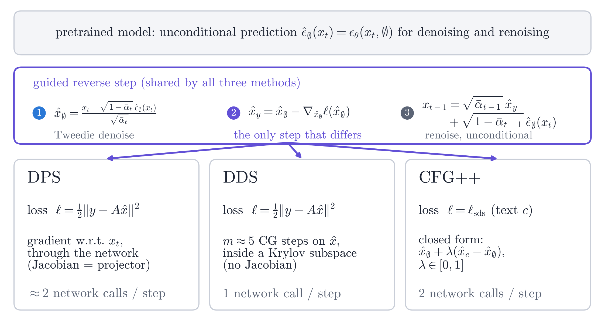
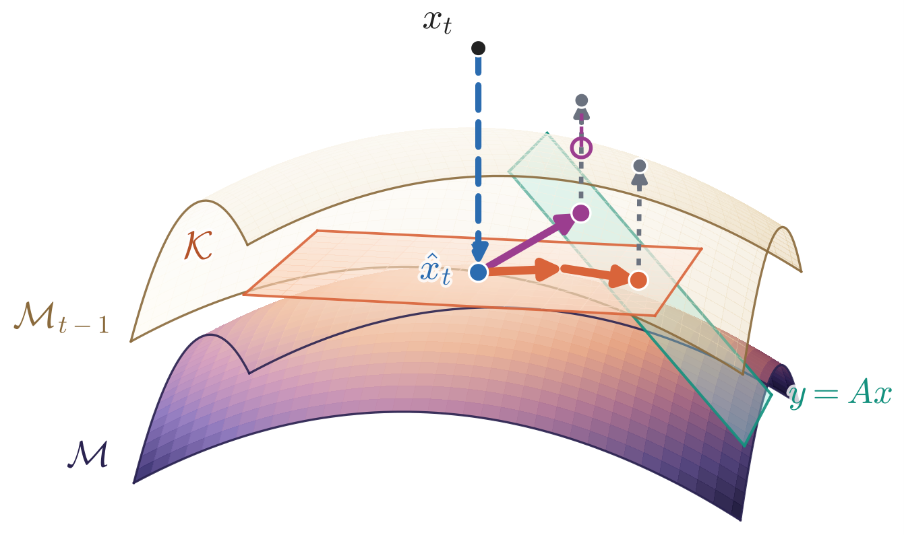
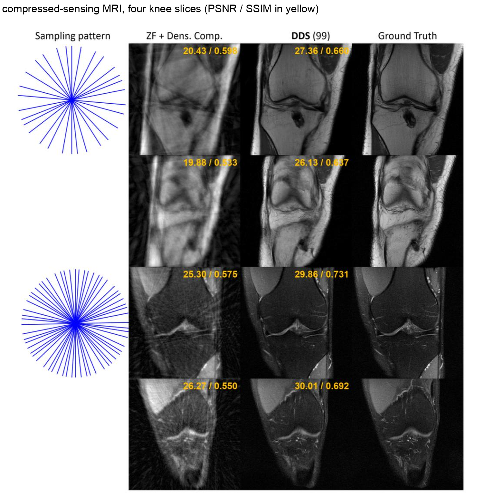
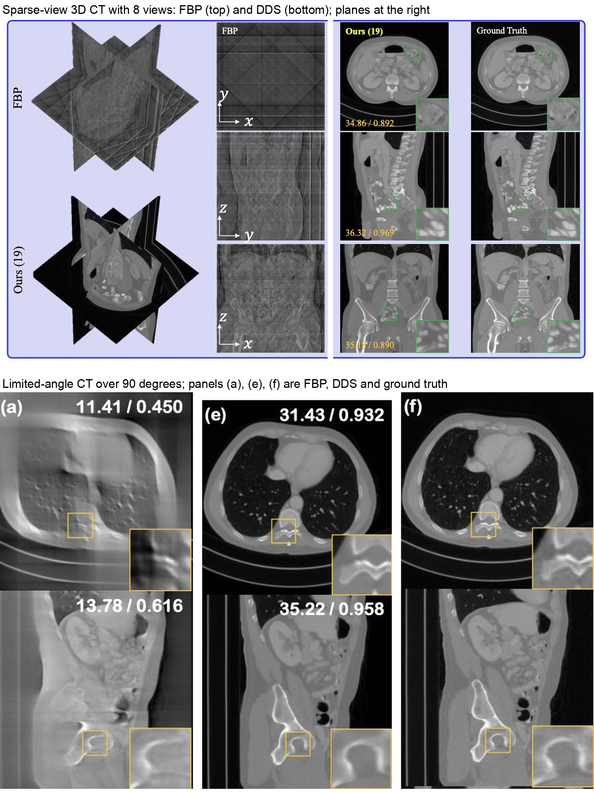
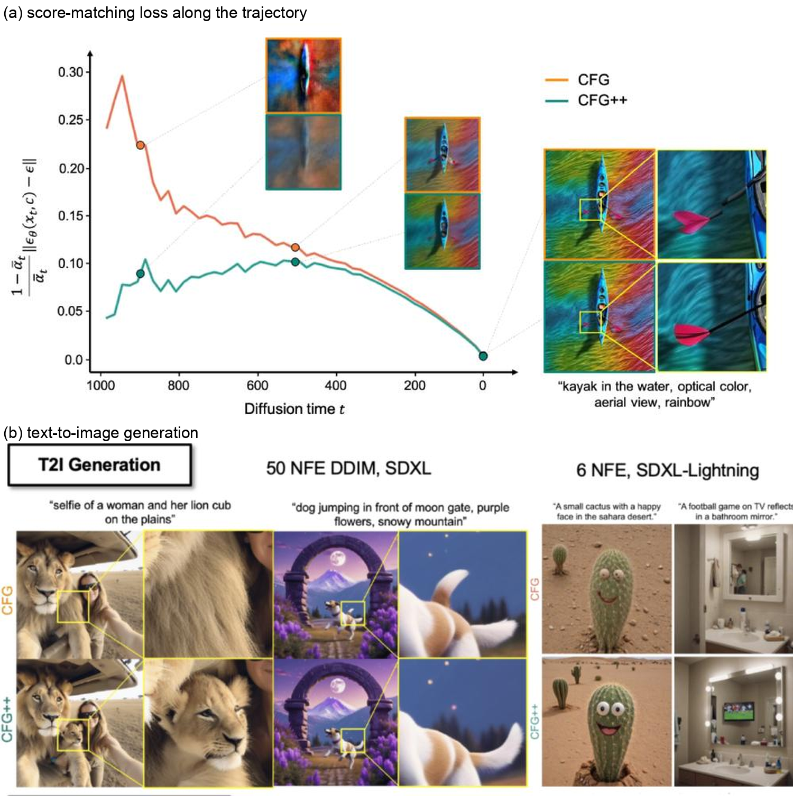
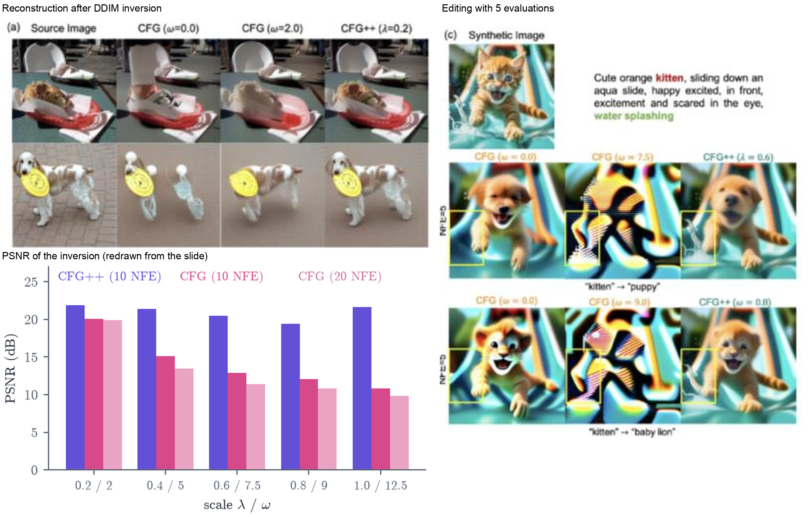
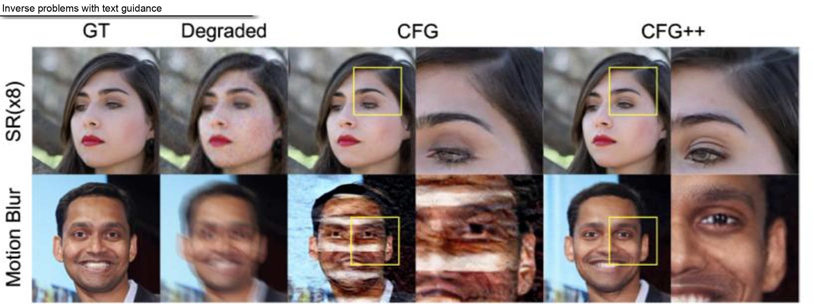

<!--
Lecture 10, slides 114-131 of `Part-4-Diffusion-Model-Theory.pptx`. The
instructor confirmed that range on 2026-10-31. The chapter slot was reserved
for *Schrodinger Bridge Problems*, which the syllabus puts at lecture 10; the
deck puts it at slides 148-156 and it was not lectured here, so the stub's
title has been replaced and the bridge material has no chapter yet.

Base note: justin4ai, the most complete of the three and the only one that
carries the quantitative readings off the slides.

Merged in: the result that DDNM is this chapter's conjugate gradient run to
convergence, with its curved-manifold figure (jintae-00); the lecture's own
open question about what several CG steps approximate, with the exchanges in
class and the exact Gaussian check that settles the direction of the answer
(be9904); the equivalent time-varying CFG scale, derived independently by
jintae-00 and be9904 and absent from the base note; and, in the DDS results,
the baselines and SSIM values the base note's composite figure does not print
(jintae-00).

Declined, and pointed at chapter 10 instead: the whole of slides 114-116.
That stretch is lecture 10's opening recap of lecture 09, and all three notes
write it up -- Tweedie's formula, the denoiser as an orthogonal projector, the
tangency of the manifold-constrained gradient, the Jensen bound, the MCG
update and the results of slides 115 and 116. Chapter 10 already derives every
one of them. The instructor asked on 2026-10-31 that the recap be folded into
that chapter rather than developed again here, so @sec-acc-recall states what
is assumed and cites it, and the one thing the recap adds -- a proof of the
Jensen-gap constant, which chapter 10 had flagged as unsettled -- was moved
into chapter 10 as @prp-jensen-sharp, with the base note's figure of the DPS
step.

Two conventions are fixed here because the notes differ, each self-consistent:

* The SDS gradient is taken with $x_t$ held fixed, which is the base note's
  and jintae-00's convention. be9904 holds the injected noise fixed instead,
  which is the convention of the SDS literature and gives a lambda larger by
  a factor sqrt(1 - abar_t). The two samplers are the same; only the meaning
  of the step size differs. @sec-pnp says so where it arises.
* Slide 128's minus sign in the guided estimate is a typo, independently
  reported by all three notes and contradicted by the slide's own Algorithm 2.
  The plus sign is used, and @sec-pnp records the disagreement rather than
  silently correcting it.

The Krylov sections write the residual as $b = A^*(y - A\hat{x})$, where the
slides write $y - A\hat{x}$, so that CG applies to the symmetric operator
$A^*A$. This is the base note's choice and is stated in @sec-krylov.

The three experiments of @sec-acc-experiments are the base note's own work.
They run on NumPy alone, which is not installed in the environment this
chapter was edited in, so the numbers were checked by re-deriving the closed
forms and limits by hand, not by re-running the code.

The base note carried its three listings and their printed output as an
appendix, 345 lines. On 2026-10-31 the instructor asked that only the
conjugate-gradient loop stay in the book; @sec-acc-appendix now carries that
loop alone, and the three listings were moved verbatim, with their output, to
`code/ch11/` in this repository, which the chapter links to in two places. Do
not restore them to the chapter: the decision was that eleven pages of NumPy
in a 52-page chapter is not what the book is for, and no other chapter carries
a code appendix of that size.
-->

## Overview {#sec-acc-overview}

A conditional generative model is usually trained for one condition at a time, which needs paired data and a new network for every task. Guidance avoids this: one pretrained unconditional diffusion model is steered at sampling time by a loss that measures how well the sample meets the condition. @sec-dps built the first method of this kind. Its difficulty is that a naive guidance step moves the sample to a place where the score network has never been trained, and the error then grows over the remaining steps. A useful guidance method must therefore

1. use only the unconditional network and the condition itself (a measurement operator or a text prompt);
2. keep the sample where the network is reliable;
3. be cheap enough for 3D volumes such as CT and MRI; and
4. extend to conditions, such as text, for which no measurement operator exists.

Diffusion posterior sampling meets the first two and fails the last two, and this chapter is about the methods that repair them. Let $\mathcal{M}$ be the clean data manifold. Noisy samples at noise level $t$ lie near a thickened copy $\mathcal{M}_t$ of it, the shell of level $t$. All methods below share one reverse step (@fig-acc-overview): Tweedie's formula jumps from the shell to $\mathcal{M}$; a step on the denoised estimate decreases a loss $\ell$; renoising with the unconditional noise estimate returns to the next shell. The methods differ in $\ell$ and in how the step is computed.

DPS takes $\ell$ to be the data misfit and differentiates it through the score network. Its step is tangential to $\mathcal{M}$, which meets requirement 2, but it needs a backward pass and a small step size. Decomposed diffusion sampling (DDS) replaces that gradient by a few conjugate-gradient steps, which under the Krylov hypothesis also stay tangential and need one network call per step; it meets requirement 3, but only for linear operators (@sec-dds). Slides 125 to 131 turn to text, where no operator exists at all. Classifier-free guidance (CFG) extrapolates between two noise predictions and leaves the manifold; CFG++ interpolates and renoises with the unconditional estimate, which restores requirement 2 (@sec-cfg, @sec-cfgpp).

In the figures violet marks methods that stay on the manifold (DDS, CG, CFG++), pink those that leave it (CFG, DDNM), black DPS, green the data manifold and orange the measurement set. The last part of the chapter goes beyond the lecture: a comparison with the authors' code (@sec-acc-code), three numerical experiments (@sec-acc-experiments) and exercises.

{#fig-acc-overview width=92%}

## Notation {#sec-acc-notation}

| Symbol | Meaning | Used in |
|:--|:--|:--|
| $x_0 \in \mathbb{R}^d$, $\mathcal{M}$ | clean signal and clean data manifold | throughout |
| $x_t = \sqrt{\bar\alpha_t}\,x_0 + \sqrt{1-\bar\alpha_t}\,\epsilon$ | noisy sample at level $t$ (variance preserving); $\mathcal{M}_t$ is the shell where such samples live | throughout |
| $\hat\epsilon_c(x_t) = \epsilon_\theta(x_t, c)$, $\hat\epsilon_\emptyset$ | noise prediction with condition $c$ and with the null condition | @sec-cfg |
| $\hat{x}_t = \mathbb{E}[x_0 \mid x_t]$ | Tweedie estimate; $\hat{x}_c$, $\hat{x}_\emptyset$ for the two predictions | @sec-acc-recall, @sec-cfg |
| $y = Ax_0 + n$, $n \sim \mathcal{N}(0, \sigma_y^2 I)$ | linear measurement; $A^*$ is the adjoint | @sec-acc-bottleneck |
| $\ell$ (script ell) | loss on $\mathcal{M}$, for example $\tfrac12\Vert y - Ax\Vert^2$; $l$ (plain) is a Krylov order | @sec-acc-bottleneck |
| $T_{\hat{x}}\mathcal{M}$, $P$ | tangent space and orthogonal projector onto it | @sec-acc-recall |
| $B = A^*A$, $g = A^*y$, $b = g - B\hat{x}$ | normal equations and their residual at $\hat{x}$ (the slides' $b$ is $y - A\hat{x}$) | @sec-krylov |
| $x^{(k)}, r_k, p_k, \alpha_k, \beta_k$ | CG iterate, residual, direction, step and coefficient; $x^{(0)} = \hat{x}$ | @sec-cg |
| $\mathcal{K}_l = \mathrm{span}\{b, Bb, \dots, B^{l-1}b\}$ | Krylov subspace | @sec-krylov |
| $\gamma_t$, $\zeta_t$, $\tilde{w}_t$ | DPS step sizes and the DDIM noise term | @sec-acc-bottleneck |
| $\nu_i$, $\kappa$, $m$ | eigenvalues and condition number of $B$; number of CG steps in DDS | @sec-cg |
| $\delta_c = \hat\epsilon_c - \hat\epsilon_\emptyset$, $\Delta^{\omega}$ | text direction; gap between the guided and the unconditional renoising | @sec-cfgpp-geometry |
| $\omega$, $\lambda$ | CFG scale and CFG++ interpolation weight | @sec-cfg, @sec-cfgpp |
| NFE | number of network function evaluations | @sec-acc-bottleneck |

: Notation of this chapter. {#tbl-acc-notation}

## What the previous chapter establishes {#sec-acc-recall}

The lecture opened by recapitulating the geometry of the previous one, which @sec-dps derives in full. Four facts are used throughout this chapter and are not repeated here.

1. **Tweedie's formula** (@lem-tweedie) turns the score into a denoised estimate, $\hat{x}_t = \mathbb{E}[x_0 \mid x_t] = (x_t - \sqrt{1-\bar\alpha_t}\,\hat\epsilon_\emptyset(x_t))/\sqrt{\bar\alpha_t}$, at the cost of one network evaluation.
2. **The denoiser is an orthogonal projector** (@prp-tweedie-projector): where $\mathcal{M}$ is a linear subspace with projector $P$, the Tweedie map is $P/\sqrt{\bar\alpha_t}$, so its Jacobian is $P/\sqrt{\bar\alpha_t}$ as well. A real manifold is not linear, but locally it is close to its tangent space, and the shells flatten as $t$ grows.
3. **A gradient taken through the denoiser is tangential** (@thm-mcg): by the chain rule $\nabla_{x_t}\ell(\hat{x}_t) = (\partial\hat{x}_t/\partial x_t)^{\!\top}\nabla_{\hat{x}_t}\ell(\hat{x}_t) \propto P\nabla_{\hat{x}_t}\ell$, so the denoiser removes the part of the raw gradient that would leave the manifold. This is what makes DPS work without a projection, and it is the property the next sections must preserve while making the step cheaper. The manifold-constrained gradient of @chung2022mcg is the same tangential step followed by a hard projection onto $\{\mathcal{A}(x) = y\}$ (@eq-mcg-alg); DPS is MCG with that projection dropped, which is what lets it tolerate measurement noise.
4. **Evaluating the likelihood at the denoised estimate is controlled by the posterior spread** (@thm-jensen and @prp-jensen-sharp). Differentiating $\Vert y - \mathcal{A}(x_t)\Vert^2$ at the noisy sample instead is not merely less accurate: it compares a noisy image with a measurement of a clean one and drops the denoiser Jacobian, so its gradient points in a different direction. @sec-likelihood draws the comparison and @sec-dps-geometry gives its geometric form.

One DPS step, with DDIM noise $\tilde{w}_t$, is therefore
$$
x_{t-1} = \sqrt{\bar\alpha_{t-1}}\,\bigl(\hat{x}_t - \gamma_t\,\nabla_{x_t}\ell(\hat{x}_t)\bigr) + \tilde{w}_t ,
$$ {#eq-acc-dps-step}
and @sec-results shows what it achieves: inpainting with 92% of the pixels missing, and nonlinear problems -- phase retrieval and non-uniform deblurring -- where no projection onto the measurement set exists. The slides repeated both results at this point in the course.

## The cost of DPS {#sec-acc-bottleneck}

A DPS step uses the network twice, once forward for $\hat{x}_t$ and once backward for $\nabla_{x_t}\ell(\hat{x}_t)$, so $N$ steps cost about $2N$ evaluations, and the backward pass stores all activations, which is costly for 3D volumes. The tangential step of @sec-acc-recall is justified only where $\mathcal{M}$ is locally linear, so $\gamma_t$ must stay small and many steps are needed. Slide 117 gives the resulting figures: thousands of network evaluations for one volume, which is hours to days of computation for 3D CT and MRI, the problems the method is wanted for.

Slide 118 rewrites the step so that the question becomes a different one. By the projector property, for $\hat{x}_t \in \mathcal{M}$ and any $\ell$,
$$
\hat{x}_t - \gamma_t\,\nabla_{x_t}\ell(\hat{x}_t) = P_{\mathcal{M}}\bigl(\hat{x}_t - \zeta_t\,\nabla_{\hat{x}_t}\ell(\hat{x}_t)\bigr), \qquad \zeta_t = \gamma_t/\sqrt{\bar\alpha_t} .
$$ {#eq-acc-pg}
The right-hand side needs no Jacobian: an ordinary gradient on the clean estimate $\hat{x}_t$, then a projection back onto the manifold. Read this way, a DPS step is one step of projected gradient descent on $\mathcal{M}$, and the expensive backward pass is only how the projection is being carried out. This suggests taking several cheap gradient steps on $\hat{x}_t$ per projection.

### Why not simply iterate the data step? {#sec-acc-naive}

Suppose we take the right-hand side of @eq-acc-pg and iterate the inner gradient step $K$ times before projecting:
$$
\hat{x}^{(0)} = \hat{x}_t,\qquad
\hat{x}^{(k+1)} = \hat{x}^{(k)} - \zeta_t\nabla\ell\bigl(\hat{x}^{(k)}\bigr),\qquad
x_{t-1} = \sqrt{\bar\alpha_{t-1}}\,P_{\mathcal{M}}\bigl(\hat{x}^{(K)}\bigr) + \tilde{w}_t .
$$ {#eq-acc-iterate}
Two things go wrong, and both are about the projector rather than the gradient.

*The iterates leave the manifold.* An unprojected gradient step follows $\nabla\ell$, which has a normal component; only $P\nabla\ell$ is tangential. After $K$ steps $\hat{x}^{(K)}$ is off $\mathcal{M}$, and the harder the data term is pushed, the further off it is. This is worst early in sampling, where $\hat{x}_t$ is still far from the solution.

*There is no projector for that kind of error.* Tweedie's formula is the orthogonal projector for *Gaussian* perturbations of a *known* level $t$, which is what the network was trained to remove. The displacement $\hat{x}^{(K)} - \hat{x}_t$ is neither Gaussian nor of a known level, so the denoiser does not apply to it, and $P_{\mathcal{M}}$ in @eq-acc-iterate is not available. A student asked in class whether a second network could be trained to perform that projection; it could, but it defeats the purpose of a sampler that needs no training.

Methods in this family therefore skip the projection and renoise directly. DDNM [@wang2023ddnm] replaces the range-space component of the estimate by the measurement,
$$
\hat{x}'_t = (I - A^\dagger A)\,\hat{x}_t + A^\dagger y ,
$$ {#eq-acc-ddnm}
which satisfies $A\hat{x}'_t = y$ exactly when $A$ has full row rank: a hard projection onto the measurement set, not onto $\mathcal{M}$. DDRM [@kawar2022ddrm] performs a similar substitution in the SVD domain. For simple problems -- inpainting, super-resolution with a clean operator -- this works. For harder ones, the component that left $\mathcal{M}$ is renoised as if it were signal: renoising combines $\hat{x}'_t$ with a noise direction predicted for $\hat{x}_t$, so if $\hat{x}'_t \notin \mathcal{M}$ the pair no longer describes a point of $\mathcal{M}_{t-1}$, the next network call sees an input it was never trained on, and the error is carried forward instead of being removed (@fig-acc-samplers b). The middle panel of slide 120 draws exactly this.

What is wanted, then, is a data step that stays in the tangent space *by construction*, so that no projector is needed afterwards.

{#fig-acc-samplers width=100%}

## Krylov subspace methods {#sec-krylov}

A data step that must stay in the tangent plane cannot use a solver that jumps to the exact solution. Krylov methods fit the requirement because every iterate is built from repeated products with $B = A^*A$ and so remains in a small, explicitly known subspace.

For a linear measurement the data term $\tfrac12\Vert y - Ax\Vert^2$ has normal equations
$$
Bx = g, \qquad B := A^*A, \quad g := A^*y .
$$ {#eq-acc-normal}
The slides assume a square symmetric $A$; replacing $A$ by $A^*A$ and $y$ by $A^*y$ reduces the general case to this, at the price that the residual written here,
$$
b := g - B\hat{x} = A^*(y - A\hat{x}),
$$ {#eq-acc-residual}
is the slides' $y - A\hat{x}$ carried through the adjoint. It is minus the gradient of $\tfrac12\Vert y - Ax\Vert^2$ at $\hat{x}$.

::: {#def-krylov}
## Krylov subspace
$\mathcal{K}_l := \mathrm{span}\{\,b, Bb, \dots, B^{l-1}b\,\}$. A Krylov method searches for the solution in $\hat{x} + \mathcal{K}_l$ and increases $l$ until the residual is small.
:::

A *projection method* with search space $\mathcal{K}$ and constraint space $\mathcal{L}$ asks for
$$
x \in \hat{x} + \mathcal{K} \quad\text{such that}\quad g - Bx \perp \mathcal{L}
$$ {#eq-acc-petrov}
(the Petrov--Galerkin condition [@saad2003; @liesen2013]). Conjugate gradient [@hestenes1952] is the choice $\mathcal{K} = \mathcal{L} = \mathcal{K}_l$, which slide 119 writes out.

::: {#prp-galerkin}
## The Galerkin condition means least squares on the affine subspace
Let $B \succeq 0$ and $f(x) = \tfrac12 x^\top B x - g^\top x = \tfrac12\Vert y - Ax\Vert^2 + \mathrm{const}$. If $x^{\circ} \in \hat{x} + \mathcal{K}_l$ satisfies $g - Bx^{\circ} \perp \mathcal{K}_l$, then $x^{\circ}$ minimises $f$ over $\hat{x} + \mathcal{K}_l$.
:::

::: {.proof}
With $r^{\circ} = g - Bx^{\circ}$ and $d \in \mathcal{K}_l$: $f(x^{\circ} + d) = f(x^{\circ}) - (r^{\circ})^\top d + \tfrac12 d^\top Bd = f(x^{\circ}) + \tfrac12 d^\top Bd \ge f(x^{\circ})$.
:::

### Conjugate gradient, derived {#sec-cg}

Assume $B \succ 0$, so $f$ has the unique minimiser $x^* = B^{-1}g$. (For $B = A^*A$, which is only semi-definite, the iteration is defined while $r_k \ne 0$ and the conclusions hold because $g \in \mathrm{range}(B)$.) The iterates are $x^{(k)}$ with $x^{(0)} = \hat{x}$.

CG minimises $f$ along conjugate directions, $p_i^\top Bp_j = 0$ for $i \ne j$, along which $f$ separates into independent one-dimensional problems, so a new line search does not spoil the old ones. With $r_k = g - Bx^{(k)}$, $r_0 = p_0 = b$, and $\alpha_k$ the exact line search along $p_k$,
$$
\begin{aligned}
x^{(k+1)} &= x^{(k)} + \alpha_k p_k, & r_{k+1} &= r_k - \alpha_k Bp_k, & \alpha_k &= \frac{r_k^\top r_k}{p_k^\top Bp_k},\\
p_{k+1} &= r_{k+1} + \beta_k p_k, & \beta_k &= \frac{r_{k+1}^\top r_{k+1}}{r_k^\top r_k}. & &
\end{aligned}
$$ {#eq-acc-cg}
Each step costs one application of $A$ and one of $A^*$, and needs neither the network nor its Jacobian.

::: {#lem-cg}
## Properties of conjugate gradient
While $r_k \ne 0$: (a) $r_{k+1} \perp p_k$; (b) $r_i^\top r_j = 0$ for $i \ne j$; (c) $p_i^\top Bp_j = 0$ for $i \ne j$; (d) $\mathrm{span}\{p_0,\dots,p_k\} = \mathrm{span}\{r_0,\dots,r_k\} = \mathcal{K}_{k+1}$, and these vectors are linearly independent.
:::

::: {.proof}
Induction on $k$; the case $k = 0$ is $p_0 = r_0$. Assume (a) to (d) up to index $k$.

(a) The exact line search gives $p_k^\top r_{k+1} = p_k^\top r_k - \alpha_k p_k^\top Bp_k = 0$. Since $p_k = r_k + \beta_{k-1}p_{k-1}$ and $r_k \perp p_{k-1}$, $p_k^\top r_k = r_k^\top r_k$, which is the closed form of $\alpha_k$.

(b) For $j < k$, $r_{k+1}^\top r_j = r_k^\top r_j - \alpha_k p_k^\top Br_j = 0$, because $r_j \in \mathrm{span}\{p_0,\dots,p_j\}$ and $p_k$ is conjugate to these. For $j = k$, $r_{k+1}^\top r_k = r_{k+1}^\top(p_k - \beta_{k-1}p_{k-1}) = 0$ by (a) and because $r_{k+1}^\top p_{k-1} = r_k^\top p_{k-1} - \alpha_k p_k^\top Bp_{k-1} = 0$ (for $k = 0$, $r_0 = p_0$ and (a) suffices).

(c) For $j < k$, $p_{k+1}^\top Bp_j = r_{k+1}^\top Bp_j + \beta_k p_k^\top Bp_j$; the second term vanishes, and $Bp_j \in \mathrm{span}\{r_0,\dots,r_{j+1}\}$ is orthogonal to $r_{k+1}$ by (b). For $j = k$, using $Bp_k = (r_k - r_{k+1})/\alpha_k$,
$$
p_{k+1}^\top Bp_k = -\frac{r_{k+1}^\top r_{k+1}}{\alpha_k} + \beta_k\frac{r_k^\top r_k}{\alpha_k} = 0 ,
$$
so $\beta_k$ is the unique value making $p_{k+1}$ conjugate to $p_k$.

(d) $r_{k+1}, p_{k+1} \in \mathcal{K}_{k+2}$. The non-zero residuals are mutually orthogonal and the non-zero directions mutually conjugate, so each family is independent and spans a $(k+2)$-dimensional subspace of $\mathcal{K}_{k+2}$; the three spaces coincide.
:::

::: {#thm-cg}
## Conjugate gradient is the Krylov least-squares solution
$x^{(k)}$ minimises $f$ over $x^{(0)} + \mathcal{K}_k$. In exact arithmetic CG terminates, with $r_k = 0$, after at most $\mathrm{rank}(B) \le d$ steps.
:::

::: {.proof}
$x^{(k)} - x^{(0)} \in \mathrm{span}\{p_0,\dots,p_{k-1}\} = \mathcal{K}_k$ by (d), and $r_k \perp r_0,\dots,r_{k-1}$ by (b), that is, $r_k \perp \mathcal{K}_k$. This is the Galerkin condition; apply @prp-galerkin. All residuals lie in $\mathrm{range}(B)$, because $r_0 = b$ does and $r_{k+1} = r_k - \alpha_kBp_k$, and at most $\mathrm{rank}(B)$ orthogonal non-zero vectors exist there.
:::

::: {#prp-cg-rate}
## Convergence rate of conjugate gradient [@saad2003; @shewchuk1994]
Let $B \succ 0$ have eigenvalues $\nu_1, \dots, \nu_d$, condition number $\kappa$, and let $e_k = x^{(k)} - x^*$. Then $e_k = \phi_k(B)e_0$ for a polynomial $\phi_k$ of degree $k$ with $\phi_k(0) = 1$ that minimises $\Vert\phi(B)e_0\Vert_B$ over all such $\phi$, and
$$
\Vert e_k\Vert_B \le \max_i|\phi(\nu_i)|\,\Vert e_0\Vert_B \ \text{ for every such }\phi, \qquad
\Vert e_k\Vert_B \le 2\Bigl(\frac{\sqrt{\kappa} - 1}{\sqrt{\kappa} + 1}\Bigr)^{\!k}\Vert e_0\Vert_B .
$$ {#eq-acc-cg-rate}
:::

::: {.proof}
Since $f(x) = f(x^*) + \tfrac12\Vert x - x^*\Vert_B^2$, minimising $f$ over $x^{(0)} + \mathcal{K}_k$ (@thm-cg) minimises the $B$-norm of the error. A point of $x^{(0)} + \mathcal{K}_k$ has error $(I - Bq(B))e_0 = \phi(B)e_0$ with $\deg q \le k-1$, that is, $\phi$ ranges over polynomials of degree at most $k$ with $\phi(0) = 1$. In the eigenbasis of $B$ the component $i$ of the error is multiplied by $\phi(\nu_i)$, which gives the first bound. For the second take $\phi(\nu) = T_k\bigl(\tfrac{\nu_{\max} + \nu_{\min} - 2\nu}{\nu_{\max} - \nu_{\min}}\bigr)/T_k\bigl(\tfrac{\kappa+1}{\kappa-1}\bigr)$ with the Chebyshev polynomial $T_k$. The numerator has modulus at most $1$ on $[\nu_{\min}, \nu_{\max}]$. Writing $T_k(z) = \tfrac12[(z + \sqrt{z^2-1})^k + (z - \sqrt{z^2-1})^k]$ and $z + \sqrt{z^2-1} = (\sqrt\kappa+1)/(\sqrt\kappa-1)$ at $z = (\kappa+1)/(\kappa-1)$, the denominator is at least $\tfrac12\bigl(\tfrac{\sqrt\kappa+1}{\sqrt\kappa-1}\bigr)^k$.
:::

CG attains the smallest $B$-norm error reachable with $k$ products by $B$, and the error contracts geometrically at a rate set by the conditioning. The polynomial picture also explains early stopping. A low-degree polynomial with $\phi(0) = 1$ cannot be small near $0$, so the first steps remove the error components of large $\nu_i$ and leave those of small $\nu_i$. For $B = A^*A$ the small $\nu_i = \sigma_i^2$ belong to the small singular values, the directions in which noise in $y$ is amplified by $1/\sigma_i$, so stopping early regularises; @sec-exp-cg measures this. For semi-definite $B$ the bound holds on $\mathrm{range}(B)$ with $\kappa$ the ratio of the extreme non-zero eigenvalues.

For a two-dimensional example take $B = \begin{pmatrix}4 & 1\\ 1 & 3\end{pmatrix}$, $g = (1, 2)^\top$, $x^{(0)} = 0$, so that $x^* = (1/11,\ 7/11)^\top$.

| $k$ | $\alpha_k$ | $x^{(k+1)}$ | $r_{k+1}$ | $\beta_k$ |
|:--:|:--:|:--:|:--:|:--:|
| 0 | $1/4$ | $(1/4,\ 1/2)$ | $(-1/2,\ 1/4)$ | $1/16$ |
| 1 | $4/11$ | $(1/11,\ 7/11)$ | $(0,\ 0)$ | -- |

: Conjugate gradient on a two-dimensional problem; it is exact after $d = 2$ steps, where steepest descent with exact line search still has a relative error of about $6\times 10^{-4}$ after six. {#tbl-acc-cg-example}

## Decomposed diffusion sampling {#sec-dds}

Decomposed diffusion sampling (DDS) of @chung2024dds, slides 117 to 123, is @eq-acc-pg with the projected gradient step replaced by a few CG steps in the denoised domain. Slide 120 sets it beside DDPM, which has no data step, and DDNM, which projects.

### Why conjugate gradient replaces the projection {#sec-dds-argument}

::: {#prp-dds-krylov}
## Consequence of the Krylov hypothesis [@chung2024dds]
Assume the tangent space at the denoised sample is a Krylov subspace, $T_t = \hat{x}_t + \mathcal{K}_{l}$. Then for every $m \le l$ the $m$-step CG iterate $x^{(m)}$ started at $\hat{x}_t$ lies in $T_t$, and it minimises $\Vert y - Ax\Vert^2$ over $\hat{x}_t + \mathcal{K}_m \subseteq T_t$.
:::

::: {.proof}
By @thm-cg, $x^{(m)}$ minimises $f$, and hence $\Vert y - Ax\Vert^2 = 2f + \mathrm{const}$, over $\hat{x}_t + \mathcal{K}_m$, which is contained in $\hat{x}_t + \mathcal{K}_l = T_t$.
:::

The proof is short because it assumes the hypothesis, and the hypothesis cannot be verified for a real data manifold. What the lecture offers for it is a reading of what Krylov methods do on imaging problems: the iterates are built from repeated products with $A^*A$, which for a blur or a Fourier sampling operator means that the low-order Krylov directions are the smooth, large-scale ones. A Krylov solution of an imaging problem therefore builds the image coarse to fine, and the first few directions look like plausible images rather than like noise -- which is to say that a low-order Krylov plane lies along the data manifold. That is the argument at full strength, and it is an argument about what imaging operators do, not a theorem. @sec-exp-krylov puts it to the test and finds it operator-dependent, so it is worth having the lecture's reason in hand before the counterexample.

In one case the hypothesis can be proved outright.

::: {#prp-krylov-affine}
## The Krylov hypothesis in the affine model
Let $\mathcal{M} = \{\bar{x} + Uu : u \in \mathbb{R}^h\}$ with $U$ orthonormal and $P = UU^\top$, and assume that $B = A^*A$ commutes with $P$. If the data are noiseless, $y = Ax_0$ with $x_0 \in \mathcal{M}$, and $\hat{x} \in \mathcal{M}$, then $\mathcal{K}_l \subset \mathrm{range}(U)$ for every $l$, so every CG iterate $x^{(m)}$ started at $\hat{x}$ lies in $\mathcal{M}$.
:::

::: {.proof}
Since $y - A\hat{x} = A(x_0 - \hat{x})$, the residual is $b = B(x_0 - \hat{x})$. Here $x_0 - \hat{x} \in \mathrm{range}(U)$ because both points lie in $\mathcal{M}$, and $B\,\mathrm{range}(U) \subset \mathrm{range}(U)$ because $BP = PB$. Hence $b \in \mathrm{range}(U)$, and by the same invariance $B^jb \in \mathrm{range}(U)$ for all $j$. The iterates satisfy $x^{(m)} - \hat{x} \in \mathcal{K}_m$ by @lem-cg (d), so $x^{(m)} \in \hat{x} + \mathrm{range}(U) = \mathcal{M}$.
:::

With noise, $A^*n$ generally has a component outside $\mathrm{range}(U)$; for an operator that does not commute with $P$ the invariance fails. @sec-exp-krylov measures both effects. DDS thus fits the data by least squares *within* the tangent plane, where the hard projection of DDNM fits the data exactly and leaves it (@fig-acc-krylov). The paper uses $m = 5$ CG steps in every experiment.

{#fig-acc-krylov width=100%}

### DDNM is the same solver run to convergence {#sec-ddnm-limit}

The relation between DDS and DDNM is closer than "a few steps" against "a projection": they are the two ends of one CG run.

::: {#prp-ddnm-limit}
## DDNM is conjugate gradient run to convergence
CG on $A^*Ax = A^*y$ started at $\hat{x}_t$ converges to the DDNM update @eq-acc-ddnm.
:::

::: {.proof}
Every Krylov vector lies in $\mathrm{range}(A^*)$, because $b = A^*(y - A\hat{x}_t)$ does and $B\,\mathrm{range}(A^*) \subset \mathrm{range}(A^*)$, so every CG correction $\delta = x^{(k)} - \hat{x}_t$ does too. At convergence $\delta$ solves the normal equations, so
$$
\delta\in\mathrm{range}(A^{*}) = \mathrm{null}(A)^{\perp},
\qquad
A^{*}A\,\delta = A^{*}(y - A\hat{x}_t)
\qquad\Longrightarrow\qquad
\delta = A^{\dagger}(y - A\hat{x}_t),
$$
the unique least-squares solution orthogonal to $\mathrm{null}(A)$. Adding it to $\hat{x}_t$ gives $(I - A^\dagger A)\hat{x}_t + A^\dagger y$.
:::

So the difference between the two methods is entirely *where the run is stopped*. DDS stops after $m \le l$ steps, inside the subspace the Krylov hypothesis identifies with the tangent space. DDNM runs to the end, far beyond $l$, along Krylov directions that are no longer tangent, and nothing then keeps its result on the clean manifold (@fig-acc-curved). This is a sharper statement of @sec-acc-naive: the hard projection is not a different kind of step, it is the same step taken too far. @chung2024dds [App. F.1] measure the consequence after a single data step -- the noise level of the DDNM sample is further from the target than that of the DDS sample -- and @sec-exp-krylov reproduces the effect in a model where the leakage can be computed exactly.

{#fig-acc-curved width=72%}

### The DDS algorithm {#sec-dds-algorithm}

One reverse step, the third panel of @fig-acc-samplers, is
$$
\hat{x}'_t = \mathrm{CG}\bigl(A^*A,\ A^*y,\ \hat{x}_t,\ m\bigr), \qquad
x_{t-1} = \sqrt{\bar\alpha_{t-1}}\,\hat{x}'_t + \tilde{w}_t ,
$$ {#eq-acc-dds}
where $\tilde{w}_t$ is the DDIM noise term [@ddim]. The network is called once per step, so NFE equals the number of reverse steps. Three things follow, and they are the reasons the method is used:

1. *Speed.* The data step costs $m$ products with $A$ and $A^*$ instead of a backward pass through the network, and no activations are stored.
2. *Staying in distribution.* Under the Krylov hypothesis the corrected estimate stays in the tangent space, so the renoised sample is back on a shell the network knows. DDNM's hard projection gives no such guarantee (@prp-ddnm-limit).
3. *Strong and stable guidance.* Several CG steps per denoising step, with step lengths chosen by CG itself rather than by a hand-tuned $\gamma_t$, enforce the measurement far more than one gradient step does, so far fewer sampling steps are needed.

Compared with DPS the data step needs no backward pass; compared with DDNM it needs no pseudo-inverse. @tbl-acc-methods collects all the methods of the chapter.

### What do several CG steps approximate? {#sec-higher-order}

The lecture raised a question at this point and left it partly open. One DDS step with $m = 1$ is one projection, one gradient step and one renoising, which is one DPS step by @eq-acc-pg, up to the step size -- CG chooses its own $\alpha_0$ by exact line search where DPS uses a fixed $\gamma_t$. With $m > 1$, what transition $x_t \to x_{t-1}$ does the step correspond to, and why does it still make sense?

The answer given in class goes back to where the gradient came from. The quantity wanted is the exact likelihood score $\nabla_{x_t}\log\int p(y \mid x_0)\,p(x_0 \mid x_t)\,dx_0$, and DPS replaces the integral by a single evaluation at $\hat{x}_t$ (@thm-jensen). That is a first-order approximation. Successive data-consistency steps re-linearise around the updated point, which shrinks the residual the first-order approximation leaves, so they are a higher-order approximation of the likelihood gradient in the sense of a better approximation of the integral. Two readings were raised in class and both were set aside: it is not higher order in the ODE-solver sense, which the lecturer said explicitly; and it is not an average of the integrand over several points, because the iterates are not independent samples from $p(x_0 \mid x_t)$ -- each depends on the one before. A rigorous error bound for the multi-step version had not been worked out.

One case can be checked exactly, and it is consistent with that reading. Take the affine model of @prp-krylov-affine with $x_0 \sim \mathcal{N}(0, s^2P)$, so that $p(x_0 \mid x_t) = \mathcal{N}(\hat{x}_t, \Sigma_{0\mid t})$ with $\Sigma_{0\mid t} = \frac{s^2\sigma^2}{s^2+\sigma^2}P$ at noise level $\sigma^2 = (1-\bar\alpha_t)/\bar\alpha_t$. For $y = Ax_0 + n$ with $n \sim \mathcal{N}(0, \sigma_y^2 I)$ the integral is a Gaussian convolution and can be written down:
$$
p(y \mid x_t) = \mathcal{N}\bigl(y;\ A\hat{x}_t,\ \sigma_y^2 I + A\Sigma_{0\mid t}A^\top\bigr),
\qquad
p_{\mathrm{dps}}(y \mid x_t) = \mathcal{N}\bigl(y;\ A\hat{x}_t,\ \sigma_y^2 I\bigr).
$$ {#eq-acc-gaussian-check}
The approximation of @thm-jensen is exactly the step of dropping $A\Sigma_{0\mid t}A^\top$, that is, of pretending the posterior over $x_0$ is a point mass. Early in sampling $\Sigma_{0\mid t}$ is large, so DPS overweights the measurement and has to compensate with a small step size; late in sampling the two densities agree. Whatever better approximation is used -- several CG steps, several manifold-constrained gradient steps, or something more principled -- it has to account for that covariance term.

The question is not confined to inverse problems. Reward alignment and reinforcement-learning fine-tuning of diffusion models face the same integral: a reward is defined on clean images and its gradient has to be carried back to the noisy $x_t$. Current practice is a one-step Tweedie approximation or a Monte Carlo average over several samples, and the lecture pointed at more systematic schemes, such as sequential Monte Carlo [e.g. @wu2023tds], as an open direction.

### Results {#sec-dds-results}

DDS is shown on compressed-sensing MRI and on sparse-view and limited-angle CT (@fig-acc-dds-results), the three large problems where DPS is too slow to run.

::: {#fig-acc-dds-results layout="[[56,44]]"}
{#fig-acc-dds-mri}

{#fig-acc-dds-ct}

DDS on large-scale inverse problems [@chung2024dds], slides 121 to 123. (a) Compressed-sensing MRI with radial sampling on four knee slices; left, the two sampling patterns; columns, zero-filled reconstruction with density compensation, DDS with 99 NFE, ground truth. (b) Top, 3D sparse-view CT from 8 views, FBP against DDS with 19 NFE, on three orthogonal planes; bottom, limited-angle CT over $90^\circ$ with DDS at 50 NFE. PSNR and SSIM are printed in yellow.
:::

The numbers printed on the slides are small in the figure, so they are collected here. For the four MRI slices the zero-filled baseline reaches $20.43$, $19.88$, $25.30$ and $26.27$ dB and DDS reaches $27.36$, $26.13$, $29.86$ and $30.01$ dB at 99 NFE; on the third slice the structural similarity goes from $0.575$ to $0.731$. For 8-view CT, DDS reaches $34.86$, $36.32$ and $35.18$ dB on the three planes at 19 NFE, with no baseline value printed for FBP, which fills the slices with streaks because most angles are missing and it has no prior to fill them. For limited-angle CT over $90^\circ$ the baseline reaches $11.41$ and $13.78$ dB on the axial and sagittal planes and DDS $31.43$ and $35.22$ dB.

The comparison that matters is not against FBP but against the previous diffusion solver. DiffusionMBIR [@chung2023diffusionmbir] pairs a 2D diffusion prior with a total-variation prior along the third axis and reaches $34.30$ dB / $0.877$ axial and $34.16$ / $0.957$ sagittal on 8-view CT -- slightly *worse* than DDS -- using 4000 network evaluations against 19, about $200$ times the cost. On limited-angle CT, DDS at 49 NFE matches DiffusionMBIR at 4000 ($31.43$ dB / $0.932$), against $27.00$ / $0.932$ for a supervised network and $19.34$ / $0.634$ for an earlier score-based solver. The paper reports about 10 minutes (19 NFE) and 25 minutes (49 NFE) per 3D volume on one RTX 3090, against two days for the previous method, and a speed-up of about 40 times over 1000-step DPS for noisy multi-coil MRI. For 3D CT, DDS adds the total-variation prior along the slice axis as well, solved by CG inside one ADMM step per denoising step [@chung2024dds, Sec. 4.2].

All three advantages are visible in these results: a few dozen network evaluations instead of thousands; clean slices without streaks, which is what staying near the manifold buys; and the PSNR gain, which comes from enforcing the measurement several times per denoising step.

Two limits remain. The tangential property rests on the Krylov hypothesis, and the number of CG steps acts as a regulariser whose best value depends on the noise (@sec-exp-cg). Both rely on a measurement operator $A$, which text does not provide; the rest of the chapter treats that case.

## Conditioning an unconditional model: the routes {#sec-cond-summary}

Slide 124 places the methods of this lecture among the ways to condition an unconditional pretrained model. The classical routes train a conditional network, which needs paired data and retraining for every task, or start the reverse process from a noised version of the condition; CCDF (@sec-ccdf) combines the two. The modern routes keep the network fixed and guide the sampler: DPS differentiates through the network, and DDS replaces that gradient by CG. Inverse problems are the main application; reward alignment has the same structure, with the reward in the role of the likelihood and the same difficulty of evaluating its gradient at the noiseless estimate (@sec-higher-order).

| family | route | idea | limitation |
|:-------|:-----------|:--------------------------|:----------------|
| classical | conditional training | train $\epsilon_\theta(x_t, c)$ on pairs $(x_0, c)$ | supervised data, and retraining for every new task |
| classical | initialisation based | start from a noised version of the condition instead of pure noise | the condition enters only at the start |
| classical | CCDF [@chung2022ccdf] | combine both: start at an intermediate noise level from a noised initial estimate, a shortcut with fewer steps | needs a rough initial reconstruction from another network |
| modern | DPS and variants | guide by $\nabla\ell(\hat{x}_t)$ and keep the step tangential to the clean manifold | backward pass through the network, small steps |
| modern | DDS | replace the gradient step by CG in a Krylov plane (@sec-dds) | rests on the Krylov hypothesis, which has no general theory |

: The routes to conditional sampling, after slide 124. {#tbl-acc-routes}

The modern routes differ in how well they approximate $p(y \mid x_t)$, which DPS replaces by its value at the posterior mean. The bound of @thm-jensen concerns that approximation; the DDS step is justified by the Krylov hypothesis instead, and no corresponding bound for the CG step is given in the lecture or in the paper. Text, the remaining condition on slide 124, is treated next. The slide's closing line, "text will be discussed next time", was written for the previous lecture's pacing: it is the subject of the rest of this one.

## Classifier-free guidance {#sec-cfg}

For a text prompt there is no forward operator $A$ whose misfit could be differentiated, so none of the preceding machinery applies as it stands. Classifier guidance [@dhariwal2021] supplies the missing gradient from a classifier trained separately on noisy images, which costs an extra model and an extra training run. Classifier-free guidance (CFG) [@ho2022cfg] obtains the same effect from a second prediction of the diffusion network itself.

### Training and the guided estimate {#sec-cfg-training}

Slide 125 shows two objectives for one network: the usual noise-prediction loss with the text condition (the slide's example prompt is "Cat"), and the same loss with the null condition $\emptyset$,
$$
\Bigl\Vert \epsilon_\theta\bigl(\sqrt{\bar\alpha_t}\,x_0 + \sqrt{1-\bar\alpha_t}\,\epsilon,\ c\bigr) - \epsilon \Bigr\Vert^2, \qquad
\Bigl\Vert \epsilon_\theta\bigl(\sqrt{\bar\alpha_t}\,x_0 + \sqrt{1-\bar\alpha_t}\,\epsilon,\ \emptyset\bigr) - \epsilon \Bigr\Vert^2 .
$$ {#eq-acc-cond-loss}
In practice the condition is replaced by $\emptyset$ with a small probability $p_{\mathrm{uncond}}$; @ho2022cfg find that $0.1$ and $0.2$ work better than $0.5$ on ImageNet $64\times64$. One network then gives two predictors $\hat\epsilon_c$ and $\hat\epsilon_\emptyset$, with Tweedie estimates $\hat{x}_c$ and $\hat{x}_\emptyset$. **Both were seen in training**, which is the fact @sec-cfgpp turns on.

Slide 126 combines them linearly:
$$
\hat\epsilon_c^{\omega}(x_t) := \hat\epsilon_\emptyset(x_t) + \omega\bigl[\hat\epsilon_c(x_t) - \hat\epsilon_\emptyset(x_t)\bigr].
$$ {#eq-acc-cfg}
Here $\omega = 0$ is unconditional and $\omega = 1$ conditional. CFG uses $\hat\epsilon_c^{\omega}$ everywhere in DDIM, both for the Tweedie estimate and for renoising [@chung2025cfgpp, Algorithm 1]:
$$
\hat{x}_c^{\omega} = \frac{x_t - \sqrt{1-\bar\alpha_t}\,\hat\epsilon_c^{\omega}}{\sqrt{\bar\alpha_t}}, \qquad
x_{t-1} = \sqrt{\bar\alpha_{t-1}}\,\hat{x}_c^{\omega} + \sqrt{1-\bar\alpha_{t-1}}\,\hat\epsilon_c^{\omega}.
$$ {#eq-acc-cfg-step}
(@ho2022cfg write $(1+w)\epsilon_\theta(z_t,c) - w\,\epsilon_\theta(z_t)$, so their $w$ is $\omega - 1$.) Sampling with $\omega = 1$ follows the prompt poorly (@fig-acc-cfg-qualitative a); in practice $5 \le \omega \le 10$.

### What is sampled: the sharpened distribution {#sec-sharpened}

By Bayes' rule, $\nabla\log p_t(c \mid x_t) = \nabla\log p_t(x_t \mid c) - \nabla\log p_t(x_t)$. Define the guided score
$$
\begin{aligned}
\nabla\log p^{\omega}_t(x_t \mid c) &:= \nabla\log p_t(x_t) + \omega\,\nabla\log p_t(c \mid x_t)\\
 &= \nabla\log p_t(x_t) + \omega\bigl(\nabla\log p_t(x_t \mid c) - \nabla\log p_t(x_t)\bigr).
\end{aligned}
$$ {#eq-acc-guided-score}
Multiplying by $-\sqrt{1-\bar\alpha_t}$ gives exactly @eq-acc-cfg. So CFG follows the score of the *sharpened distribution*
$$
p^{\omega}(x \mid c) \propto p(x)\,p(c \mid x)^{\omega},
$$ {#eq-acc-sharpened}
which puts more weight on the condition, as a data-fidelity term with a larger weight would.

### A closed-form example {#sec-cfg-gaussian}

Let $p(x) = \mathcal{N}(0, \tau^2)$ and $p(x \mid c) = \mathcal{N}(\mu_c, s^2)$ with $\mu_c > 0$ and $s^2 < \tau^2$, so that conditioning narrows. Write $q_0 = 1/\tau^2$ and $q_c = 1/s^2$, so $q_c > q_0$.

::: {#prp-gauss-cfg}
## Sharpening a Gaussian
$p^{\omega}(x \mid c)$ is Gaussian with precision $q_\omega = (1-\omega)q_0 + \omega q_c$ and mean $\mu_\omega = \omega q_c\mu_c/q_\omega$. For $\omega \ge 1$ the variance $1/q_\omega$ decreases strictly in $\omega$, $\mu_\omega \ge \mu_c$ increases, and $\mu_\omega \to \mu_c/(1 - s^2/\tau^2)$ as $\omega \to \infty$.
:::

::: {.proof}
$p(c \mid x) \propto p(x \mid c)/p(x) \propto \exp(-\tfrac{q_c}{2}(x-\mu_c)^2 + \tfrac{q_0}{2}x^2)$, so $p(x)p(c \mid x)^{\omega} \propto \exp\bigl(-\tfrac12[q_0 + \omega(q_c - q_0)]x^2 + \omega q_c\mu_c x\bigr)$. The precision is increasing since $q_c > q_0$. Further $\mu_\omega/\mu_c = \omega q_c/(q_0 + \omega(q_c - q_0))$ equals $1$ at $\omega = 1$, has derivative $q_0q_c/(q_0 + \omega(q_c-q_0))^2 > 0$, and tends to $q_c/(q_c - q_0)$.
:::

For $\tau^2 = 4$, $s^2 = 1$, $\mu_c = 1.5$ and $\omega = 7.5$: $q_\omega = 5.875$, so the variance drops from $1$ to $0.17$ -- the Gaussian counterpart of the mode collapse of slide 126 -- and the mean moves from $1.5$ to $1.92$, the counterpart of the saturated images seen in practice.

The family $\{p^{\omega}_t\}_t$ is in general *not* the family of noised versions of $p^{\omega}_0$. At level $\bar\alpha_t$, $p_t = \mathcal{N}(0, v_\emptyset)$ and $p_t(\cdot \mid c) = \mathcal{N}(\sqrt{\bar\alpha_t}\mu_c, v_c)$ with $v_\emptyset = \bar\alpha_t\tau^2 + 1 - \bar\alpha_t$ and $v_c = \bar\alpha_t s^2 + 1 - \bar\alpha_t$. The CFG field is the score of a Gaussian of variance $[(1-\omega)/v_\emptyset + \omega/v_c]^{-1}$, whereas noising $p^{\omega}_0$ gives $\bar\alpha_t/q_\omega + 1 - \bar\alpha_t$. For $\omega = 2$ and $\bar\alpha_t = 0.5$: $v_\emptyset = 2.5$, $v_c = 1$, so $1/(-0.4 + 2) = 0.625$ against $0.5/1.75 + 0.5 = 0.786$ (@fig-acc-cfg-gaussian c). The CFG fields thus correspond to no noising process at all, and the guided estimate is not one the network was trained on.

{#fig-acc-cfg-gaussian width=100%}

### Three problems {#sec-cfg-problems}

A high guidance scale has three consequences, which slide 126 lists and the rest of the chapter addresses.

*The trajectory curves.* The guided estimate $\hat{x}_c^{\omega} = (1-\omega)\hat{x}_\emptyset + \omega\hat{x}_c$ (@eq-acc-interp) lies beyond the segment between the two estimates. Early in sampling the two differ greatly, so the estimate jumps far from the data manifold and the early images are saturated. Global and semantic structure is decided early, and these errors persist into the final image.

*Inversion fails.* DDIM is deterministic, so a real image should be recoverable from its noise and then re-edited; but the guided estimate was never seen in training, and the error of the inversion grows with $\omega$ (@sec-cfgpp-inversion).

*Diversity is lost.* The sharpened distribution concentrates, which is mode collapse; in the Gaussian example above it is the shrinking variance.

The first two come from the extrapolation, which the next section replaces by an interpolation.

![(a) Slide 126: the same model and prompt ("Pirate ship trapped in a cosmic maelstrom nebula") sampled with the plain conditional estimate (left: cluttered, no clear subject) and with CFG at $\omega = 7.5$ (right: one coherent, saturated ship). (b) Slide 130: the Tweedie estimate $\hat{x}_t$ along the reverse trajectory from high noise (left) to clean (right), for CFG (curved trajectory: early estimates saturated and structurally wrong) and CFG++ (smooth: details appear gradually) [@chung2025cfgpp].](figures/lec10/justin4ai-fig-cfg-qualitative.png){#fig-acc-cfg-qualitative width=84%}

## CFG++: manifold-constrained guidance {#sec-cfgpp}

The costs of CFG come from extrapolating between two noise predictions and then renoising with the extrapolated one. The question is whether text guidance can instead be written in the template of @sec-dds -- guidance acting on the denoised estimate, renoising left unconditional. CFG++ [@chung2025cfgpp] shows that it can, and that the resulting sampler differs from CFG in exactly two places.

### Text guidance as plug-and-play guidance {#sec-pnp}

Slide 127 recalls the template: minimise a loss $\ell$ over the clean manifold $\mathcal{M}$ of the unconditional model,
$$
\hat{x}_\emptyset = \frac{x_t - \sqrt{1-\bar\alpha_t}\,\hat\epsilon_\emptyset}{\sqrt{\bar\alpha_t}}, \quad
\hat{x}_y = \hat{x}_\emptyset - \gamma_t\nabla_{\hat{x}_\emptyset}\ell(\hat{x}_\emptyset, c), \quad
x_{t-1} = \sqrt{\bar\alpha_{t-1}}\,\hat{x}_y + \sqrt{1-\bar\alpha_{t-1}}\,\hat\epsilon_\emptyset(x_t).
$$ {#eq-acc-pnp}
In words: denoise without the condition, lower the loss on the clean manifold, renoise without the condition. Only the middle step sees the condition. For an inverse problem $\ell$ is the negative log-likelihood and the middle step is @eq-acc-dds; reward guidance is the same with a reward to maximise.

For text the network itself supplies the loss: its own training objective measures how well the noise is predicted under the condition $c$. Read as a function of a clean image, that is the score distillation sampling (SDS) loss [@poole2022dreamfusion],
$$
\ell_{\mathrm{sds}}(x) := \Bigl\Vert \epsilon_\theta\bigl(\sqrt{\bar\alpha_t}\,x + \sqrt{1-\bar\alpha_t}\,\epsilon,\ c\bigr) - \epsilon \Bigr\Vert^2 ,
$$ {#eq-acc-sds}
which is small when the conditional network, shown a noised copy of $x$, can tell which noise was added -- that is, when $x$ is a typical image for the prompt. Two steps turn it into the update, and both are worth writing out because the slides go straight from one to the other.

**The gradient needs no new network call.** Let $x_t' = \sqrt{\bar\alpha_t}x + \sqrt{1-\bar\alpha_t}\epsilon$. With $x_t$ held fixed and $\hat{x}_c = (x_t - \sqrt{1-\bar\alpha_t}\,\hat\epsilon_c(x_t))/\sqrt{\bar\alpha_t}$, the identity $\epsilon_\theta(x_t', c) - \epsilon = \sqrt{\bar\alpha_t}(x - \hat{x}_c)/\sqrt{1-\bar\alpha_t}$ turns @eq-acc-sds into a quadratic bowl centred at the conditional estimate,
$$
\ell_{\mathrm{sds}}(x) = \frac{\bar\alpha_t}{1 - \bar\alpha_t}\,\Vert x - \hat{x}_c\Vert^2, \qquad
\nabla_x\ell_{\mathrm{sds}}(x) = \frac{2\bar\alpha_t}{1-\bar\alpha_t}\,(x - \hat{x}_c) .
$$ {#eq-acc-sds-rewritten}
The reason $\hat{x}_c$ can be treated as a constant is worth stating in the sampler's own terms. The gradient is wanted at $x = \hat{x}_\emptyset$, and the noise that produced the current sample from it is $\epsilon = \hat\epsilon_\emptyset(x_t)$; with that choice $x_t' = \sqrt{\bar\alpha_t}\hat{x}_\emptyset + \sqrt{1-\bar\alpha_t}\hat\epsilon_\emptyset(x_t) = x_t$ exactly, so the network input is the sample already in hand and its conditional output is $\hat\epsilon_c(x_t)$, which the sampler computes anyway. As in SDS, the network's Jacobian inside the loss is dropped; this is the SDS convention rather than a consequence of the projector property of @sec-acc-recall, and @poole2022dreamfusion justify it by the Jacobian being expensive and poorly conditioned at small noise levels. Two conventions are in use and they differ by a factor: holding $x_t$ fixed, as here, gives @eq-acc-sds-rewritten, while holding the injected $\epsilon$ fixed and replacing the dropped Jacobian by the identity gives $\nabla_x\ell_{\mathrm{sds}} \approx 2\sqrt{\bar\alpha_t}(\hat\epsilon_c - \hat\epsilon_\emptyset)$, which is smaller by $\sqrt{1-\bar\alpha_t}$. Only the meaning of the step size changes; the sampler below is the same either way.

**One gradient step is an interpolation.** A step of size $\gamma_t$ from $\hat{x}_\emptyset$ gives
$$
\hat{x}_y = \hat{x}_\emptyset - \gamma_t\nabla\ell_{\mathrm{sds}}(\hat{x}_\emptyset) = \hat{x}_\emptyset + \lambda(\hat{x}_c - \hat{x}_\emptyset), \qquad \lambda := \frac{2\bar\alpha_t}{1-\bar\alpha_t}\gamma_t ,
$$ {#eq-acc-cfgpp-xhat}
which inserted into @eq-acc-pnp yields the CFG++ sampler
$$
x_{t-1} = \sqrt{\bar\alpha_{t-1}}\,\bigl(\hat{x}_\emptyset + \lambda(\hat{x}_c - \hat{x}_\emptyset)\bigr) + \sqrt{1-\bar\alpha_{t-1}}\,\hat\epsilon_\emptyset(x_t).
$$ {#eq-acc-cfgpp}
On the bowl of @eq-acc-sds-rewritten, $\lambda = 1$ lands exactly on the minimiser $\hat{x}_c$, $\lambda < 1$ stops short of it, and $\lambda > 1$ overshoots as CFG's $\omega > 1$ does. Two choices define CFG++ (slide 128): $\lambda \in [0,1]$ is *imposed* as an interpolation weight rather than derived, and the renoising uses the unconditional estimate. Nothing in the derivation depends on what $c$ is, so the same two lines apply to a class label or an image.

::: {.callout-warning}
## A sign on slide 128
The slide writes the guided estimate as $\hat{x}_\emptyset - \lambda(\hat{x}_c - \hat{x}_\emptyset)$, with a minus, and slide 129 repeats it. The derivation above, Algorithm 2 on the same slide, and Eq. 11 of @chung2025cfgpp all require a plus, which moves *towards* $\hat{x}_c$; a minus would move away from the text. All three scribe notes of this lecture reported the discrepancy independently. This chapter uses the plus sign.
:::

### Comparison of the two steps {#sec-cfgpp-algorithm}

Let $\hat\epsilon_c^{\lambda} = \hat\epsilon_\emptyset + \lambda(\hat\epsilon_c - \hat\epsilon_\emptyset)$. The Tweedie map is affine in the noise prediction, so an estimate computed from a mixed noise is the same mixture of the estimates -- the guidance commutes with the mixing:
$$
\hat{x}_c^{\lambda} = (1-\lambda)\,\hat{x}_\emptyset + \lambda\,\hat{x}_c, \qquad
\hat{x}_c^{\omega} = (1-\omega)\,\hat{x}_\emptyset + \omega\,\hat{x}_c .
$$ {#eq-acc-interp}

| line | CFG (slide 129, Algorithm 1) | CFG++ (Algorithm 2) |
|:--|:--|:--|
| scale | $\omega \ge 0$, typically $5$ to $10$ | $\lambda \in [0, 1]$ |
| mix | $\hat\epsilon_c^{\omega} = \hat\epsilon_\emptyset + \omega[\hat\epsilon_c - \hat\epsilon_\emptyset]$ | $\hat\epsilon_c^{\lambda} = \hat\epsilon_\emptyset + \lambda[\hat\epsilon_c - \hat\epsilon_\emptyset]$ |
| denoise | $\hat{x}_c^{\omega} = (x_t - \sqrt{1-\bar\alpha_t}\,\hat\epsilon_c^{\omega})/\sqrt{\bar\alpha_t}$ | $\hat{x}_c^{\lambda} = (x_t - \sqrt{1-\bar\alpha_t}\,\hat\epsilon_c^{\lambda})/\sqrt{\bar\alpha_t}$ |
| renoise | $\sqrt{\bar\alpha_{t-1}}\,\hat{x}_c^{\omega} + \sqrt{1-\bar\alpha_{t-1}}\,\hat\epsilon_c^{\omega}$ | $\sqrt{\bar\alpha_{t-1}}\,\hat{x}_c^{\lambda} + \sqrt{1-\bar\alpha_{t-1}}\,\hat\epsilon_\emptyset$ |

: The two samplers side by side, as in the algorithm boxes of slide 128. Everything is the same except the range of the scale and the noise used for renoising; the cost is identical, two noise predictions per step. {#tbl-acc-cfg-cfgpp}

### CFG++ is CFG with a time-varying scale {#sec-omega-t}

The two rules can be compared more directly, and the comparison explains why a $\lambda$ below $1$ is enough. Expand both updates in terms of $x_t$, write $\bar\alpha' = \bar\alpha_{t-1}$ and $\kappa_t = \sqrt{\bar\alpha'(1-\bar\alpha_t)/\bar\alpha_t}$, and collect the coefficient of the guidance direction $\delta := \hat\epsilon_c - \hat\epsilon_\emptyset$:
$$
\begin{aligned}
\text{CFG:}\quad x_{t-1} &= \sqrt{\bar\alpha'/\bar\alpha_t}\;x_t + \bigl(\sqrt{1-\bar\alpha'} - \kappa_t\bigr)\bigl(\hat\epsilon_\emptyset + \omega\,\delta\bigr),\\
\text{CFG++:}\quad x_{t-1} &= \sqrt{\bar\alpha'/\bar\alpha_t}\;x_t + \bigl(\sqrt{1-\bar\alpha'} - \kappa_t\bigr)\hat\epsilon_\emptyset - \kappa_t\lambda\,\delta .
\end{aligned}
$$ {#eq-acc-expanded}
The unconditional parts are identical, so the two steps coincide when $\omega(\sqrt{1-\bar\alpha'} - \kappa_t) = -\kappa_t\lambda$, that is, when
$$
\omega_t = \lambda\,\frac{\kappa_t}{\kappa_t - \sqrt{1-\bar\alpha_{t-1}}} .
$$ {#eq-acc-omega-t}
The denominator is positive, since $\kappa_t^2 > 1-\bar\alpha_{t-1}$ reduces to $\bar\alpha_{t-1} > \bar\alpha_t$, which holds for any decreasing schedule. **A single CFG++ step is therefore a CFG step whose scale depends on $t$.** @chung2025cfgpp [Sec. 5] state the equivalence; their formula omits the factor $\lambda$.

What @eq-acc-omega-t says is that a fixed $\lambda$ is a *schedule* of CFG scales. @tbl-acc-omega evaluates it for 50 evenly spaced DDIM steps.

| $t$ | 999 | 799 | 599 | 439 | 199 | 99 | 39 | 19 |
|:--|--:|--:|--:|--:|--:|--:|--:|--:|
| SD v1.5 schedule, $\lambda = 0.6$ | 5.3 | 7.0 | 8.8 | 9.5 | 7.3 | 4.5 | 1.9 | 0.6 |
| linear DDPM schedule, $\lambda = 0.8$ | 4.4 | 5.4 | 6.9 | 8.4 | 6.9 | 4.0 | 1.8 | 0.8 |

: The equivalent CFG scale $\omega_t$ of @eq-acc-omega-t, for 50 evenly spaced DDIM steps ($t = 999, 979, \dots, 19$). The first row uses the scaled-linear schedule of Stable Diffusion v1.5 with $\lambda = 0.6$, the second the linear DDPM schedule with $\lambda = 0.8$; the peak of the second row is at $t = 359$. Both rows were recomputed for this chapter. {#tbl-acc-omega}

The shape is the same in both rows and is the point: moderate guidance at the start, a peak in the familiar range $5 \le \omega \le 10$ in the middle of sampling, and guidance switched off at the end, where $\omega_t \to \lambda$ as $\bar\alpha_{t-1} \to 1$. A small $\lambda$ therefore does not mean weak guidance; it means *gradual* guidance, strong where the image is being decided and absent where it is being finished. The level of the curve scales with $\lambda$, and its shape with the noise schedule, which is why the two rows differ in height: the quantitative claim belongs to a schedule, not to CFG++ in general. The equivalence holds step by step; the two trajectories still differ, because the states $x_t$ at which the predictions are evaluated differ.

### Geometry of the two updates {#sec-cfgpp-geometry}

The two updates differ in the estimate and in the renoising, and the geometry separates the two effects. Both $\hat{x}_\emptyset$ and $\hat{x}_c$ lie on $\mathcal{M}$, being Tweedie projections of the same $x_t$ that the network was trained to make in both modes. If they lie in a convex patch of a piecewise-linear $\mathcal{M}$, every $\hat{x}_c^{\lambda}$ with $\lambda \in [0,1]$ stays in it. An extrapolation, $\omega > 1$, has no such guarantee: at distance $(\omega-1)\Vert\hat{x}_c - \hat{x}_\emptyset\Vert$ beyond $\hat{x}_c$ it leaves the region where the linear picture holds, and where $\mathcal{M}$ bends it leaves $\mathcal{M}$ for a point never seen in training (@fig-acc-cfgpp-geometry a).

With the same $\hat{x}$ in both rules, the renoising is the second source of error. The updates differ by
$$
\Delta^{\omega} := x^{\mathrm{cfg}}_{t-1} - x^{\mathrm{cfg}\text{++}}_{t-1} = \sqrt{1-\bar\alpha_{t-1}}\,\bigl(\hat\epsilon_c^{\omega} - \hat\epsilon_\emptyset\bigr) = \omega\,\sqrt{1-\bar\alpha_{t-1}}\,\bigl(\hat\epsilon_c - \hat\epsilon_\emptyset\bigr),
$$ {#eq-acc-delta}
growing linearly with $\omega$ and with the gap between the two predictions. By the paper's argument, $\hat\epsilon_\emptyset$ is the noise an unconditional DDIM step would add back from the same $\hat{x}$, so it puts $x_{t-1}$ on the shell $\mathcal{M}_{t-1}$ the network knows, whereas any other direction leaves the gap $\Delta^{\omega}$ (@fig-acc-cfgpp-geometry b) and the next denoising step then follows a trajectory it never learned. @eq-acc-delta gives the size of the gap exactly; that a gap of this size takes the sample off the shell is part of the argument and is not proved. In one coordinate, with $\hat{x}_\emptyset = 1$ and $\hat{x}_c = 2$, CFG with $\omega = 7.5$ gives the estimate $8.5$, far outside $[1, 2]$, while CFG++ with $\lambda = 0.6$ gives $1.6$.

![(a) Both denoised estimates lie on $\mathcal{M}$; $\hat{x}_c^{\lambda}$ with $\lambda \in [0,1]$ interpolates and stays on it, while $\hat{x}_c^{\omega}$ with $\omega > 1$ extrapolates and can leave it. (b) From the same $\hat{x}$, renoising with $\hat\epsilon_\emptyset$ lands on the shell $\mathcal{M}_{t-1}$, renoising with the guided $\hat\epsilon_c^{\omega}$ leaves the gap $\Delta^{\omega}$ of @eq-acc-delta.](figures/lec10/justin4ai-fig7-cfgpp-geometry.png){#fig-acc-cfgpp-geometry width=100%}

Three consequences are claimed for the two changes, and they are worth separating because the evidence for them differs. *Stable denoising*: the guided estimate is an interpolation between two points of the clean manifold, so it stays on the manifold however strong the guidance is in effect -- this follows from @eq-acc-interp wherever the local linearity holds. *A trajectory that stays in distribution*: the noise added back is the unconditional one, so every renoised sample lies on a shell the network was trained on, which is the argument above and is not proved. *No early error to carry forward*: sampling is coarse to fine, the early steps fix layout, shape and colour and the later ones only refine them, so an excursion off the manifold at the start can survive into the final image -- this is an empirical claim, and @sec-exp-cfg measures the size of the effect in a model where the scores are exact.

### Invertibility {#sec-cfgpp-inversion}

DDIM inversion maps $x_{t-1}$ to $x_t$ by reusing the noise prediction at the less noisy point [@ddim]:
$$
\begin{aligned}
\hat{x}_\emptyset(x_t) &\simeq \frac{x_{t-1} - \sqrt{1-\bar\alpha_{t-1}}\,\hat\epsilon_\emptyset(x_{t-1})}{\sqrt{\bar\alpha_{t-1}}}, \\
x_t &\simeq \sqrt{\bar\alpha_t}\,\hat{x}_\emptyset(x_t) + \sqrt{1-\bar\alpha_t}\,\hat\epsilon_\emptyset(x_{t-1}),
\end{aligned}
$$ {#eq-acc-ddim-inv}
where $\hat{x}_\emptyset(x_t)$ is computed from the noise prediction at $x_{t-1}$, as in the paper, rather than at $x_t$. The only approximation is $\hat\epsilon_\emptyset(x_t) \simeq \hat\epsilon_\emptyset(x_{t-1})$, which is accurate for small steps, so unconditional inversion is nearly exact. For CFG the same trick is applied to the guided noise. With the text direction $\delta_c(x) = \hat\epsilon_c(x) - \hat\epsilon_\emptyset(x)$ the error of that step is $[\hat\epsilon_\emptyset(x_t) - \hat\epsilon_\emptyset(x_{t-1})] + \omega\,[\delta_c(x_t) - \delta_c(x_{t-1})]$; the first bracket is what plain DDIM inversion already neglects, and keeping the second, as the paper does [@chung2025cfgpp, Eq. 21],
$$
\varepsilon_{\mathrm{cfg}} \simeq \omega\bigl(\delta_c(x_t) - \delta_c(x_{t-1})\bigr).
$$ {#eq-acc-inv-cfg}
The text direction carries the prompt and is not small, so the error grows with $\omega$, and the scale has to be cut to invert a real image, which limits how strongly it can then be edited. In CFG++ the inversion estimates $\hat{x}_c^{\lambda}(x_t)$ from the unconditional noise at $x_{t-1}$ and renoises with the guided noise $\hat\epsilon_c^{\lambda}(x_{t-1})$, and the error has the same form with $\lambda$ in place of $\omega$ [@chung2025cfgpp, Eq. 22]:
$$
\Vert\varepsilon_{\mathrm{cfg}\text{++}}\Vert \simeq \lambda\,\Vert\delta_c(x_t) - \delta_c(x_{t-1})\Vert < \omega\,\Vert\delta_c(x_t) - \delta_c(x_{t-1})\Vert \simeq \Vert\varepsilon_{\mathrm{cfg}}\Vert ,
$$ {#eq-acc-inv-cfgpp}
since $\lambda < \omega$ at matched scales ($\lambda = 0.2, 0.4, 0.6, 0.8, 1.0$ against $\omega = 2, 5, 7.5, 9, 12.5$, matched by LPIPS). The comparison is a heuristic: it treats $\delta_c(x_t) - \delta_c(x_{t-1})$ as the same for both samplers, although they follow different trajectories. The lecture's conclusion is that inversion under CFG is usually not possible and that under CFG++ it is. Null-text inversion [@mokady2023nulltext], which optimises the null embedding at every step, is the separate workaround for inverting under CFG.

### Results {#sec-cfgpp-results}

Slide 131 collects the evidence: a smoother trajectory, better samples at the same guidance strength, and better inversion.

The normalised text-conditioned score-matching loss along one sampling run, $\tfrac{1-\bar\alpha_t}{\bar\alpha_t}\Vert\epsilon_\theta(x_t, c) - \epsilon\Vert$ (the slide's label has no square; with the square it is $\Vert x - \hat{x}_c\Vert^2$ by @eq-acc-sds-rewritten), is higher and fluctuates for CFG, especially at the start, and is lower and smoother for CFG++; the two curves merge near $t = 0$ (@fig-acc-slide131-left a). The Tweedie estimates of CFG++ show detail appearing gradually, while under CFG an object that is wrong early is not corrected later: two towers appear where one was asked for, and the lion cub and the cup are missing (@fig-acc-slide131-left b). The quantitative evidence is Table 1 of @chung2025cfgpp (SD v1.5, 50 steps, COCO 10k): the FID of CFG++ is lower at every matched scale, for example $12.75$ against $13.84$ at $(\lambda, \omega) = (0.2, 2)$ and $20.88$ against $21.23$ at $(1, 12.5)$, with equal or better CLIP score.

The reconstruction PSNR of DDIM inversion falls for CFG from about $20$ dB at the smallest scale to $10$ to $11$ dB at the largest, whereas CFG++ stays between about $19$ and $22$ dB (@fig-acc-slide131-right, @tbl-acc-psnr131). With 5 network evaluations, editing "kitten" to "puppy" fails with CFG at $\omega = 7.5$ and succeeds with CFG++ at $\lambda = 0.6$. The last panel applies text guidance inside an inverse-problem solver (@fig-acc-slide131-inverse): CFG leaves artefacts on $8\times$ super-resolution and motion deblurring, and CFG++ leaves fewer.

| $\lambda$ / $\omega$ | 0.2 / 2 | 0.4 / 5 | 0.6 / 7.5 | 0.8 / 9 | 1.0 / 12.5 |
|:-----------------|:-----:|:-----:|:-----:|:-----:|:-----:|
| CFG++, 10 NFE | 21.9 | 21.4 | 20.5 | 19.4 | 21.6 |
| CFG, 10 NFE | 20.1 | 15.1 | 12.9 | 12.1 | 10.8 |
| CFG, 20 NFE | 19.9 | 13.5 | 11.4 | 10.8 | 9.8 |

: Reconstruction PSNR (dB) of DDIM inversion, read off the bar chart of slide 131 (uncertainty about $\pm 0.5$ dB). {#tbl-acc-psnr131}

{#fig-acc-slide131-left width=84%}

{#fig-acc-slide131-right width=88%}

{#fig-acc-slide131-inverse width=86%}

The interpolation is argued to keep the sample on the shells the network was trained on. A proof is missing, and @sec-exp-cfg tests the geometric claim in a model where it can be measured.

## From equations to code {#sec-acc-code}

The equations above omit implementation details: the normalisation of the step, the noise parameterisation, the handling of noisy data. The authors' repositories are compared here with the equations of this chapter -- DPS (commit `effbde7`), DDS (`509b140`) and CFG++ (`8035352`) [@dpscode; @ddscode; @cfgppcode]. The listings are condensed PyTorch-style pseudocode; `net`, `clamp` and `cg` are placeholders.

### DPS

`condition_methods.py` computes the guidance (`grad_and_value`, method `ps`), and `gaussian_diffusion.py` (`p_sample_loop`) wraps it around the unconditional DDPM step.

```{.python}
def dps_step(x_t, t, y, A, net, scale):
    x_t = x_t.requires_grad_()
    eps = net(x_t, t)
    x0 = clamp((x_t - sqrt(1 - abar[t])*eps)/sqrt(abar[t]), -1, 1)
    x_prev = ddpm_ancestral_step(x0, x_t, t)         # unconditional step
    r = torch.linalg.norm(y - A(x0))                 # NOT squared
    g = torch.autograd.grad(r, x_t)[0]               # through the network
    return (x_prev - scale*g).detach()
```

The third line is Tweedie's formula; the gradient is the chain rule of @sec-acc-recall, evaluated by autograd, so the Jacobian is never formed; the last line is @eq-acc-dps-step with the DDPM ancestral step [@ho2020] in place of DDIM.

The code differentiates the *unsquared* norm. Since $\nabla\Vert r\Vert = \nabla\Vert r\Vert^2/(2\Vert r\Vert)$, the update equals the paper's $\zeta_i\nabla\Vert r\Vert^2$ with $\zeta_i = \texttt{scale}/(2\Vert r\Vert)$, a residual-normalised step. Algorithm 1 of the paper prints the squared norm, so the code agrees in effect but not literally. The default `scale` is $0.3$ for deblurring and super-resolution, $0.5$ for inpainting and $1.0$ for phase retrieval, with 1000 DDPM steps. The clamp of $\hat{x}_0$ to $[-1,1]$ lies inside the autograd graph and is not in the paper.

### DDS

`solver_2d.py` (`Diffusion.dds`) holds the loop and `utils.py` the CG routine.

```{.python}
def dds_step(x_t, t, t_next, y, A, AT, net, eta, m=5, gamma=1.0):
    eps = net(x_t, t)                                # no gradient taken
    x0 = (x_t - sqrt(1 - a_t)*eps)/sqrt(a_t)         # Tweedie
    if noiseless:
        x0 = cg(lambda v: AT(A(v)), AT(y), x0, m)
    else:                                            # Tikhonov form
        x0 = cg(lambda v: v + gamma*AT(A(v)), x0 + gamma*AT(y), x0, m)
    c1 = sqrt(1 - a_next)*eta
    c2 = sqrt(1 - a_next)*sqrt(1 - eta**2)
    return sqrt(a_next)*x0 + c1*randn_like(x0) + c2*eps
```

The routine `CG(A, b, x, n_inner=5)` is @eq-acc-cg line by line, warm-started at the Tweedie estimate, with an early exit when $\Vert r\Vert < 10^{-5}$. For noisy data the code solves $(I + \gamma A^*A)x = \hat{x}_t + \gamma A^*y$, a Tikhonov-regularised version of @eq-acc-normal that keeps the solution near $\hat{x}_t$ (paper Eq. 26).

The code's $\eta$ mixes fresh noise ($\eta\sqrt{1-\bar\alpha_{t-1}}$) with the predicted noise ($\sqrt{1-\eta^2}\sqrt{1-\bar\alpha_{t-1}}$), preserving the total variance; it is not the $\eta$ of the DDIM paper in @eq-acc-dds. The last step returns $\hat{x}_0$ without noise. The defaults are `CG_iter` $=5$, $\eta = 0.85$, 50 sampling steps (50 NFE) and $\gamma = 1$. Single-coil MRI uses an exact projection instead of CG, and 3D problems wrap CG in ADMM-TV.

### CFG++

`latent_diffusion.py` (class `BaseDDIMCFGpp`, registered as `ddim_cfg++`) is Stable Diffusion with the CFG++ update.

```{.python}
def cfgpp_ddim_step(z_t, t, t_prev, uc, c, unet, lam):
    e_u, e_c = unet(z_t, t, [uc, c])                 # one batched call
    e = e_u + lam*(e_c - e_u)
    z0 = (z_t - sqrt(1 - a_t)*e)/sqrt(a_t)           # Tweedie, guided noise
    return sqrt(a_prev)*z0 + sqrt(1 - a_prev)*e_u    # CFG would use e here
```

The guided noise is @eq-acc-cfg with $\lambda$ for $\omega$, the next line is the estimate $\hat{x}_c^{\lambda}$ of @eq-acc-interp, and the last line is @eq-acc-cfgpp. The only difference from CFG (class `BaseDDIM`) is `e_u` in the last line. The README recommends $\lambda \in [0,1]$ ($0.6$ for DDIM); the code's default is $7.5$ and it enforces no range. For inversion the code estimates $\hat{x}_0$ with the unconditional noise and renoises with the guided noise [@chung2025cfgpp, Eqs. 19--20].

| | DPS | DDS | CFG++ |
|:--|:--|:--|:--|
| guidance step | autograd through the network | 5 CG steps on $\hat{x}_t$ | closed form, no solver |
| network calls / step | forward + backward | 1 (no gradient) | 2 (batched) |
| sampler | DDPM, 1000 steps | DDIM-like, 50 steps | DDIM and others, 50 steps |
| key parameter | `scale` $0.3$ to $1$ | `CG_iter` $5$, $\eta = 0.85$ | $\lambda \in [0,1]$ |
| differs from the paper in | unsquared norm, clamp | $\eta$ parameterisation | none |

: The three implementations side by side. {#tbl-acc-code}

## Three experiments {#sec-acc-experiments}

The chapter rests on three claims that neither the lecture nor the papers verify directly: that early stopping makes CG a regulariser, that the Krylov hypothesis holds where DDS is used, and that interpolation keeps CFG++ on the manifold. Each experiment below isolates one claim in a model where the answer can be computed. The code of all three and its printed output are in the book's repository under [`code/ch11/`](https://github.com/bispl-website/ai618-textbook/tree/main/code/ch11); @sec-acc-appendix gives the conjugate-gradient loop itself.

### Early stopping of conjugate gradient {#sec-exp-cg}

@sec-cg argued that the first CG iterations fit the dominant singular directions of $A$, so that stopping early regularises. The question is whether this holds for an imperfect Tweedie estimate and noisy data, and how early-stopped CG compares with a tuned hard projection of the form @eq-acc-ddnm. The error should be U-shaped in the number of steps $l$, with its minimum at small $l$, while the data residual keeps falling; the exact pseudo-inverse projection fits the noise and should fail.

The operator is a circular Gaussian blur on $d = 128$ samples (width $2$, condition number of order $10^{8}$). Each problem has a random smooth signal, data $y = Ax_{\mathrm{true}} + n$ with $n \sim \mathcal{N}(0, 0.01^2 I)$, and a start $\hat{x}$ equal to the truth plus a smooth error of relative norm $5.6\%$, which stands in for the error of a Tweedie estimate. CG runs 40 steps from $\hat{x}$. The projection uses a pseudo-inverse that drops singular values below a fraction $\rho$ of the largest. The step count $l$ and the threshold $\rho$ are tuned on 50 problems; the table gives means and standard errors on 200 other problems.

| method | relative error |
|:--|:--:|
| start $\hat{x}$ | $0.0560$ |
| exact pseudo-inverse projection | $(3.7 \pm 0.1)\times10^{5}$ |
| truncated pseudo-inverse, tuned ($\rho = 0.45$) | $0.0195 \pm 0.0002$ |
| CG, $l = 5$ (the DDS setting) | $0.0234 \pm 0.0004$ |
| CG, tuned ($l^{*} = 2$) | $0.0192 \pm 0.0002$ |
| CG, $l = 40$ | $0.347 \pm 0.009$ |

: Error of the data step on 200 test problems. {#tbl-acc-exp-cg}

The error falls from $0.056$ to $0.0192$ at $l^{*} = 2$ and then rises (@fig-acc-cg-regulariser a), while the data residual falls from $0.051$ to $0.011$ at $l = 5$ and $0.009$ at $l = 40$ (@fig-acc-cg-regulariser b). Later iterates fit the noise-dominated directions of small singular values, which is ordinary semi-convergence. Tuned CG matches a tuned spectral truncation (paired difference $-0.0003$, standard error below $0.00005$), and CG at $l = 5$ is $22\%$ worse than its optimum but $2.4$ times better than no data step. Beyond $l \approx 25$ the residuals lose orthogonality in floating point ($B$ has a condition number of order $10^{16}$), so the iterates are no longer those of exact arithmetic.

The best $l^{*}$ depends on the noise. At noise standard deviation $0.003$, $0.01$ and $0.03$ it is $8$, $2$ and $1$, and at $0.03$ a fixed $l = 5$ gives $0.0595$, which is worse than the start. The DDS setting $m = 5$ is thus a choice for moderate noise. The advantage of CG is practical: it needs only products with $A$ and $A^*$, and one integer to tune. The experiment has no data manifold and says nothing about the Krylov hypothesis.

{#fig-acc-cg-regulariser width=95%}

### When does the Krylov hypothesis hold? {#sec-exp-krylov}

@prp-dds-krylov rests on the hypothesis that the tangent space is a Krylov space. How far does the CG data step leave the tangent space, and what does that cost in accuracy when DDS, DPS and DDNM are given the same number of network calls? By @prp-krylov-affine the leakage is zero when $B$ commutes with $P$ and the data are noiseless; for an operator that does not preserve $\mathcal{M}$ it should be large. DPS is tangential, so it should be more accurate where DDS leaks, at two network calls per step.

The manifold is the span of the $h = 12$ lowest real Fourier modes in $\mathbb{R}^{64}$ and $x_0 \sim \mathcal{N}(0, UU^\top)$, so the Tweedie estimate is exact, $\hat{x}_t = \sqrt{\bar\alpha_t}\,Px_t$, and every difference between the methods comes from the data step. Two operators are used: a circular blur (width $1.5$), which commutes with $P$, and a random mask keeping half of the entries, which does not preserve a low-frequency subspace.

All methods are followed by the same deterministic DDIM renoising: DPS uses its exact Jacobian $\sqrt{\bar\alpha_t}P$, DDNM the pseudo-inverse projection with a singular-value threshold, DDS @eq-acc-dds with $m = 5$ and the Tikhonov form. The budgets $10, 20, 50, 100$ count network calls, two per DPS step; the products with $A$ and $A^*$ that CG uses are not counted. The DPS step size, the DDNM threshold and the DDS weight $\gamma$ are tuned per method, operator and budget on 100 problems; errors are means and standard errors on 200 fresh problems with $\sigma_y = 0.02$, and methods are compared by paired differences. The leakage of a data step $\Delta = \hat{x}' - \hat{x}$ is $\Vert(I - P)\Delta\Vert/\Vert\Delta\Vert$; the leakage runs use the fixed weight $\gamma = 2$ without tuning.

| operator | method | NFE $=10$ | $20$ | $50$ | $100$ |
|:--|:--|:--:|:--:|:--:|:--:|
| blur | DPS | 0.172 | 0.081 | 0.026 | 0.024 |
| blur | DDNM | 0.029 | 0.029 | 0.029 | 0.029 |
| blur | DDS | 0.040 | 0.033 | 0.028 | 0.028 |
| mask | DPS | 0.418 | 0.172 | 0.051 | 0.040 |
| mask | DDNM | 0.296 | 0.165 | 0.076 | 0.053 |
| mask | DDS | 0.296 | 0.165 | 0.076 | 0.053 |

: Relative error with $\sigma_y = 0.02$ (standard errors $0.001$ to $0.013$). {#tbl-acc-exp-krylov}

The leakage of the CG step is $0.000$ for the noiseless blur at every $m$, as @prp-krylov-affine predicts. With noise it is $0.044$ at $m = 1$ and saturates at $0.077$, because $A^*n \notin \mathcal{M}$. For the mask it is $0.68$ to $0.69$ at every $m$ (@fig-acc-exp-krylov a). The hard projection of DDNM behaves alike: $0.000$ on the noiseless blur, $0.11$ with noise and $0.69$ on the mask -- which is @prp-ddnm-limit seen from the other side, the same leakage at the end of the run that DDS incurs a fraction of by stopping early.

The accuracy prediction holds only for large budgets (@fig-acc-exp-krylov b, c). At 10 and 20 calls DDS and DDNM are far more accurate than DPS on the blur (paired difference DDS $-$ DPS $-0.131 \pm 0.004$ and $-0.048 \pm 0.003$) and at 10 calls on the mask ($-0.122 \pm 0.014$); from 50 calls DPS is more accurate on both operators, so the crossover lies at about 20 to 50 calls (at 20 calls on the mask the paired difference, $-0.007 \pm 0.005$, is not significant). With $\sigma_y = 0.1$ (in the printed output of the second listing; those comparisons are between unpaired means and only suggestive) DPS is already as accurate as DDS at 20 calls on the blur ($0.140$ for both) and more accurate on the mask ($0.240$ against $0.270$).

On the mask DDS and DDNM coincide to three digits, which is @prp-ddnm-limit in the sharpest possible form: for a coordinate projector the CG solution of $A^*Ax = A^*y$ *is* the hard projection, and the tuned Tikhonov weight sits at the largest value of its grid ($\gamma = 2048$), which is again the hard projection. The DDNM threshold $0.9$ is also at the edge of its grid but has no effect, since all singular values of a coordinate mask equal $1$. At $\sigma_y = 0.1$ the tuned weight is $2$ for 50 and 100 calls (and $2048$ at 10 and 20), and there DDS has the lower mean error ($0.218$ against $0.228$, and $0.200$ against $0.221$).

On the blur a tuned DDNM is better than DDS at 10 and 20 calls and worse by $0.001$ at 50 and 100 calls (paired differences of 3.5 to 28 standard errors, though both methods were tuned on only 100 problems). The exact pseudo-inverse fails on the blur (error $342$) because noise is amplified by $1/\sigma_i$; DDS is protected by early stopping and the Tikhonov term, DDNM only by a hand-tuned truncation.

{#fig-acc-exp-krylov width=100%}

Leaving the tangent space does not hurt at small budgets in this model: DDS and DDNM leak on the mask and are still more accurate than the tangential DPS at 10 calls, although DPS is better from 50 calls. A possible reason is that the exact denoiser at the next step removes any off-manifold component, since $\hat{x}_t = \sqrt{\bar\alpha_t}Px_t$ projects onto $\mathcal{M}$; a trained network cannot do this, which is why the failure of DDNM described in the lecture is not reproduced here. MRI measures Fourier coefficients on a sampling pattern, and whether such operators behave like the blur or like the mask depends on the manifold, which this experiment does not decide.

### CFG and CFG++ with exact scores {#sec-exp-cfg}

@sec-cfgpp claims for CFG++ a smoother Tweedie trajectory, better invertibility and, according to the paper, no loss of diversity. With a trained network the effect of guidance cannot be separated from network error; for a Gaussian mixture with exact scores each claim can be measured. The trajectory claim follows from @eq-acc-interp, since an interpolation stays between the two estimates, so what the experiment measures is its size. At matched guidance strength CFG++ should have equal or better diversity and inversion error.

The data are three isotropic Gaussians in the plane ($s = 0.35$, centres at radius $2$ and angles $90^\circ, 210^\circ, 330^\circ$), and the text $c$ selects the first, $p(x \mid c) = \mathcal{N}(\mu_1, s^2 I)$. With $v = \bar\alpha_t s^2 + 1 - \bar\alpha_t$ the exact noise predictions are
$$
\hat\epsilon_c(x) = \sqrt{1-\bar\alpha_t}\,\frac{x - \sqrt{\bar\alpha_t}\,\mu_1}{v}, \qquad
\hat\epsilon_\emptyset(x) = \sqrt{1-\bar\alpha_t}\,\frac{\sum_k w_k(x)(x - \sqrt{\bar\alpha_t}\,\mu_k)}{v},
$$ {#eq-acc-toy-scores}
with responsibilities $w_k \propto \exp(-\Vert x - \sqrt{\bar\alpha_t}\mu_k\Vert^2/2v)$. The sampler is 50-step deterministic DDIM. Since a larger scale trivially moves the samples further from $\mu_1$, scales are compared at equal *overshoot* $\Vert\mathrm{mean}(x_0) - \mu_1\Vert$. The other measures are the per-coordinate standard deviation of the final samples (the target conditional has $0.35$; the conditional sampler itself gives $0.324$), the path length $\sum_t\Vert\hat{x}_{t-1} - \hat{x}_t\Vert$ of the Tweedie estimate and its largest jump, and the mean error after DDIM inversion @eq-acc-ddim-inv followed by re-sampling. Each setting uses 2000 samples and five seeds; standard errors over seeds are at most $0.003$ and reflect only the initial noise.

| setting | overshoot | std | path | max jump | inversion error |
|:--|:--:|:--:|:--:|:--:|:--:|
| $\omega = 1$ (conditional) | 0.011 | 0.324 | 0.406 | 0.029 | 0.060 |
| CFG $\omega = 3$ | 0.442 | 0.225 | 4.635 | 0.399 | 0.053 |
| CFG $\omega = 7.5$ | 0.909 | 0.192 | 14.067 | 1.315 | 0.068 |
| CFG $\omega = 12.5$ | 1.248 | 0.181 | 24.364 | 2.423 | 0.084 |
| CFG++ $\lambda = 0.3$ | 0.383 | 0.220 | 2.022 | 0.159 | 0.050 |
| CFG++ $\lambda = 0.6$ | 0.685 | 0.192 | 1.577 | 0.095 | 0.053 |
| CFG++ $\lambda = 1$ | 0.954 | 0.178 | 0.981 | 0.071 | 0.062 |

: CFG and CFG++ on the Gaussian mixture. {#tbl-acc-exp-cfg}

At similar overshoot ($0.909$ for CFG with $\omega = 7.5$, $0.954$ for CFG++ with $\lambda = 1$) the Tweedie path is about $14$ times shorter and the largest jump about $18$ times smaller (@fig-acc-cfg-toy d to f). With CFG the second coordinate of $\hat{x}_t$ shoots out to about $15$ although the data lie within radius $2$; with CFG++ it stays near $3$. **Diversity is not better.** At the overshoot of each of the three CFG++ settings its standard deviation is slightly *lower* than the value interpolated between the four CFG points (@fig-acc-cfg-metrics a), contrary to the paper's expectation. The inversion error of CFG++ is lower over the whole range (@fig-acc-cfg-metrics b): interpolating the CFG curve, computed on a dense grid of eleven scales, to the overshoot of each CFG++ setting gives differences of $-0.0027$, $-0.0053$ and $-0.0079$ for $\lambda = 0.3, 0.6, 1$, with standard error below $0.0001$ over seeds (the interpolation adds an error not included in that figure). The effect is small: all errors lie between $0.050$ and $0.084$, and the unguided sampler has $0.060$. Moderate guidance (CFG with $\omega = 3$, at $0.053$) is even below the unguided value, which the experiment does not explain.

{#fig-acc-cfg-toy width=100%}

{#fig-acc-cfg-metrics width=75%}

Interpolation does not remove overshoot, which depends on the guidance strength. The experiment supports the geometric argument and agrees in direction with the inversion bound @eq-acc-inv-cfgpp, though an effect of this size does not establish it. The scores are exact, the space is two-dimensional and the modes are well separated, so it says nothing about the SDXL results of @sec-cfgpp-results.

## Exercises {#sec-acc-exercises}

1. Show that CG terminates in at most $k$ steps if $B \succ 0$ has $k$ distinct eigenvalues.
2. For $\tau^2 = 4$, $s^2 = 1$ and $\mu_c = 1.5$, find the $\omega$ at which the sharpened variance of @prp-gauss-cfg equals $s^2/4$, and the mean there.
3. For $T = 50$ steps, count the network evaluations and the products with $A$ and $A^*$ for DPS and for DDS with $m = 5$.
4. Using @eq-acc-omega-t, show that $\omega_t \to \lambda$ as $\bar\alpha_{t-1} \to 1$, and that $\omega_t$ is proportional to $\lambda$ at every $t$. What does the second fact say about reporting a single "equivalent CFG scale" for CFG++?

### Solutions {.unnumbered}

1. $x^{(k)}$ minimises the $B$-norm of the error over $x^{(0)} + \mathcal{K}_k$, that is, over error polynomials $\phi$ of degree at most $k$ with $\phi(0) = 1$. For the distinct positive eigenvalues $\nu_1,\dots,\nu_k$ take $\phi(\nu) = \prod_i(1 - \nu/\nu_i)$: it vanishes on the spectrum, so the error is zero.
2. $q_\omega = 1/(s^2/4) = 4$, so $(1-\omega)/4 + \omega = 4$ and $\omega = 5$. The mean is $\mu_\omega = 5\cdot1\cdot1.5/4 = 1.875$.
3. DPS: $50$ forward and $50$ backward passes, about $100$ evaluations, and $50$ products with $A$ (forward) plus $50$ with $A^*$ (backward, through the data term). DDS: $50$ network calls and $50\times 6$ products with $B = A^*A$ (one for the initial residual, five CG iterations), that is $300$ each of $A$ and $A^*$, none of which touches the network.
4. As $\bar\alpha_{t-1} \to 1$, $\sqrt{1-\bar\alpha_{t-1}} \to 0$ and the fraction in @eq-acc-omega-t tends to $1$. Proportionality is immediate, since $\lambda$ appears only as a factor. A single equivalent scale is therefore meaningless without the time and the schedule: the honest statement is a curve such as @tbl-acc-omega, not a number.

## Connections {#sec-acc-connections}

@tbl-acc-methods collects the methods of the chapter in the template of @fig-acc-overview. The same template applies to reward alignment, where $\ell$ is a negative reward and the approximation problem of @sec-higher-order reappears unchanged.

| method | step on $\hat{x}_t$ | renoise | calls | relation to $\mathcal{M}$ |
|:--|:--------------|:--:|:--:|:------------|
| DPS | gradient through the network | $\hat\epsilon_\emptyset$ | 2 | tangential (affine model) |
| DDNM | hard projection | $\hat\epsilon_\emptyset$ | 1 | leaves $\mathcal{M}$ |
| DDS | $m$ CG steps | $\hat\epsilon_\emptyset$ | 1 | tangential if Krylov holds |
| CFG | extrapolation, $\omega$ | $\hat\epsilon_c^{\omega}$ | 2 | leaves $\mathcal{M}$ |
| CFG++ | interpolation, $\lambda \le 1$ | $\hat\epsilon_\emptyset$ | 2 | stays (paper's argument) |

: The methods of the chapter in the template of @fig-acc-overview; calls are network evaluations per step. DPS, DDNM and DDS take the measurement misfit as the loss, CFG and CFG++ a text loss. {#tbl-acc-methods}

### Further reading {.unnumbered}

@hestenes1952 introduced conjugate gradient; @shewchuk1994 gives the geometric picture used here, and @saad2003 and @liesen2013 treat Krylov and Petrov--Galerkin methods in general. DPS [@chung2023dps] and its manifold-constrained predecessor MCG [@chung2022mcg] are the origin of the geometry of @sec-acc-recall, derived in @sec-dps; DDS [@chung2024dds] contains the Krylov argument and the results of @sec-dds-results, and DDNM [@wang2023ddnm] is the hard-projection baseline. For text, @ho2022cfg introduce CFG, CFG++ [@chung2025cfgpp] is the subject of @sec-cfgpp, score distillation [@poole2022dreamfusion] supplies its loss, and null-text inversion [@mokady2023nulltext] is the workaround for inverting under CFG.

## The conjugate-gradient step in code {#sec-acc-appendix}

The whole of the data step of @eq-acc-dds is the loop below: the recursion
@eq-acc-cg applied to $B = A^*A$ and started from the Tweedie estimate
$\hat{x}$, stopped after $m$ steps. It needs products with $A$ and $A^*$ and nothing else
-- no factorisation, no pseudo-inverse, no stored matrix -- which is the reason
@sec-dds can afford it inside every sampler step.

```{.python}
def cg(A, At, y, xh, m):
    """m steps of conjugate gradient on A*A x = A*y, started from xh."""
    B = lambda v: At(A(v))
    x = xh.copy()
    r = At(y) - B(x)          # residual of the normal equations
    p = r.copy()
    rr = r @ r
    for _ in range(m):
        Bp = B(p)
        a = rr/(p @ Bp)       # exact line search along p
        x = x + a*p
        r = r - a*Bp
        rr_new = r @ r
        p = r + (rr_new/rr)*p  # the next direction, B-conjugate to the last
        rr = rr_new
    return x
```

With the Tikhonov form that the authors use for noisy data (@sec-acc-code),
$B$ becomes `lambda v: v + gamma*At(A(v))` and the right-hand side
`xh + gamma*At(y)`; the loop is unchanged. Three remarks follow from the loop itself. It returns
$\hat{x}$ for $m = 0$, so the sampler degrades to the unconditional one rather
than failing. Its cost is $m$ operator pairs per sampler step against the one
network call, which is why $m = 5$ is affordable where a second network call
is not. And it keeps no history, so the orthogonality that @lem-cg establishes is
the orthogonality of exact arithmetic -- in the experiment of @sec-exp-cg the
residuals lose it past $l \approx 25$, and the iterates after that are not the
ones the theorem describes.

The three experiments of @sec-acc-experiments were run with NumPy alone. Their
code and printed output are not reproduced here; they are in the book's
repository under
[`code/ch11/`](https://github.com/bispl-website/ai618-textbook/tree/main/code/ch11),
one file per experiment with its output beside it.


---

*Based on the scribe note of Junyeong Ahn, with the materials from Jintae Park and Junghoon Choi. Edited by Jong Chul Ye.*
