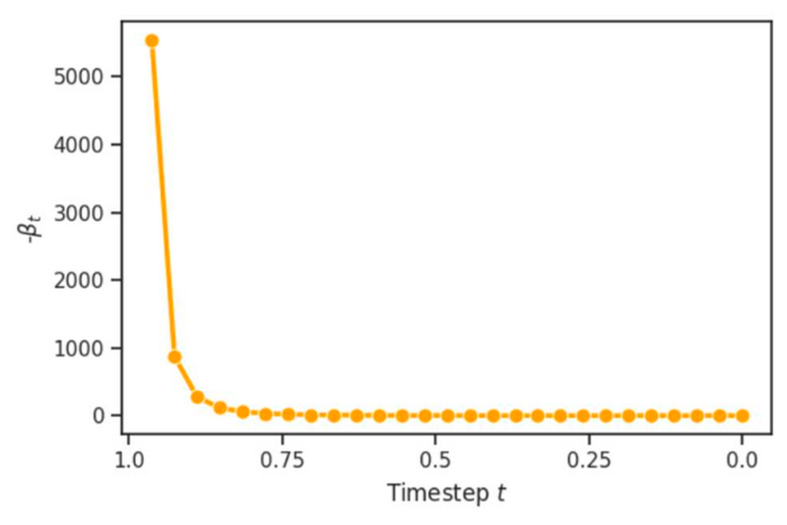

<!--
Lecture 14 of AI618 (2026-11-05), taught from `Part-5-Flow-Models_v2.pptx`
slides 25-44 and `Part-6-Distillation_v2.pptx` pages 1-9.

Built on the scribe note of Yoojin Oh, with the timeline, the runnable
one-dimensional check and the figure-licensing note taken from Yoonjae Jung's,
and the generative learning trilemma written for this chapter because no note
stated it.

Two things an editor should not undo:

* The endpoint convention is x_0 = data, x_1 = noise, which is the deck's from
  Part II on. Chapter 14 documents the reversal at the Part I/II boundary and
  this chapter continues the later half; the recap section says so explicitly.
* Slides 39 and 40 of deck 5 write the score coefficient as a'b - b^2 a'/a.
  Slide 37 derives b'b - b^2 a'/a, and Bayes' rule cannot change the
  coefficient in front of the score, so slide 37 is right. The remark in
  @sec-flowdps-posterior records this deliberately; every note of this lecture
  found it independently.
-->


## Overview {#sec-rf-overview}

The previous lecture built flow models: a velocity field, learned by plain regression, transports noise to data along an ordinary differential equation (ODE). Training is cheap, but sampling is not: every sample is an ODE solve, and curved trajectories need many small steps, each a network evaluation. This chapter asks what decides the curvature, and answers that it is the pairing of noise with data, the *coupling*, rather than the interpolation path [@liu2023rf; @lipman2023fm]. It covers slides 25--44 of Part 5, Flow Models [@lecture-slides-flow], and slides 1--9 of Part 6, Diffusion/Flow Model Distillation [@lecture-slides-distillation], after a recap of 1-rectified flow (slides 18--23). The chapter has three parts.

1.  **ReFlow** (slides 25--31; @sec-reflow). A trained flow defines a deterministic coupling, and retraining on it preserves the marginals, never increases a convex transport cost, and lowers the quadratic cost by exactly the straightness of the new flow plus the crossing of the old coupling. Repeating this straightens the flow, which is what one-step sampling needs; but straight is not optimal transport, and each round costs compute and some fidelity.

2.  **Flow models at scale** (slides 32--44; @sec-applications). Stable Diffusion 3 scales rectified flow to text-to-image generation [@esser2024sd3]. FlowDPS and FlowEdit reuse a pre-trained flow without retraining, for inverse problems and image editing [@kim2025flowdps; @kulikov2024flowedit]. Both rest on the flow version of Tweedie's formula, which splits each Euler step into a denoising and a re-noising step.

3.  **Early few-step methods** (Part 6, slides 1--9; @sec-rf-fewstep). Progressive distillation halves the number of steps with an exact regression target [@salimans2022], and the denoising diffusion GAN makes large stochastic steps possible [@xiao2022ddgan].

After this chapter, the reader should be able to prove what one round of ReFlow does to a coupling and why $n$-RF straightens at rate $O(1/K)$; explain why a straight flow samples in one step and 1-rectified flow cannot; derive the flow Tweedie formula, the FlowDPS update and the FlowEdit ODE; and derive the progressive distillation target. Figures and examples marked "own computation" are new to this chapter.

## Notation {#sec-rf-notation}

We follow the notation of the slides and of *Geometry of Deep Learning* [@gdl]. The general flow matching literature, and the first part of the lecture, write $x_0$ for noise, as in @lipman2023fm. From the rectified flow part of the lecture on, and throughout this chapter, the convention is reversed,

$$
x_t = (1-t)\,x_0 + t\,x_1, \qquad x_0 \sim p_0 \ \text{(data)},\quad x_1 \sim p_1 = \mathcal{N}(0, I) \ \text{(noise)},
$$ {#eq-interp}

so $t = 0$ is data and $t = 1$ is noise, sampling runs from $t = 1$ to $t = 0$, and an Euler step of sampling has $dt < 0$. Stable Diffusion 3 and FlowDPS use the same convention. The symbols are collected in @tbl-rf-notation.

| Symbol | Meaning |
|:------------|:--------------------|
| $x_0 \sim p_0$, $x_1 \sim p_1$ | endpoints of the path; for generation $p_0$ is the data distribution and $p_1 = \mathcal{N}(0, I)$. In @sec-reflow $p_0$, $p_1$ are general |
| $X_t = (1-t)X_0 + tX_1$ | linear interpolation of a coupled pair, $t \in [0,1]$ |
| $p_{01}$ | a coupling: a joint law of $(X_0, X_1)$ with marginals $p_0$, $p_1$ |
| $p_{01}^{0} = p_0 \cdot p_1$, $p_{01}^{n}$ | the independent coupling used by 1-RF; the coupling defined by $n$-RF |
| $u_t(x \mid x_0, x_1) = x_1 - x_0$ | conditional velocity of the linear path |
| $u_t(x) = \mathbb{E}[X_1 - X_0 \mid X_t = x]$ | marginal velocity of the coupling |
| $u_t(x;\theta)$ | network approximation of $u_t$ |
| $Z = (Z_t)_{t \in [0,1]}$ | rectified flow: solution of $\dot Z_t = u_t(Z_t)$ |
| $S(Z)$, $V(X_0, X_1)$ | straightness of a flow (@eq-S); crossing of a coupling (@eq-V) |
| $a_t$, $b_t$ | coefficients of an affine path $x_t = a_t x_0 + b_t x_1$ |
| $v_t(x)$ | marginal velocity in the FlowDPS notation; the same object as $u_t(x)$ |
| $\hat{x}_{0\vert t}$, $\hat{x}_{1\vert t}$ | $\mathbb{E}[x_0 \mid x_t]$ and $\mathbb{E}[x_1 \mid x_t]$: denoised and noise estimates |
| $y = A x_0 + n$ | measurement of an inverse problem, $n \sim \mathcal{N}(0, \sigma_n^2 I_m)$ |
| $\zeta_t$ | coefficient of the score in the velocity (@eq-zeta) |
| $\beta_t$, $C_1(t)$, $C_2(t)$ | FlowDPS step size and DDIM coefficients (@sec-flowdps-sampling) |
| $z_t = \alpha_t x + \sigma_t \epsilon$ | diffusion latent in progressive distillation |
| NFE | number of network function evaluations per sample |

: Notation. {#tbl-rf-notation}

References of the form "slide 30" point to the slides of Part 5, Flow Models [@lecture-slides-flow], and "Part 6, slide 8" to the slides of Part 6, Diffusion/Flow Model Distillation [@lecture-slides-distillation], so that each section can be checked against the lecture. Norms are Euclidean, and all random variables have finite second moments.

## Recap: 1-rectified flow {#sec-recap}

This section collects the facts about rectified flow that @sec-reflow uses (slides 18--23): the conditional and marginal velocities of the linear path, the regression objective that learns the marginal one, and the reason why straight conditional paths do not give straight sampling trajectories. All of it is developed in the previous chapter -- flows and the Euler step in @sec-flow-fields, the continuity equation in @sec-ce, the two losses and their shared gradient in @sec-loss, and affine paths in @sec-gauss -- and is repeated here only as far as this chapter's arguments need it, in the endpoint convention of @sec-rf-notation rather than the one the previous chapter opens with.

### Conditional velocity, marginal velocity and the training objective {#sec-rf-objective}

Let $(X_0, X_1) \sim p_{01}$ be a coupling of $p_0$ and $p_1$. Rectified flow conditions on both endpoints (slide 20). Given $(x_0, x_1)$, $X_t$ is the point $(1-t)x_0 + t x_1$ of the segment from $x_0$ to $x_1$, and the conditional velocity is constant in time,

$$
p_t(x \mid x_0, x_1) = \delta\big(x - ((1-t)x_0 + t x_1)\big), \qquad
u_t(x \mid x_0, x_1) = x_1 - x_0 .
$$ {#eq-cond-vel}

Neither the path nor the velocity depends on how the endpoints were paired, so the same construction applies to every coupling; ReFlow relies on this.

At sampling time the endpoints are unknown, and a sampler can only use the conditional expectation of the conditional velocity given the current state,

$$
u_t(x) = \mathbb{E}[X_1 - X_0 \mid X_t = x] ,
$$ {#eq-marg-vel}

that is, the average of $x_1 - x_0$ over all pairs whose segment passes through $x$ at time $t$. It needs the unknown posterior over these pairs, so $u_t$ has no closed form and is learned by regression below. This field generates the marginal path $p_t = \mathrm{Law}(X_t)$: for a test function $\varphi$, the chain rule and the tower property give $\tfrac{d}{dt}\mathbb{E}\varphi(X_t) = \mathbb{E}[\nabla\varphi(X_t)\cdot(X_1 - X_0)] = \mathbb{E}[\nabla\varphi(X_t)\cdot u_t(X_t)]$, the weak form of the continuity equation $\partial_t p_t + \nabla\cdot(p_t u_t) = 0$.

Since $u_t$ is a conditional expectation, it minimizes a least-squares regression, and rectified flow with coupling $p_{01}$ is trained by

$$
\min_\theta\ \mathbb{E}_{t \sim U[0,1]}\,\mathbb{E}_{(X_0, X_1) \sim p_{01}}
\big\lVert u_t(X_t;\theta) - (X_1 - X_0) \big\rVert^2 ,
$$ {#eq-cfm}

with 1-RF the case $p_{01} = p_{01}^{0} = p_0 \cdot p_1$ (slide 18). The loss needs no ODE solve, so training is simulation-free, unlike maximum-likelihood training of a continuous normalizing flow (CNF), which integrates the ODE at every step. Adding and subtracting $u_t(X_t)$ inside the norm, the cross term vanishes after conditioning on $X_t$, and for each $t$

$$
\mathbb{E}\lVert u_t(X_t;\theta) - (X_1 - X_0)\rVert^2
= \mathbb{E}\lVert u_t(X_t;\theta) - u_t(X_t)\rVert^2
+ \underbrace{\mathbb{E}\lVert (X_1 - X_0) - u_t(X_t)\rVert^2}_{\text{independent of } \theta} .
$$ {#eq-cfm-decomp}

The first term is the flow matching loss and the second does not depend on $\theta$, so the two losses share a gradient and a minimizer [@lipman2024guide, Theorem 4]. The second term is irreducible: it is the spread of the directions of the segments that pass through the same point at the same time. Integrated over $t$, it is the crossing $V$ of the coupling (@eq-V), which drives the analysis of @sec-reflow.

**1-RF is a reparametrized diffusion model** (slides 19, 22 and 23). For the independent coupling with $p_1 = \mathcal{N}(0, I)$, dividing the interpolation by $1-t$ gives

$$
\frac{x_t}{1-t} = x_0 + s\,x_1 , \qquad s = \frac{t}{1-t},
$$ {#eq-rf-ve}

a sample of a variance-exploding diffusion at noise level $s$. A 1-RF velocity and a diffusion denoiser $D_s$ therefore differ only in how time and the network output are parametrized, and their losses have the same minimizer. At the optimum, $D_{t/(1-t)}\big(x/(1-t)\big) = \mathbb{E}[X_0 \mid X_t = x] = x - t\,u_t(x)$ (slide 23; @eq-linear-tweedie).

### Why straight conditional paths still need many steps {#sec-recap-curved}

Every conditional path of @eq-cond-vel is straight, but a sampler never follows one, because it does not know which data point it is heading to. It follows the marginal velocity $u_t(x)$, an average of conditional velocities towards different data points (@fig-cfm-paths). Under the independent coupling, every data point is a plausible endpoint when $t$ is close to $1$, so the sampling direction $-u_t$ points towards the mean of the data; as $t$ decreases, the posterior over $x_0$ concentrates and the direction turns towards a single data point. The sampling trajectories are therefore curved, and an Euler solver needs many steps to follow them. In the extreme case, one Euler step from $t = 1$ gives $x_1 - u_1(x_1) = \mathbb{E}[X_0]$, the mean of the data, for every $x_1$ (@sec-onestep). The sampling trajectories follow the segments exactly when the segments do not cross, and @sec-reflow shows how ReFlow changes the coupling to remove the crossings.

![Conditional and marginal objects of flow matching, drawn in the convention with data $q$ at $t = 1$: (a) conditional path, (b) marginal path, (c) conditional velocity, (d) marginal velocity, an average of conditional velocities towards different data points. From slide 10 of the course slides [@lecture-slides-flow], originally Figure 3 of @lipman2024guide.](figures/lec14/finallyupper-slide-cfm-paths.png){#fig-cfm-paths width=80%}

## ReFlow: straightening the flow {#sec-reflow}

### The coupling decides the curvature {#sec-coupling}

@sec-recap left the coupling $p_{01}$ free: any joint law with marginals $p_0$ and $p_1$ can be used in @eq-cfm. The choice of $p_{01}$ has a large impact on sampling speed (slide 26). @fig-rf-coupling compares two couplings of the same marginals, eight Gaussians and two moons, through the trajectories of the flows trained on them.

![Trajectories of flows trained on two couplings of the same marginals, eight Gaussians and two moons: the independent coupling $p_0 \cdot p_1$ (left) and the OT coupling $\mathrm{OT}(p_0, p_1)$ (right). From slide 26 of the course slides [@lecture-slides-flow].](figures/lec14/finallyupper-slide-coupling.png){#fig-rf-coupling width=50%}

Under the independent coupling $p_{01} = p_0 \cdot p_1$, $X_0$ and $X_1$ are drawn independently, so a source point can be paired with any target point. Every combination of a source and a target appears as a training pair, and the segments of these pairs overlap and cross everywhere. Where several segments pass through the same point $x$ at the same time $t$, the marginal velocity $u_t(x)$ of @eq-marg-vel averages their directions, and in general the average is none of them. This spread of directions is the irreducible part $V$ of the training loss (@eq-cfm-decomp and @eq-V). The trajectories of the ODE $\dot Z_t = u_t(Z_t)$ cannot cross, so instead of following any one segment they bend. The result is the tangled, curved trajectories of the left panel, which a solver can follow only with many small steps.

Under the optimal transport (OT) coupling $p_{01} = \mathrm{OT}(p_0, p_1)$, the pairing minimizes the expected transport distance $\mathbb{E}\lVert X_1 - X_0\rVert^2$, so nearby sources go to nearby targets. For this cost the segments do not cross. If two segments met at the same time, swapping their endpoints would lower the total cost. Each point $X_t$ therefore lies on a single segment, $u_t(X_t) = X_1 - X_0$, and the trajectories are the linear paths themselves (right panel). A straight trajectory traversed at constant speed is integrated exactly by a single Euler step, $Z_0 = Z_1 - u_1(Z_1)$.

The OT coupling, however, is hard to compute for two high-dimensional distributions. This raises the question of how to find straight paths with the flow itself, without solving an OT problem first. ReFlow answers it by using a trained flow to generate new pairs and training again on them (@sec-reflow-def). The resulting paths are straight, but, as @sec-not-ot shows, they need not be the OT paths.

### A flow defines a coupling {#sec-reflow-def}

The key observation is that a CNF also defines a coupling of $p_0$ and $p_1$. Let $\Phi$ be the time-$1$ map of the ODE $\dot Z_t = u_t(Z_t)$ run from $t = 1$ to $t = 0$. Drawing $Z_1 \sim p_1$ and setting $Z_0 = \Phi(Z_1)$ gives a pair $(Z_0, Z_1)$ whose marginals are $p_0$ and $p_1$ (by @prp-marginal below), and in which $Z_0$ is a *deterministic* function of $Z_1$.

::: {#def-reflow}
## ReFlow and n-rectified flow

Let $p_{01}^{0} = p_0 \cdot p_1$. For $n \ge 1$, the *$n$-rectified flow* ($n$-RF) is the flow trained by the loss in @eq-cfm with $p_{01} = p_{01}^{n-1}$, the linear conditional path and velocity of @eq-cond-vel. The coupling it induces, $(Z_0, Z_1)$ with $Z_1 \sim p_1$ and $Z_0 = \Phi^{(n)}(Z_1)$, is denoted $p_{01}^{n}$. The procedure of training a new flow model with a coupling defined by another flow model is called **ReFlow**.

:::

In practice, one round of ReFlow is:

1.  Train 1-RF $u_t(\cdot;\theta_1)$ on independent pairs, as in @sec-rf-objective.

2.  Draw $z_1^{(i)} \sim \mathcal{N}(0,I)$, $i = 1,\dots,M$, and solve the ODE of $u_t(\cdot;\theta_1)$ from $t = 1$ to $t = 0$ with an accurate solver to obtain $z_0^{(i)}$. Store the pairs $(z_0^{(i)}, z_1^{(i)})$.

3.  Train $u_t(\cdot;\theta_2)$, usually initialized from $\theta_1$, on $\min_\theta \mathbb{E}_{t,i}\lVert u_t((1-t)z_0^{(i)} + t z_1^{(i)};\theta) - (z_1^{(i)} - z_0^{(i)})\rVert^2$. This is 2-RF; repeating steps 2--3 gives 3-RF, and so on.

The only change from 1-RF is the coupling, a point the lecture stressed. The 1-RF loss $\mathbb{E}_{t, x_0, x_1}\lVert u_t(x_t;\theta) - (x_1 - x_0)\rVert^2$ is taken over *all* combinations $(x_0, x_1)$ of data and noise, which is the *independent coupling*. ReFlow takes the same loss over pairs in which $z_0$ was produced from $z_1$ by the previous flow, a *deterministic coupling*. The path and the network are unchanged.

@liu2023rf start the rectified flow at $Z_0 = X_0$ and integrate forward, whereas a sampler starts at $Z_1 = X_1$ and integrates backward. Since the flow map is a bijection pushing $p_1$ to $p_0$, both give the same joint law of $(Z_0, Z_1)$.

### Non-crossing property of flows {#sec-reflow-picture}

@fig-reflow shows how ReFlow straightens a flow on the example of @liu2023rf [Figure 2] (slides 28--29). Here $p_0$ and $p_1$ each consist of two clusters, one above the other, and the flow moves from left to right.

![ReFlow on two clusters, with $\pi_0$ (purple) and $\pi_1$ (red) in the roles of $p_0$ and $p_1$. 1-RF (red box): (a) linear interpolation of the independent coupling and (b) the 1-RF trajectories, which rewire the pairs at the crossing. 2-RF: (c) linear interpolation of the 1-RF coupling $(Z_0, Z_1)$ and (d) the 2-RF trajectories, which are straight. From slide 28 of the course slides [@lecture-slides-flow], originally Figure 2 of @liu2023rf.](figures/lec14/finallyupper-slide-reflow-2rf.png){#fig-reflow width=90%}

In @fig-reflow(a), the independent coupling pairs every source with every target, so all four combinations of clusters appear. The segments from the upper left to the lower right cross those from the lower left to the upper right in the middle. In @fig-reflow(b), the 1-RF velocity at this crossing is the average in @eq-marg-vel of a downward and an upward direction, which is horizontal. The trajectories of an ODE cannot cross, so they turn *horizontal* in the middle instead. Sources in the upper cluster end in the upper target cluster, and sources in the lower cluster in the lower one. The flow has *rewired* the pairs, and the trajectories bend where it does so.

In @fig-reflow(c), the endpoints $(Z_0, Z_1)$ of these trajectories form the 1-RF coupling. Their segments are horizontal and do not cross, so every point lies on the segment of exactly one pair. The average in @eq-marg-vel then has a single term, and the 2-RF velocity equals the segment direction $Z_1 - Z_0$. Applying the flow again therefore follows the segments themselves, and the trajectories in (d) are straight, as @sec-rf-toy checks numerically. @thm-reflow makes precise the sense in which $n$-RF becomes a straight ODE as $n$ grows (slide 30).

### What one rectification does: marginals, cost and straightness {#sec-reflow-theory}

The lecture stated the main theorem (slide 30; Theorem 3.7 of @liu2023rf) without proof. The proof needs three facts, which we prove in turn. Throughout this section $(X_0, X_1) \sim p_{01}$ is any coupling with $\mathbb{E}\lVert X_1 - X_0\rVert^2 < \infty$, $u_t$ is its exact marginal velocity (@eq-marg-vel), and $Z$ is the rectified flow, the solution of $\dot Z_t = u_t(Z_t)$ with $Z_0 = X_0$. We assume the coupling is *rectifiable* in the sense of @liu2023rf: this ODE has a unique solution and the continuity equation with velocity $u_t$ has a unique solution from $p_0$ (for example, $u_t$ locally Lipschitz with linear growth).

::: {#prp-marginal}
## Rectification preserves the marginals

$\mathrm{Law}(Z_t) = \mathrm{Law}(X_t)$ for every $t \in [0,1]$. In particular $(Z_0, Z_1)$ is again a coupling of $p_0$ and $p_1$.

:::

::: {.proof}

$\mathrm{Law}(X_t)$ solves the continuity equation with velocity $u_t$ (@sec-recap). $\mathrm{Law}(Z_t)$ solves the same equation, since for a test function $\varphi$, $\tfrac{d}{dt}\mathbb{E}\varphi(Z_t) = \mathbb{E}[\nabla\varphi(Z_t)\cdot u_t(Z_t)]$ by the chain rule. Both start from $p_0$ at $t = 0$, so by uniqueness they coincide [@liu2023rf, Theorem 3.3].

:::

::: {#prp-cost}
## Rectification does not increase transport cost

For every convex $c : \mathbb{R}^d \to \mathbb{R}$, $\mathbb{E}\,c(Z_1 - Z_0) \le \mathbb{E}\,c(X_1 - X_0)$.

:::

::: {.proof}

Since $Z_1 - Z_0 = \int_0^1 u_t(Z_t)\,dt$ and $c$ is convex, Jensen's inequality over $t$ gives $c(Z_1 - Z_0) \le \int_0^1 c(u_t(Z_t))\,dt$. Take expectations. By @prp-marginal, $\mathbb{E}\,c(u_t(Z_t)) = \mathbb{E}\,c(u_t(X_t))$, and by Jensen's inequality for conditional expectations, $c(u_t(X_t)) = c(\mathbb{E}[X_1 - X_0 \mid X_t]) \le \mathbb{E}[c(X_1 - X_0) \mid X_t]$. Integrating over $t$ gives the claim [@liu2023rf, Theorem 3.5].

:::

The cost does not merely fail to increase; for the quadratic cost the decrease can be computed exactly. Define the **straightness** of a flow and the **crossing** of a coupling:

$$
S(Z) = \int_0^1 \mathbb{E}\,\big\lVert (Z_1 - Z_0) - u_t(Z_t) \big\rVert^2\, dt ,
$$ {#eq-S}

$$
V(X_0, X_1) = \int_0^1 \mathbb{E}\,\big\lVert (X_1 - X_0) - \mathbb{E}[X_1 - X_0 \mid X_t] \big\rVert^2\, dt .
$$ {#eq-V}

$S(Z) = 0$ exactly when the velocity along every trajectory equals its chord $Z_1 - Z_0$, that is, when every trajectory is a straight line traversed at constant speed. $V(X_0, X_1) = 0$ exactly when $X_t$ determines $X_1 - X_0$, that is, when no two segments pass through the same point at the same time. By @eq-cfm-decomp, $V$ is the irreducible part of the training loss @eq-cfm. In the lecture the velocity in $S$ is the network $u_t(\cdot;\theta)$; with a perfectly trained network the two agree.

::: {#lem-identity}
## Cost decrease = straightness + crossing

$$
\mathbb{E}\lVert X_1 - X_0\rVert^2 - \mathbb{E}\lVert Z_1 - Z_0\rVert^2 = S(Z) + V(X_0, X_1).
$$ {#eq-identity}

:::

::: {.proof}

The proof combines two variance decompositions.

*Mean--variance in time.* For a square-integrable $f : [0,1] \to \mathbb{R}^d$ with mean $m = \int_0^1 f\,dt$, expanding the square gives $\int_0^1 \lVert f - m\rVert^2 dt = \int_0^1 \lVert f\rVert^2 dt - \lVert m\rVert^2$. Apply it to $f(t) = u_t(Z_t)$, whose integral is $Z_1 - Z_0$, and take expectations:

$$\int_0^1 \mathbb{E}\lVert u_t(Z_t)\rVert^2 dt - \mathbb{E}\lVert Z_1 - Z_0\rVert^2 = S(Z).$$

*Mean--variance in the coupling.* For each $t$, $u_t(X_t)$ is the conditional mean of $X_1 - X_0$ given $X_t$, so $\mathbb{E}\lVert X_1 - X_0\rVert^2 = \mathbb{E}\lVert u_t(X_t)\rVert^2 + \mathbb{E}\lVert (X_1 - X_0) - u_t(X_t)\rVert^2$. Integrating over $t$,

$$\mathbb{E}\lVert X_1 - X_0\rVert^2 = \int_0^1 \mathbb{E}\lVert u_t(X_t)\rVert^2 dt + V(X_0, X_1).$$

By @prp-marginal the two integrals $\int_0^1 \mathbb{E}\lVert u_t(\cdot)\rVert^2 dt$ are equal. Subtracting the first display from the second gives @eq-identity.

:::

::: {#thm-reflow}
## n-RF converges to a straight ODE; slide 30, Theorem 3.7 of @liu2023rf

Let $Z^{0} = (X_0, X_1)$ and let $Z^{k+1}$ be the rectified flow of the coupling $(Z_0^{k}, Z_1^{k})$, assumed rectifiable for $k = 0, \dots, K$. Then

$$
\sum_{k=0}^{K} \Big( S(Z^{k+1}) + V\big(Z_0^{k}, Z_1^{k}\big) \Big) \le \mathbb{E}\lVert X_1 - X_0\rVert^2 ,
$$ {#eq-reflow-bound}

and hence $\min_{k \le K} \big(S(Z^{k+1}) + V(Z_0^{k}, Z_1^{k})\big) \le \mathbb{E}\lVert X_1 - X_0\rVert^2/(K+1) = O(1/K)$.

:::

::: {.proof}

Apply @lem-identity to the coupling $(Z_0^{k}, Z_1^{k})$, whose rectified flow is $Z^{k+1}$: $\mathbb{E}\lVert Z_1^{k} - Z_0^{k}\rVert^2 - \mathbb{E}\lVert Z_1^{k+1} - Z_0^{k+1}\rVert^2 = S(Z^{k+1}) + V(Z_0^{k}, Z_1^{k})$. Summing over $k = 0, \dots, K$, the left side telescopes to $\mathbb{E}\lVert X_1 - X_0\rVert^2 - \mathbb{E}\lVert Z_1^{K+1} - Z_0^{K+1}\rVert^2$, which is at most $\mathbb{E}\lVert X_1 - X_0\rVert^2$. The minimum of $K+1$ non-negative terms is at most their average.

:::

The proof also explains *why* ReFlow straightens. The straightness and crossing of every round are paid out of a fixed quantity, the initial transport cost, which can never become negative; the terms must therefore become small, and the coupling becomes nearly non-crossing and the flow nearly straight. Note what the theorem does not say: it bounds the *minimum* over rounds, not the last round, and it assumes the exact velocity field.

### Why straightening enables one-step sampling {#sec-onestep}

For the linear path, the velocity determines the posterior means. Taking the conditional expectation of @eq-interp gives $x = (1-t)\,\mathbb{E}[X_0 \mid X_t = x] + t\,\mathbb{E}[X_1 \mid X_t = x]$ and $u_t(x) = \mathbb{E}[X_1 \mid X_t = x] - \mathbb{E}[X_0 \mid X_t = x]$. Then solving the two linear equations gives

$$
\mathbb{E}[X_0 \mid X_t = x] = x - t\,u_t(x), \qquad \mathbb{E}[X_1 \mid X_t = x] = x + (1-t)\,u_t(x).
$$ {#eq-linear-tweedie}

These are the linear case of the flow Tweedie formula (@sec-flowdps-tweedie). One Euler step of sampling from $t$ straight to $0$ is $x - t\,u_t(x)$, so **a one-step sampler outputs the posterior mean $\mathbb{E}[X_0 \mid X_t = x]$**, and in particular one step from pure noise outputs $\mathbb{E}[X_0 \mid X_1 = x_1]$. Two cases:

-   **1-RF.** $X_0$ and $X_1$ are independent, so $\mathbb{E}[X_0 \mid X_1 = x_1] = \mathbb{E}[X_0]$ for every $x_1$: one Euler step maps *all* noise to the mean of the data. In images this is the familiar blurry average.

-   **After reflow.** The coupling $p_{01}^{n}$ is deterministic, $Z_0 = \Phi(Z_1)$, so $\mathbb{E}[Z_0 \mid Z_1 = z_1] = \Phi(z_1)$: the posterior mean *is* a sample. If in addition $S(Z) = 0$, every trajectory is a straight line at constant speed and the Euler method with any number of steps, one included, is exact.

Determinism makes the conditional mean, which is all a one-step regression can output, a sample; straightness makes the Euler path agree with the ODE at every intermediate time. ReFlow supplies both, and this is the sense in which it enables few-step sampling.

### Worked example: ReFlow on two clusters {#sec-rf-toy}

This section goes beyond the slides. The results of @sec-reflow-theory can be checked numerically on the two-cluster problem of @fig-reflow, where the 1-RF velocity has a closed form. The cost is that the problem is two-dimensional.

**Setup.**

-   **Source.** $p_0$ is an equal mixture of $\mathcal{N}(m_i, 0.5^2 I)$, with $m_i = (-4, \pm 2.5)$.

-   **Target.** $p_1$ is an equal mixture of $\mathcal{N}(n_j, I)$, with $n_j = (4, \pm 2.5)$.

-   **Couplings.** 1-RF is trained on the independent coupling $p_0 \cdot p_1$, and 2-RF on the pairs $(Z_0, Z_1)$ produced by 1-RF.

Given the pair of components $(i, j)$, $X_1 - X_0$ and $X_t$ are jointly Gaussian, so $\mathbb{E}[X_1 - X_0 \mid X_t, i, j]$ is affine in $X_t$. The 1-RF velocity $u_t(x)$ is the average of these four affine fields, weighted by the posterior probability of each pair given $X_t = x$. We solve the 1-RF ODE accurately (RK4, 1000 steps) from 2000 samples of $p_0$, which gives the 1-RF coupling. The 2-RF velocity $\mathbb{E}[Z_1 - Z_0 \mid Z_t]$ has no closed form. We estimate it from the pairs by kernel regression with bandwidth 0.15, which stands in for a trained network.

|  | independent | 1-RF | 2-RF |
|:----------------|------:|------:|------:|
| transport cost $\mathbb{E}\lVert Z_1 - Z_0\rVert^2$ | 79.4 (exact 79.0) | 64.5 | 64.5 |
| crossing $V$ of the coupling | 7.97 | -- | -- |
| straightness $S$ of the flow | -- | 6.68 | $3.5 \times 10^{-4}$ |
| one-step Euler error $\mathbb{E}\lVert \mathrm{Euler}_1 - \mathrm{ODE}\rVert^2$ | -- | 8.13 | $5 \times 10^{-4}$ |

: ReFlow on two clusters. The first column describes the independent coupling $(X_0, X_1)$; the columns 1-RF and 2-RF describe each flow and the coupling $(Z_0, Z_1)$ it produces. Monte Carlo averages over 2000 pairs; -- marks quantities not computed. Own computation. {#tbl-rf-toy}

Three things in @tbl-rf-toy match the theory.

1.  **1-RF rewires the pairs.** The exact cost of the independent coupling is $8^2 + \tfrac12 \cdot 5^2 + 2(0.5^2 + 1^2) = 79.0$. The three terms are the horizontal distance, the vertical distance between clusters on opposite sides, and the variances. The 1-RF coupling costs 64.5. This is exactly the cost of mapping each cluster affinely onto the cluster on its own side, $x \mapsto n_j + 2(x - m_i)$, which is $64 + 2 \cdot 0.5^2 = 64.5$. The vertical term has disappeared: upper sources end in the upper cluster, as in @fig-reflow(b).

2.  **The cost decrease is $S + V$.** In the first round the cost falls by $79.4 - 64.5 = 14.9$, and $S + V = 6.68 + 7.97 = 14.65$. The two agree up to Monte Carlo error, as @lem-identity predicts. The decrease is split almost evenly between the crossing of the independent coupling and the curvature of 1-RF.

3.  **One round is enough here.** 2-RF keeps the cost at 64.5. By @lem-identity, a round that does not lower the cost has $S + V = 0$, so the 1-RF coupling is already non-crossing and 2-RF is straight. The measured straightness confirms this: it falls from 6.68 to $3.5 \times 10^{-4}$, four orders of magnitude.

**Few-step sampling.** Straightness is what makes few steps possible. @fig-reflow-euler shows that 1-RF still has a squared error of 0.09 after 16 Euler steps, while 2-RF is essentially exact after one. With a single step, 1-RF shows the collapse predicted in @sec-onestep, here run from $p_0$ towards $p_1$. Every point is sent to $\mathbb{E}[X_1] = (4, 0)$, so the error, 8.13, is close to the mean squared distance of $p_1$ from its mean, $\mathbb{E}\lVert X_1 - (4,0)\rVert^2 = 2.5^2 + 2 = 8.25$.

![Few-step sampling on the two-cluster example. (a) Squared distance between the endpoint of $N$ Euler steps and the accurate ODE endpoint, for 1-RF and 2-RF. (b) One Euler step from 1000 points of $p_0$: 2-RF (green) reproduces $p_1$ (red), while 1-RF sends every point to the mean $\mathbb{E}[X_1]$ (blue cross). Own computation.](figures/lec14/finallyupper-reflow-euler.png){#fig-reflow-euler width=90%}

The example shows the whole mechanism of ReFlow in one round. Crossing is removed, the cost falls by exactly $S + V$, and the flow becomes straight enough for a single step. It also hints at the price. The 2-RF velocity here comes from a regression on generated pairs, and a smoother regression (bandwidth 1.0 instead of 0.15) keeps the flow straight but shrinks the spread of the generated clusters from 0.98 to 0.65 (target 1.0).

#### A one-dimensional check a reader can run {#sec-toy-1d}

The two-cluster experiment needs a kernel regression to stand in for the second
network. One dimension less and both regressions have closed forms, so the
whole mechanism can be checked in a few lines. Take $X_0\sim\mathcal{N}(0,1)$
and $X_1\sim\mathcal{N}(m,1)$ independent with $m=2$, in the convention of
@sec-reflow where $t=0$ is the source. With $r(t)=(1-t)^2+t^2$, the pair
$(D,X_t)$ is jointly Gaussian with $\operatorname{Cov}(D,X_t)=2t-1$ and
$\operatorname{Var}(X_t)=r(t)$, so the exact 1-RF field and its trajectory are

$$
u^1_t(x)=m+\frac{2t-1}{r(t)}\,(x-tm),
\qquad Z^1_t=tm+\sqrt{r(t)}\,z_0 ,
$$ {#eq-toy1d}

whose endpoint $Z^1_1=z_0+m$ has the right law. One Euler step of size $1$,
however, gives $z_0+u^1_0(z_0)=m$ for *every* $z_0$: the collapse onto the mean
of @sec-onestep, in closed form. The 1-RF coupling is the translation
$(z_0,z_0+m)$, every displacement equals $m$, so the second regression returns
the constant field $u^2_t\equiv m$ and one Euler step is exact.

```python
import numpy as np

m = 2.0
z0 = np.array([-1.0, 0.0, 1.0])

def u1(t, z):                      # exact 1-RF field, @eq-toy1d
    r = (1.0 - t)**2 + t**2
    return m + (2.0*t - 1.0) / r * (z - t*m)

def integrate(z, steps=256):       # RK4, as an independent check on the closed form
    z = z.copy()
    h = 1.0 / steps
    for j in range(steps):
        t = j*h
        k1 = u1(t, z); k2 = u1(t + h/2, z + h*k1/2)
        k3 = u1(t + h/2, z + h*k2/2); k4 = u1(t + h, z + h*k3)
        z += h*(k1 + 2*k2 + 2*k3 + k4)/6
    return z

exact = z0 + m
for name, end in [("1-RF, RK4 256 steps", integrate(z0)),
                  ("1-RF, one Euler step", z0 + u1(0.0, z0)),
                  ("2-RF, one Euler step", z0 + m)]:
    err = np.abs(end - exact)
    print(f"{name:22s} {np.array2string(end, precision=6)}  max error {err.max():.2e}")
```

```
1-RF, RK4 256 steps    [1. 2. 3.]  max error 8.04e-14
1-RF, one Euler step   [2. 2. 2.]  max error 1.00e+00
2-RF, one Euler step   [1. 2. 3.]  max error 0.00e+00
```

Both flows realise the same endpoint map $z_0\mapsto z_0+m$. Only the
numerical cost of realising it has changed, which is the whole claim of
@sec-onestep in three numbers.

### Straight is not optimal transport {#sec-not-ot}

@thm-reflow makes the flow straight, but it does not make it optimal: a straight ODE need not be the OT ODE (slide 31). A four-point example shows this, with $$p_0 = \tfrac12\delta_A + \tfrac12\delta_B, \qquad
p_1 = \tfrac12\delta_C + \tfrac12\delta_D, \qquad
A = (0,0),\ B = (2,1),\ C = (1,1),\ D = (1,0).$$ Only two deterministic couplings exist, and @fig-not-ot shows both.

![A straight ODE is not an OT ODE. Circles are the points of $p_0$, squares those of $p_1$. Left: straight and optimal ($A \to D$, $B \to C$). Right: straight and non-crossing, hence a fixed point of ReFlow, but at twice the transport cost ($A \to C$, $B \to D$). From slide 31 of the course slides [@lecture-slides-flow].](figures/lec14/finallyupper-slide-straight-not-ot.png){#fig-not-ot width=55%}

**A straight coupling that is not optimal.** Take the coupling $A \to C$, $B \to D$. Its segments are $A_t = (t, t)$ and $B_t = (2-t, 1-t)$. They would meet only if $t = 2 - t$ and $t = 1 - t$ at the same time, which is impossible, so $X_t$ always identifies its pair. The average in @eq-marg-vel has a single term, $u_t(X_t) = X_1 - X_0$, and so $V = 0$. The rectified flow follows the segments, and so $S = 0$. Its cost is $\tfrac12\big(\lVert C - A\rVert^2 + \lVert D - B\rVert^2\big) = \tfrac12(2 + 2) = 2$.

**The optimal coupling.** The other coupling, $A \to D$, $B \to C$, costs $\tfrac12(1 + 1) = 1$. Its segments are horizontal and parallel, so it is also straight. It is the OT coupling for the quadratic cost. Since $\lVert x - y\rVert^2 = \lVert x\rVert^2 + \lVert y\rVert^2 - 2\,x\cdot y$ and the marginals are fixed, minimizing the cost is the same as maximizing $\sum x\cdot y$, and $A\cdot D + B\cdot C = 3 > A\cdot C + B\cdot D = 2$.

**Why ReFlow does not move.** Rectifying the first coupling returns it unchanged, so it is a *fixed point* of ReFlow. @lem-identity says the same thing in numbers: the cost falls by $S + V = 0$. ReFlow removes crossings, and crossing is a local property: it only asks whether two segments meet. Optimality is a global property: it compares the current pairing with every other pairing. ReFlow never makes that comparison, so it has no reason to swap the partners of $A$ and $B$. Started from the first coupling, ReFlow stays there forever.

**Reaching OT.** @prp-cost guarantees that ReFlow never *increases* a convex cost, but ReFlow can stop at any non-crossing coupling. Reaching OT needs an additional constraint (slide 31). @liu2022ot shows that if the velocity of each rectification is restricted to a gradient field, $u_t = \nabla\phi_t$, the fixed points become optimal couplings for the quadratic cost. ReFlow alone therefore guarantees a straight path, not the shortest one.

### Advantages and costs of ReFlow {#sec-reflow-tradeoffs}

ReFlow buys straightness with computation and some fidelity.

**Advantages.**

-   **No OT coupling is needed.** Repeated flow-based generation alone makes the coupling deterministic and the flow straight (@thm-reflow).

-   **The cost never increases.** Every round keeps the marginals and does not increase any convex transport cost (@prp-marginal and @prp-cost).

-   **Nothing new to design.** The loss, path, and architecture of 1-RF are reused, and only the coupling changes (@sec-reflow-def).

**Costs.**

-   **Time overhead.** Every round needs many pairs, each a full ODE solve with an accurate solver, and then a new training run.

-   **Not OT.** Only straightness is guaranteed. ReFlow can stop at a non-crossing coupling that is not optimal (@sec-not-ot).

-   **Fidelity.** The pairs of round $n$ come from a learned, discretized model, so $Z_0$ follows the model distribution $\hat p_0$ rather than $p_0$. Each round adds its own regression error on top of the errors of the rounds before.

As the lecture added, distilling the reflowed flow into a one-step map then removes the ODE solve from sampling altogether (@sec-rf-fewstep).

## Scaling and applications {#sec-applications}

A trained rectified flow is more than a sampler. This section follows slides 32--44 through three uses of one. Stable Diffusion 3 uses it as the backbone of a large text-to-image model (@sec-sd3). FlowDPS uses it as a prior for inverse problems (@sec-flowdps), and FlowEdit as an image editor (@sec-flowedit). The last two reuse the flow without retraining and change only how its ODE is solved.

### Scaling rectified flow: Stable Diffusion 3 {#sec-sd3}

Stable Diffusion 3 (SD3) is a latent rectified flow [@esser2024sd3] that applies the linear path $z_t = (1-t)z_0 + t\epsilon$ in the latent space of an autoencoder and trains it with the loss of @eq-cfm, drawing $t$ from a logit-normal rather than a uniform distribution.

**The MM-DiT architecture**. Earlier Stable Diffusion models are attention U-Nets that read the text prompt through cross-attention. Image features provide the queries and text embeddings the keys and values, so the text is a side stream that is never updated. SD3 instead uses a DiT-style transformer with **two streams**, image tokens and text tokens, each with its own weights (@fig-mmdit).

-   **Text input.** Three text encoders (CLIP-L/14, CLIP-G/14 and T5-XXL) give $77 + 77$ text tokens of 4096 channels.

-   **Global conditioning.** The pooled CLIP embeddings and the timestep embedding form a vector $y$, which modulates every block through adaptive layer normalization.

-   **Joint attention.** In each block the two streams are concatenated for one attention, $\mathrm{softmax}\big([Q_x; Q_c][K_x; K_c]^\top/\sqrt{d}\big)[V_x; V_c]$, so information flows in both directions.

Only the image tokens are decoded at the end. The text stream serves as context and is then discarded.

![The MM-DiT architecture: (a) overview, with text tokens $c$, pooled vector $y$ and image tokens $x$; (b) one MM-DiT block, with separate weights per stream joined in a single attention. From slide 34 of the course slides [@lecture-slides-flow], originally Figure 2 of @esser2024sd3.](figures/lec14/finallyupper-slide-mmdit.png){#fig-mmdit width=60%}

**Scaling.** The paper trains this architecture up to 8B parameters. The validation loss falls predictably with model size, and a lower loss goes with better human preference ratings.

### FlowDPS: posterior sampling with a flow prior {#sec-flowdps}

An inverse problem asks for $x_0 \in \mathbb{R}^d$ from a measurement

$$
y = A x_0 + n \in \mathbb{R}^m, \qquad n \sim \mathcal{N}(0, \sigma_n^2 I_m),
$$ {#eq-measurement}

for example in super-resolution or deblurring. The operator $A$ loses information, so many $x_0$ explain $y$, and a prior has to choose among them. Diffusion inverse solvers (DIS) such as DPS [@chung2023dps] sample the posterior $p(x_0 \mid y)$ by combining a pre-trained diffusion prior with the gradient of the likelihood. FlowDPS [@kim2025flowdps] carries these solvers over to flows (slides 36--40). The development rests on three facts.

1.  Through a flow version of Tweedie's formula, each step of the flow ODE splits into a clean-image estimate and a noise estimate (@sec-flowdps-affine, @sec-flowdps-tweedie and @sec-flowdps-score).

2.  The likelihood gradient belongs on the clean estimate, and the noise estimate is left alone (@sec-flowdps-posterior and @sec-flowdps-sampling).

3.  To guide correctly, the early steps, near $t = 1$, must be emphasized. This is a consequence of how flows parametrize time (@sec-flowdps-early).

#### Affine conditional flows {#sec-flowdps-affine}

FlowDPS works with any affine conditional flow (slide 15),

$$
x_t = \psi_t(x_1 \mid x_0) = a_t x_0 + b_t x_1, \qquad a_0 = 1,\ b_0 = 0,\ a_1 = 0,\ b_1 = 1,
$$ {#eq-affine}

with data $x_0 \sim q$ and noise $x_1 \sim \mathcal{N}(0, I)$ independent. Rectified flow is the case $a_t = 1 - t$, $b_t = t$. Since $X_t = a_t X_0 + b_t X_1$, either endpoint can be written through the other,

$$
X_0 = \frac{X_t - b_t X_1}{a_t}, \qquad X_1 = \frac{X_t - a_t X_0}{b_t} .
$$ {#eq-affine-inverse}

The conditional velocity is $\dot\psi_t = \dot a_t x_0 + \dot b_t x_1$, so the marginal velocity, the posterior average of the conditional one, is

$$
v_t(x) = \mathbb{E}[\dot a_t x_0 + \dot b_t x_1 \mid x_t = x]
= \dot a_t\,\hat{x}_{0|t} + \dot b_t\,\hat{x}_{1|t},
\qquad \hat{x}_{0|t} := \mathbb{E}[x_0 \mid x_t],\ \hat{x}_{1|t} := \mathbb{E}[x_1 \mid x_t] .
$$ {#eq-vel-decomp}

Substituting either line of @eq-affine-inverse inside the conditional expectation gives the two forms of the marginal velocity:

$$
v_t(x) = \frac{\dot b_t}{b_t}\,x + \Big[\dot a_t - a_t\frac{\dot b_t}{b_t}\Big]\mathbb{E}[X_0 \mid X_t = x]
= \frac{\dot a_t}{a_t}\,x + \Big[\dot b_t - b_t\frac{\dot a_t}{a_t}\Big]\mathbb{E}[X_1 \mid X_t = x].
$$ {#eq-vel-two-forms}

In each form the velocity is a known multiple of $x$ plus a multiple of one posterior mean. Solving them for the posterior means gives the flow version of Tweedie's formula.

#### The flow version of Tweedie's formula {#sec-flowdps-tweedie}

::: {#prp-tweedie}
## Tweedie formula for flows; slide 38, Proposition 1 of @kim2025flowdps

If $a_t \dot b_t - \dot a_t b_t \neq 0$ and $\dot a_t, \dot b_t \neq 0$, the denoised and noise estimates are

$$
\hat{x}_{0|t} = \Big[a_t - \dot a_t \frac{b_t}{\dot b_t}\Big]^{-1}\Big(x_t - \frac{b_t}{\dot b_t}\,v_t(x_t)\Big),
\qquad
\hat{x}_{1|t} = \Big[b_t - \dot b_t \frac{a_t}{\dot a_t}\Big]^{-1}\Big(x_t - \frac{a_t}{\dot a_t}\,v_t(x_t)\Big).
$$ {#eq-rf-tweedie}

:::

::: {.proof}

Taking $\mathbb{E}[\,\cdot \mid x_t]$ of @eq-affine gives $x_t = a_t \hat{x}_{0|t} + b_t \hat{x}_{1|t}$, because $x_t$ is known given itself. Together with @eq-vel-decomp this is a $2 \times 2$ linear system for $(\hat{x}_{0|t}, \hat{x}_{1|t})$ with determinant $a_t \dot b_t - \dot a_t b_t$. From the second equation, $\hat{x}_{1|t} = (v_t - \dot a_t \hat{x}_{0|t})/\dot b_t$. Substituting into the first gives $x_t = (a_t - \dot a_t b_t/\dot b_t)\,\hat{x}_{0|t} + (b_t/\dot b_t)\,v_t$, which is the first formula. Eliminating $\hat{x}_{0|t}$ instead gives the second.

:::

**The simple linear rectification case.** For $a_t = 1-t$, $b_t = t$, we have $\dot a_t = -1$, $\dot b_t = 1$ and $a_t \dot b_t - \dot a_t b_t = 1$. Then $a_t - \dot a_t b_t/\dot b_t = (1-t) + t = 1$ and $b_t - \dot b_t a_t/\dot a_t = t + (1-t) = 1$, so

$$
\hat{x}_{0|t} = x_t - t\,v_t(x_t), \qquad \hat{x}_{1|t} = x_t + (1-t)\,v_t(x_t).
$$ {#eq-tweedie-linear}

This is @eq-linear-tweedie again. The clean estimate is one Euler step to $t = 0$, and the noise estimate one Euler step to $t = 1$.

#### Velocity and score {#sec-flowdps-score}

The conditional law is Gaussian, $p_t(x_t \mid x_0) = \mathcal{N}(x_t \mid a_t x_0, b_t^2 I)$, with score $\nabla_{x_t}\log p_t(x_t \mid x_0) = -(x_t - a_t x_0)/b_t^2 = -x_1/b_t$. The marginal score is the posterior average of the conditional score. Indeed, for $b_t > 0$, differentiating $p_t(x) = \int p_t(x \mid x_0)\,q(x_0)\,dx_0$ under the integral gives

$$
\begin{aligned}
\nabla \log p_t(x) &= \frac{\int p_t(x \mid x_0)\,\nabla\log p_t(x \mid x_0)\,q(x_0)\,dx_0}{p_t(x)} \\
&= \mathbb{E}\big[\nabla\log p_t(x_t \mid x_0) \mid x_t = x\big] = -\frac{1}{b_t}\,\hat{x}_{1|t}.
\end{aligned}
$$ {#eq-score}

This is Tweedie's formula in its classical form. Now eliminate $\hat{x}_{0|t} = (x_t - b_t \hat{x}_{1|t})/a_t$ (valid for $a_t > 0$) from @eq-vel-decomp and substitute @eq-score (slide 37):

$$
v_t(x_t) = \frac{\dot a_t}{a_t}\,x_t + \Big[\dot b_t - b_t\frac{\dot a_t}{a_t}\Big]\hat{x}_{1|t}
= \frac{\dot a_t}{a_t}\,x_t - \zeta_t\,\nabla\log p_t(x_t),
$$ {#eq-rf-vel-score}

where $\zeta_t$ is the coefficient of the score,

$$
\zeta_t = \dot b_t b_t - b_t^2\,\frac{\dot a_t}{a_t} .
$$ {#eq-zeta}

Velocity, score and denoiser therefore carry the same information. For example, the path $a_t = 1$, $b_t = t$, which drops the condition $a_1 = 0$, is a VE diffusion with $\sigma(t) = t$. There $\zeta_t = t$, and @eq-rf-vel-score reduces to its probability-flow ODE $v_t = -t\,\nabla\log p_t$. For the linear path, $\zeta_t = t + t^2/(1-t) = t/(1-t)$.

#### Posterior velocity {#sec-flowdps-posterior}

The measurement depends on $x_t$ only through $x_0$. Conditioning on $y$ therefore changes the prior $q(x_0)$ into $q(x_0 \mid y)$ but leaves the path $p_t(x_t \mid x_0)$ unchanged. Repeating the derivation of @eq-rf-vel-score with every expectation conditioned on $y$ replaces $\nabla \log p_t(x_t)$ by $\nabla \log p_t(x_t \mid y)$. Bayes' rule splits the posterior score into a likelihood term and the prior score (slide 39):

$$
\begin{gathered}
\nabla_{x_t}\log p_t(x_t \mid y) = \nabla_{x_t}\log p_t(y \mid x_t) + \nabla_{x_t}\log p_t(x_t), \\
v_t(x_t \mid y) = v_t(x_t) - \zeta_t\,\nabla_{x_t}\log p_t(y \mid x_t),
\end{gathered}
$$ {#eq-post-vel}

with $\zeta_t$ defined in @eq-zeta. Note that the only difference is that the score has become a posterior score. Posterior sampling is therefore unconditional sampling plus a likelihood-gradient correction.

::: {.remark}

Slides 39--40 and Eqs. (19)--(21) of @kim2025flowdps write $\zeta_t$ with $\dot a_t b_t$ in place of $\dot b_t b_t$. Conditioning on $y$ does not change the coefficient, and the paper's own Eq. (17), like slide 37, has $\dot b_t b_t$, so we use @eq-zeta. For the linear path the two forms give $\zeta_t/a_t = t/(1-t)^2$ and $t(2t-1)/(1-t)^2$. Their magnitudes are both large near $t = 1$ and small near $t = 0$. However, the second expression changes sign at $t = 1/2$, which also reverses the direction of the likelihood-gradient correction when $dt < 0$. We therefore consistently use @eq-zeta in the following derivation.

:::

**The intractable likelihood.** The likelihood $p_t(y \mid x_t) = \int p(y \mid x_0)\,p(x_0 \mid x_t)\,dx_0$ is intractable. As in DPS [@chung2023dps], replace the posterior $p(x_0 \mid x_t)$ by a Dirac delta at its mean, $p(x_0 \mid x_t) \approx \delta(x_0 - \hat{x}_{0|t})$:

$$
\nabla_{x_t}\log p_t(y \mid x_t) \approx \nabla_{x_t}\log p(y \mid \hat{x}_{0|t}),
\qquad
\nabla_{\hat{x}_{0|t}}\log p(y \mid \hat{x}_{0|t}) = \frac{1}{\sigma_n^2}A^\top(y - A\hat{x}_{0|t})
$$ {#eq-dps}

for the Gaussian noise of @eq-measurement.

**Avoiding the Jacobian.** Even with this approximation, the gradient is taken with respect to $x_t$. By the chain rule, $$\nabla_{x_t}\log p(y \mid \hat{x}_{0|t})
= J_t^\top\,\nabla_{\hat{x}_{0|t}}\log p(y \mid \hat{x}_{0|t}),
\qquad J_t = \frac{\partial \hat{x}_{0|t}}{\partial x_t},$$ so evaluating it requires backpropagation through the network, which is costly and often unstable. FlowDPS bypasses the Jacobian with a further approximation that treats the clean-image manifold as piecewise linear (Proposition 2 of @kim2025flowdps). Suppose that the clean data are distributed uniformly on an affine subspace $\mathcal{M}$. The posterior $p(x_0 \mid x_t) \propto \exp\big(-a_t^2\lVert x_t/a_t - x_0\rVert^2/(2b_t^2)\big)$ is then a Gaussian restricted to $\mathcal{M}$, centered at the orthogonal projection of $x_t/a_t$ onto $\mathcal{M}$. The denoised estimate is therefore this projection, and its Jacobian is $J_t = P_{\mathcal{M}}/a_t$, where $P_{\mathcal{M}}$ denotes the orthogonal projection onto $\mathcal{M}$. If, in addition, the likelihood gradient at $\hat{x}_{0|t}$ does not leave $\mathcal{M}$, the projection leaves it unchanged, and the gradient with respect to $x_t$ reduces to the gradient with respect to the clean estimate, scaled by $1/a_t$: $$\nabla_{x_t}\log p(y \mid \hat{x}_{0|t})
= \frac{1}{a_t}P_{\mathcal{M}}\nabla_{\hat{x}_{0|t}}\log p(y \mid \hat{x}_{0|t})
= \frac{1}{a_t}\nabla_{\hat{x}_{0|t}}\log p(y \mid \hat{x}_{0|t}).$$ Substituting this into @eq-post-vel gives a posterior velocity that needs no backpropagation through the network,

$$
v_t(x_t \mid y) \approx v_t(x_t) - \frac{\zeta_t}{a_t}\,\nabla_{\hat{x}_{0|t}}\log p(y \mid \hat{x}_{0|t}).
$$ {#eq-post-vel-approx}

#### The sampler: correct the clean estimate {#sec-flowdps-sampling}

Write one Euler step $x_{t+dt} = x_t + v_t(x_t)\,dt$, with $dt < 0$, in terms of the two estimates. Using $x_t = a_t\hat{x}_{0|t} + b_t\hat{x}_{1|t}$ and @eq-vel-decomp,

$$
x_{t+dt} = (a_t + \dot a_t\,dt)\,\hat{x}_{0|t} + (b_t + \dot b_t\,dt)\,\hat{x}_{1|t}
=: C_1(t)\,\hat{x}_{0|t} + C_2(t)\,\hat{x}_{1|t} .
$$ {#eq-euler-decomp}

To first order $C_1(t) = a_{t+dt}$ and $C_2(t) = b_{t+dt}$, and exactly so for the linear path. Each step therefore **denoises** to $\hat{x}_{0|t}$ and **re-noises** with $\hat{x}_{1|t}$ to the next level, the same structure as DDIM. Using the posterior velocity of @eq-post-vel-approx instead gives

$$
\begin{gathered}
x_{t+dt} = C_1(t)\,\tilde{x}_{0|t} + C_2(t)\,\hat{x}_{1|t}, \\
\tilde{x}_{0|t} = \hat{x}_{0|t} - \beta_t\,\nabla_{\hat{x}_{0|t}}\log p(y \mid \hat{x}_{0|t}),
\qquad \beta_t = \frac{\zeta_t}{a_t}\,\frac{dt}{C_1(t)} ,
\end{gathered}
$$ {#eq-flowdps-step}

which follows by moving $-(\zeta_t/a_t)\,dt\,\nabla$ inside the factor $C_1(t)$. The likelihood gradient acts on the clean estimate only, and the noise estimate is left alone. Since $dt < 0$ and $\zeta_t/a_t > 0$, $-\beta_t > 0$ is the step size of gradient ascent on the likelihood. In the notation of the slides, $\hat{x}_{0|t}(y) := \tilde{x}_{0|t}$ is the conditional posterior mean, $\hat{x}_{0|t}$ the unconditional one, and $\nabla\log p(y \mid \hat{x}_{0|t})$ the likelihood gradient at the Tweedie estimate (slide 40). Compared with DPS, the gradient acts on the clean estimate without a Jacobian, and its step size $\beta_t$ follows from the flow ODE.

![What the sampler produces: super-resolution from average-pooled and bicubic
measurements, and Gaussian and motion deblurring, the lower row at
$1024\times1408$. From slides 36 and 40 of the course slides [@lecture-slides-flow],
originally Figure 1 of @kim2025flowdps.](figures/lec14/tejava317-flowdps-results.png){#fig-flowdps-results width=85%}

@fig-flowdps-results shows the sampler on the four degradations the lecture
used, at resolutions up to $1024\times1408$. The prior is a pre-trained
text-to-image flow and is not retrained for any of them; only the likelihood
term changes with the operator $A$.

#### Why the early steps matter {#sec-flowdps-early}

For the linear path with the derived $\zeta_t$, $C_1(t) = 1 - t - dt$ and

$$
-\beta_t = \frac{t\,\lvert dt\rvert}{(1-t)^2\,(1 - t - dt)} .
$$ {#eq-beta-linear}

Using the second form of the coefficient instead, as on slide 40, gives

$$
\beta_t = \frac{dt\,\sigma_t(2\sigma_t - 1)}{(1-\sigma_t)^2(1 - \sigma_{t+dt})}, \qquad \sigma_t = t .
$$ {#eq-beta-printed}

@fig-beta, reproduced from @kim2025flowdps, plots this step size over a sampling run. It is enormous in the first few steps near $t = 1$ and falls to almost zero long before $t = 0$. The magnitude of the step size in @eq-beta-linear behaves similarly, since both expressions contain the factor $1/(1-t)^2$. Their signs differ, however: @eq-beta-printed makes the ascent step $-\beta_t$ negative for $t < 1/2$, whereas @eq-beta-linear keeps it positive throughout. FlowDPS therefore applies a large likelihood correction to $\hat{x}_{0|t}$ in the first few steps and lets the prior take over afterwards.

{#fig-beta width=55%}

**Why flows need it.** The reason is the reparametrization that relates 1-RF to diffusion (@eq-rf-ve, slide 19). Diffusion time runs from noise level $s = \infty$ down to $0$, and flow time from $t = 1$ down to $0$, with $s = t/(1-t)$. The whole range $s \in [1, \infty)$ is squeezed into $t \in [1/2, 1)$, and $ds/dt = 1/(1-t)^2$ is the factor that appears in @eq-beta-linear. A diffusion sampler decides the global structure of the image over a long stretch of large noise levels. A flow decides it within the first few steps near $t = 1$, and guidance has to act there, with a large weight.

### FlowEdit: inversion-free image editing {#sec-flowedit}

Text-based editing maps a source image $x_{src}$, described by a prompt $c_{src}$, to a target image $x_{tgt}$ that follows a target prompt $c_{tgt}$ while preserving the structure of the source. FlowEdit [@kulikov2024flowedit] (slides 41--43) performs this edit with a pre-trained text-to-image flow such as SD3, without training, inversion or manipulation of the model's internal features. With $v^{src}_t$ and $v^{tgt}_t$ the model velocity under each prompt, the edit is posed as a linear path between the two images,

$$
x_t = (1-t)\,x_{tgt} + t\,x_{src}, \qquad x_1 = x_{src},\ x_0 = x_{tgt},
$$ {#eq-flowedit-path}

whose velocity would ordinarily require a flow trained between the two image distributions.

![Editing by inversion versus FlowEdit. (a) Inversion through the noise space. (b) The same edit as a direct path $Z^{inv}_t$ driven by the velocity difference (orange). (c) FlowEdit: the velocities are evaluated at noisy versions of the source drawn at every step, giving a shorter, noise-free path. From slide 42 of the course slides [@lecture-slides-flow], originally Figure 2 of @kulikov2024flowedit.](figures/lec14/finallyupper-slide-flowedit.png){#fig-flowedit width=82%}

**Editing by inversion.** The standard approach maps $x_{src}$ to noise with $v^{src}$ and back to an image with $v^{tgt}$ (@fig-flowedit(a)). This doubles the number of function evaluations and links source and target only through a shared noise map. The induced pairing has a high transport cost even when the inversion is exact, so the edit departs from the structure of the source [@kulikov2024flowedit].

**Inversion as a direct path.** Let $Z^{src}_t$ be the inversion trajectory, with $Z^{src}_0 = x_{src}$, and $Z^{tgt}_t$ the sampling trajectory, with $Z^{tgt}_1 = Z^{src}_1$. The path $Z^{inv}_t := x_{src} + Z^{tgt}_t - Z^{src}_t$ runs from $Z^{inv}_1 = x_{src}$ to $Z^{inv}_0 = Z^{tgt}_0$ and satisfies $\dot Z^{inv}_t = v^{tgt}_t(Z^{tgt}_t) - v^{src}_t(Z^{src}_t)$ (@fig-flowedit(b)). Editing by inversion is thus itself an ODE from source to target, driven by a *velocity difference*. Since $Z^{tgt}_t$ and $Z^{src}_t$ carry approximately the same noise, the difference reflects only the clean-image predictions: the path is noise-free and edits coarse structure first and finer detail as $t$ decreases.

**FlowEdit** (slide 43; @fig-flowedit(c)) keeps this ODE but replaces the inversion trajectory by noisy versions of the source, which have the same marginals and require no inversion. With a single $\epsilon \sim \mathcal{N}(0,I)$ for both prompts,

$$q_t = (1-t)\,x_{src} + t\,\epsilon, \qquad p_t = (1-t)\,x_{tgt} + t\,\epsilon$$

are the noisy source and the unknown noisy target. Since $p_t - q_t = (1-t)(x_{tgt} - x_{src})$, @eq-flowedit-path can be written as $x_t = p_t - q_t + x_{src}$, in which the noise cancels. If $q_t$ and $p_t$ were generative trajectories of the two prompts, $dq_t = v^{src}_t(q_t)\,dt$ and $dp_t = v^{tgt}_t(p_t)\,dt$, and differentiating would give

$$
dx_t = dp_t - dq_t = \big[v^{tgt}_t(p_t) - v^{src}_t(q_t)\big]\,dt,
\qquad p_t := q_t + x_t - x_{src}.
$$ {#eq-flowedit-ode}

The last definition makes $p_t$ computable from the current edit $x_t$ without knowing $x_{tgt}$.

**Conditional versus marginal.** For a fixed $\epsilon$, however, $q_t$ and $p_t$ are straight lines with the conditional velocities $\epsilon - x_{src}$ and $\epsilon - x_{tgt}$, whereas the network returns marginal ones. FlowEdit therefore uses the expectation over the noise, $\mathbb{E}_\epsilon\big[v^{tgt}_t(p_t) - v^{src}_t(q_t) \mid x_{src}\big]$, estimated by redrawing $\epsilon$ at every step and optionally averaging $n_{avg}$ draws; sharing $\epsilon$ between the two terms reduces the variance of the difference.

## Early few-step methods {#sec-rf-fewstep}

### Why distillation? {#sec-why-distill}

A diffusion or flow sampler is slow because every sample integrates an ODE, with tens to hundreds, sometimes thousands, of solver steps, each one network function evaluation (NFE). Distillation aims at 1--4 NFEs at teacher-level quality, with or without a pre-trained teacher. Geometrically, a few-step generator learns *large jumps along the probability-flow ODE trajectory instead of integrating it*: the teacher walks along a curve in many small steps, and the student jumps from noise to the end (@fig-why-distill).

![A teacher integrates the ODE in many small steps (green); a one-step student jumps from noise $x_T$ to data $x_0$ (orange). From Part 6, slide 3 of the course slides [@lecture-slides-distillation].](figures/lec14/finallyupper-slide-why-distill.png){#fig-why-distill width=42%}

The difficulty is that the target of a one-step student is unknown: a noise sample $x_T$ does not come with the data point at which its trajectory ends. Generating the targets with the teacher first, as ReFlow does with its pairs (@sec-reflow-def), costs one full ODE solve per target. Slide 3 lists four other ways to take big steps:

1.  *step halving*: progressive distillation (@sec-pd);

2.  *jump to the end*: consistency models (CM, LCM);

3.  *jump anywhere*: flow maps (CTM, MeanFlow, Align Your Flow, flow map matching);

4.  *match the distribution*: adversarial methods such as the denoising diffusion GAN (@sec-ddgan), and drifting models.

This chapter covers the two early methods: item 1 and the denoising diffusion GAN of item 4. The rest of Part 6 develops the flow-map theory behind items 2 and 3 (slides 2 and 5).

@tbl-timeline places these methods on the schematic timeline the lecture used
to orient the rest of Part 6 (Part 6, slide 5). The movement is from many small
denoising steps, through learned jumps to the data, to flow maps that jump
between arbitrary times.

| Year | Methods |
|:---|:---|
| 2020 | DDPM |
| 2021 | Score-SDE |
| 2022 | Flow matching; progressive distillation; consistency models (CM) |
| 2023 | Consistency trajectory models (CTM) |
| 2024 | Flow map matching (FMM) |
| 2025 | Scaling continuous CMs; MeanFlow; Align Your Flow |
| 2026 | Pixel MeanFlow |

: The timeline of Part 6, slide 5. The slide places consistency models at 2022;
the first preprint is March 2023 [@song2023consistency]. {#tbl-timeline}

### Progressive distillation {#sec-pd}

Progressive distillation [@salimans2022] (Part 6, slides 6--8) distills a trained deterministic diffusion sampler into a new model that takes half as many steps, and repeats. It uses the notation of the paper, $z_t = \alpha_t x + \sigma_t \epsilon$ with $\epsilon \sim \mathcal{N}(0,I)$, data at $t = 0$ and noise at $t = 1$, and a network $\hat{x}_\eta(z_t)$ that predicts the clean image. Given $z_t$ and a prediction $\hat{x}$, the deterministic DDIM step to an earlier time $s < t$ keeps the implied noise $\hat\epsilon = (z_t - \alpha_t\hat{x})/\sigma_t$ and re-mixes it at level $s$:

$$
z_s = \alpha_s\,\hat{x} + \frac{\sigma_s}{\sigma_t}\,\big(z_t - \alpha_t\hat{x}\big).
$$ {#eq-rf-ddim-step}

**The distillation target.** The student should do in *one* DDIM step what the teacher does in *two*. With $N$ student steps, $t = i/N$, $t' = t - 0.5/N$ and $t'' = t - 1/N$, the teacher takes two steps $z_t \to z_{t'} \to z_{t''}$ with @eq-rf-ddim-step. Requiring one student step from $z_t$ to land exactly on $z_{t''}$ gives a linear equation for the student's prediction $\tilde{x}$:

$$
z_{t''} = \alpha_{t''}\tilde{x} + \frac{\sigma_{t''}}{\sigma_t}\big(z_t - \alpha_t\tilde{x}\big)
\quad\Longrightarrow\quad
\tilde{x} = \frac{z_{t''} - (\sigma_{t''}/\sigma_t)\,z_t}{\alpha_{t''} - (\sigma_{t''}/\sigma_t)\,\alpha_t} .
$$ {#eq-pd-target}

The student, initialized from the teacher, regresses on this target with the loss $w(\lambda_t)\lVert\tilde{x} - \hat{x}_\theta(z_t)\rVert^2$, where $\lambda_t = \log(\alpha_t^2/\sigma_t^2)$. It then becomes the teacher of the next round, and $N$ is halved (@fig-pd). Compared with standard diffusion training, only three things change: the initialization from the teacher, time drawn from the grid $t = i/N$, and the target $\tilde{x}$ in place of the clean data $x$. Note that $\tilde{x}$ is a property of the teacher's trajectory, not of the data, and in general differs from $x$.

![Two rounds of progressive distillation. A four-step deterministic sampler $f(z;\eta)$ is distilled into a two-step one, and that into a one-step sampler $f(z;\theta)$. From Part 6, slide 7 of the course slides [@lecture-slides-distillation], originally Figure 1 of @salimans2022.](figures/lec14/finallyupper-slide-pd.png){#fig-pd width=52%}

**What it achieves.** Each round is a short training run, since the student only has to merge pairs of steps. On $64\times 64$ ImageNet, four sampling steps are visually close to 256, while a single step loses some detail (Part 6, slide 6). With so few steps the student is evaluated near $t = 1$, where $\alpha_t \approx 0$, and an $\epsilon$-prediction $\hat{x} = (z_t - \sigma_t\hat\epsilon)/\alpha_t$ would amplify any error. The network therefore predicts $x$ or the velocity $v = \alpha_t\epsilon - \sigma_t x$ instead.

**Limitation.** Progressive distillation shortens a deterministic sampler. A stochastic sampler cannot simply take larger steps, because its reverse step is Gaussian only when the step is small. The denoising diffusion GAN removes that restriction.

### Denoising diffusion GAN {#sec-ddgan}

Xiao et al. frame the problem as a **generative learning trilemma**: a
generative model is wanted to have high sample quality, to cover the modes of
the data, and to sample fast, and the established families give up one of the
three. Diffusion models have quality and coverage and are slow; GANs are fast
and sharp but drop modes; variational autoencoders and normalising flows cover
the data and sample fast but produce weaker samples. The question this section
answers is how to keep the first two while fixing the third, and the answer
begins with why the reverse step cannot simply be made larger.

The DDPM reverse step $p_\theta(x_{t-1} \mid x_t) = \mathcal{N}(\mu_\theta, \sigma_t^2 I)$ is justified only for small steps. By Bayes' rule, $q(x_{t-1} \mid x_t) \propto q(x_t \mid x_{t-1})\,q(x_{t-1})$: when the forward step is small, the first factor is a narrow Gaussian and the product is close to Gaussian; when it is large, the product inherits the multimodal shape of $q(x_{t-1})$, which a Gaussian cannot fit (@fig-ddgan-multimodal). The denoising diffusion GAN [@xiao2022ddgan] (Part 6, slide 9) therefore keeps a handful of large steps and models each reverse step with a conditional GAN, which can represent multimodal distributions.

{#fig-ddgan-multimodal width=80%}

**Parametrization and training.** A generator $G_\theta(x_t, z, t)$ with latent $z \sim \mathcal{N}(0, I)$ predicts a clean image $x_0'$, and the reverse step samples the forward posterior given that prediction, as in DDPM:

$$
\begin{gathered}
p_\theta(x_{t-1} \mid x_t) = \int q(x_{t-1} \mid x_t, x_0)\,p_\theta(x_0 \mid x_t)\,dx_0, \\
x_0' = G_\theta(x_t, z, t),\qquad x_{t-1}' \sim q(x_{t-1} \mid x_t, x_0').
\end{gathered}
$$ {#eq-ddgan}

The randomness of $z$ makes the step an implicit, possibly multimodal distribution. A time-dependent discriminator $D_\phi(x_{t-1}, x_t, t)$ compares real pairs from the forward diffusion with fake pairs in which $x_{t-1}$ is replaced by the generator's $x_{t-1}'$ (@fig-ddgan). Like distribution matching distillation (DMD) [@yin2024dmd], it matches distributions rather than regressing on targets, but on transitions $(x_{t-1}, x_t)$ rather than on final images. The paper reports quality and diversity competitive with diffusion models at up to 2000 times faster sampling on CIFAR-10.

![Training of the denoising diffusion GAN. Real pairs $(x_{t-1}, x_t)$ come from the forward diffusion; the generator $G(x_t, z, t)$ predicts $x_0'$, from which $x_{t-1}'$ is drawn by posterior sampling; the discriminator $D(x_{t-1}, x_t, t)$ tells the two kinds of pairs apart. From Part 6, slide 9 of the course slides [@lecture-slides-distillation], originally Figure 3 of @xiao2022ddgan.](figures/lec14/finallyupper-slide-ddgan.png){#fig-ddgan width=50%}

### Discussion: why not train a one-step generator directly? {#sec-discussion}

Why should diffusion-based distillation beat a one-step generator, such as a GAN, trained directly? This question came up in class. The answer is that distillation learns the whole geometry of the transport, including the intermediate transitions, so the model knows *which* noise is mapped *where*. The two methods of this section learn that geometry in different ways.

-   **Progressive distillation** trains gradually. Each round only merges pairs of steps of the previous sampler, so every student stays connected to the teacher's ODE and inherits its noise-to-data map, by regression rather than an adversarial game.

-   **The denoising diffusion GAN** learns the transitions $x_t \to x_{t-1}$ that the forward diffusion defines through $q(x_{t-1} \mid x_0)$ and $q(x_t \mid x_{t-1})$. Conditioned on $x_t$, these are far simpler than the data distribution, and the discriminator sees every noise level.

A one-step GAN has two problems that these methods avoid.

1.  **The mapping is arbitrary.** The adversarial loss asks only that the generated distribution match the data. Every map from noise to data that achieves this is equally good, so nothing decides which noise goes where.

2.  **There is no control over the intermediate noise levels $\sigma$.** A diffusion model fixes a whole scale space of distributions between data and noise: the distribution at noise level $\sigma$ is the data distribution smoothed by a Gaussian of width $\sigma$, and these levels connect data to noise continuously. However, a one-step GAN has no intermediate levels at all and must find the whole map from a distributional signal alone.

## Summary {#sec-summary}

1.  The coupling decides the curvature: the marginal velocity averages over crossing pairs and bends. ReFlow trains a new flow on the deterministic coupling of the old one. Each round preserves the marginals, does not increase any convex cost, and lowers the quadratic cost by exactly $S + V$, which gives the $O(1/K)$ bound (@thm-reflow).

2.  One Euler step outputs $\mathbb{E}[X_0 \mid X_t]$: the data mean for 1-RF, and a sample for a straight deterministic coupling. Straight is not OT, and every round of ReFlow costs compute and some fidelity.

3.  SD3 scales rectified flow with logit-normal time sampling and the two-stream MM-DiT.

4.  For affine flows, velocity, score and denoiser determine each other (@prp-tweedie). FlowDPS corrects the clean estimate with a step that is large near $t = 1$. FlowEdit edits along a noise-free path driven by a velocity difference.

5.  Few-step generation learns large jumps along the ODE. Progressive distillation halves the steps with an exact target (@eq-pd-target). The denoising diffusion GAN makes large steps possible by replacing the Gaussian reverse step by a conditional GAN.

Figures marked "own computation" were made for this chapter. The rest are
cropped or rasterised from the course slides and from the papers they cite,
and are reproduced under the licence of their source: the SD3, FlowDPS and
FlowEdit artwork under [CC BY 4.0](https://creativecommons.org/licenses/by/4.0/)
from the [SD3 PMLR publication](https://proceedings.mlr.press/v235/esser24a.html),
[FlowDPS](https://arxiv.org/abs/2503.08136) and
[FlowEdit](https://arxiv.org/abs/2412.08629); the remaining artwork retains its
source copyright. No changes were made beyond cropping, extraction and
rasterisation.

## References {.unnumbered}

---

*Based on the scribe note of Yoojin Oh, with the materials from Yunjae Jeong and Yeonwoo Cha. Edited by Jong Chul Ye.*
