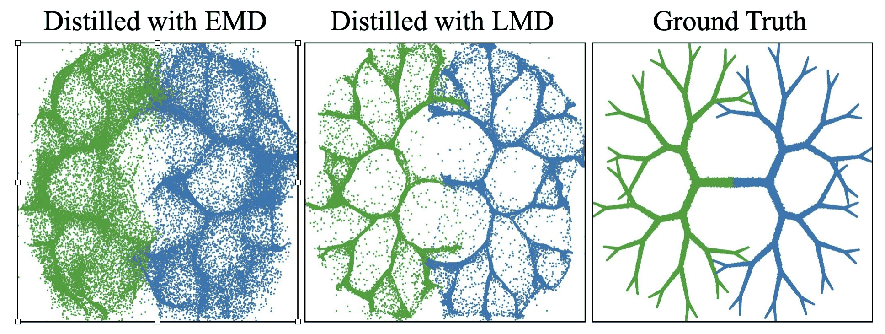

<!--
Lecture 16 of AI618 (2026-11-12), taught from `Part 6 - Distillation_v2.pptx`
slides 52-85.

Built on the scribe note of Wook Jung, with the materials from Seonho Yoo,
Jaehwi Song.

Not in any scribe note, and written for this chapter:
* MeanFlow beside Align Your Flow (slides 57-58)

Written at stage 5 on 2026-11-27 from the deck record, the merge worksheet and
lecture-chapters.yml, replacing promote.py's DRAFT comment. A decision an
editor made that is not in those three files is not in here either: add it.
-->


## Overview

Diffusion and flow models describe a continuous transformation of a simple distribution into data. Their sampling cost comes from repeatedly evaluating a learned vector field. The second half of Part 6 asks whether we can learn the transformation over a whole interval instead. A consistency model predicts a common endpoint, a consistency trajectory model predicts an arbitrary destination, and MeanFlow predicts the average velocity needed to reach that destination. Flow map matching places these ideas inside a common differential framework.

The lecture then addresses two complementary questions. First, can pretrained visual representations make generative learning easier? REPA supervises hidden features, while VA-VAE, REPA-E, and representation autoencoders change how the latent space is learned. Second, must the distribution evolve during inference at all? Drifting models move the generator's output distribution during training and use a single forward pass at inference.

This note follows **physical PDF pages 34-85** of the course deck [@lecture-slides-distillation], in their order. The printed slide numbers embedded in some figures differ from the PDF page numbers. References to pages below always mean physical PDF pages. Progressive distillation and denoising diffusion GANs precede this range; they appear only in the final method map. The mathematical expansions and worked examples below fill in the lecture's skipped steps; the figures are original explanatory drawings rather than copied experimental results.

## Notation and time conventions

The deck uses two orientations of time. We retain both and make the change explicit.

| Symbol | Meaning |
|---|---|
| $x_s$, $b_s(x)$ | ODE state and instantaneous velocity in the flow-map sections |
| $I_s$, $\rho_s$ | Sample from a prescribed interpolant and its marginal law |
| $X_{s,t}(x)$ | Exact flow map from source time $s$ to destination time $t$ |
| $\widehat X_{s,t}$, $\theta$ | Learned map and its trainable parameters |
| $\operatorname{sg}(a)$ | Same numerical value as $a$, with derivative set to zero |
| $\theta^-$ | Target-network parameters, often updated by exponential moving average (EMA) |
| $w_s$, $w_{s,t}$ | Positive training weights; expectations also include sampled states |
| $\tau$, $z_\tau$, $\alpha_\tau$, $\sigma_\tau$ | Diffusion noise time and latent noising schedule in LCM |
| $z_t$, $v(z_t,t)$, $u(z_t,r,t)$ | MeanFlow state, instantaneous velocity, and average velocity |
| $p$, $q_\theta$ | Data law and current generator-output law in drifting |
| $\phi_j$, $k$, $Z_p$ | Frozen feature extractor, positive kernel, and kernel normalizer |

For the flow-map discussion on pages 35-49 and 60-62, $s=0$ is the base distribution and $t=1$ is data. Thus a consistency model is $X_{s,1}$. For the original CM algorithms, LCM, and MeanFlow on pages 40, 43-44, and 53-56, noise time increases from clean data to noise: clean time is near zero, noisy time near one or $T$, and generation runs backward. Changing the clock reverses the velocity sign; it does not change the underlying transport map.

We assume the vector fields are continuous in time, locally Lipschitz in space, and have growth bounds sufficient for trajectories to exist throughout the interval. Differential identities require the indicated differentiability. These assumptions apply to the ideal ODE; a trained neural map need not satisfy them globally or be invertible.

## Consistency models: predict the endpoint

### Endpoint consistency and the boundary condition

On pages 34-36, a consistency model [@song2023consistency] associates every state on one ODE trajectory with the same terminal point:

$$
\dot x_s=b_s(x_s),\qquad
X_s(x_s):=X_{s,1}(x_s)=x_1,\qquad X_1(x)=x.
$$ {#eq-cm-definition}

Different trajectories generally have different endpoints. Consistency means invariance **along one trajectory**, rather than a constant output for all inputs. The boundary condition in @eq-cm-definition rules out the globally constant solution and identifies which invariant we want. In the original diffusion clock, the endpoint is a small positive noise time $\varepsilon$ rather than exactly zero, and the boundary condition is $f_\theta(x,\varepsilon)=x$.

One way to enforce that boundary is

$$
f_\theta(x,\tau)
=c_{\mathrm{skip}}(\tau)x+c_{\mathrm{out}}(\tau)F_\theta(x,\tau),
\quad c_{\mathrm{skip}}(\varepsilon)=1,
\quad c_{\mathrm{out}}(\varepsilon)=0.
$$ {#eq-cm-boundary}

The scalar functions enforce the identity exactly at the endpoint, independently of the network weights. At high noise, one evaluation of $f_\theta$ approximates a long denoising trajectory.

### Consistency distillation and the reason for stop-gradient

Let $\Psi_{s,s+\delta}$ denote a short numerical integration of a pretrained teacher ODE. Pages 35-39 train the student to agree with a target evaluated slightly farther along the same trajectory:

$$
\begin{aligned}
y&=\Psi_{s,s+\delta}(I_s),\\
\mathcal L_{\mathrm{CD}}
&=\mathbb E\left[
 w_s\left\|\widehat X_{s,1}^{\theta}(I_s)
 -\operatorname{sg}\!\left(\widehat X_{s+\delta,1}^{\theta^-}(y)\right)
 \right\|^2\right].
\end{aligned}
$$ {#eq-ch17-cd}

The teacher provides the short displacement $I_s\mapsto y$. The target map provides a prediction of the remaining long displacement. These are different roles: the target map may be an EMA of the student, whereas the ODE teacher is separately pretrained and frozen.

Why detach the target? Write the two predictions as $A_\theta$ and $B_\theta$. If both branches move, the ordinary squared-distance gradient is

$$
\nabla_\theta\|A_\theta-B_\theta\|^2
=2(J_A-J_B)^\top(A_\theta-B_\theta).
$$ {#eq-full-gradient}

With a detached target it becomes $2J_A^\top(A_\theta-B_{\theta^-})$. Both losses compare the same numerical endpoints when the parameter values coincide, but their updates differ. Pages 37-39 illustrate the distinction: ordinary matching pulls both endpoints together, whereas distillation holds the more advanced prediction fixed during the update. "More accurate" is the intended training direction, rather than a theorem that every target prediction is closer to truth. The boundary, teacher quality, and target-update schedule still matter.

{#fig-cm width=95%}

As @fig-cm shows, the short teacher step and long student jump serve different purposes. Numerical error in the short step becomes part of the learning target, while error in the learned long jump is an approximation error of the student.

### Distillation versus training from data

Page 40 contrasts consistency distillation (CD) with consistency training (CT). In the original variance-exploding noise clock, draw clean $x$, Gaussian $\epsilon$, and adjacent noise levels $\tau_n<\tau_{n+1}$. CD uses a teacher solver to construct the cleaner neighbor. CT instead uses the same noise realization:

$$
x_{\tau_{n+1}}=x+\tau_{n+1}\epsilon,
\qquad x_{\tau_n}=x+\tau_n\epsilon,
$$

and minimizes

$$
\mathbb E\left[
\lambda(\tau_n)
d\!\left(f_\theta(x+\tau_{n+1}\epsilon,\tau_{n+1}),
\operatorname{sg}f_{\theta^-}(x+\tau_n\epsilon,\tau_n)\right)
\right].
$$ {#eq-ch17-ct}

Here $d$ is a discrepancy such as squared distance or a perceptual discrepancy. Sharing $\epsilon$ couples the two states. They are not generally exact points on one marginal PF-ODE trajectory: CT uses a data-based local construction whose justification concerns the small-spacing limit. It removes the need for a pretrained diffusion teacher, rather than removing the need for a training distribution or a noise schedule.

The original algorithm increases the number of noise levels during training and updates $\theta^-\leftarrow\mu\theta^-+(1-\mu)\theta$. Page 41 then lists two refinements. Improved CT removes EMA lag **from the target branch** by setting its EMA rate to zero, changes the noise sampling and curriculum, uses inverse-spacing weights, and replaces LPIPS with the Pseudo-Huber discrepancy

$$
d(a,b)=\sqrt{\|a-b\|^2+c^2}-c,\qquad c>0.
$$

Its gradient behaves quadratically near zero and is less sensitive to large residuals [@ict]. Target-branch EMA and an EMA model saved for evaluation are distinct choices. Continuous-time consistency models address the numerical and optimization difficulties of taking the spacing to zero [@scm]. The lecture names these developments without deriving their full recipes.

A CM supports one-step generation and iterative refinement by denoising, adding noise at a chosen intermediate level, and denoising again. Repeated endpoint prediction with re-noising is different from composing deterministic maps between arbitrary intermediate times. That missing destination-time control motivates CTM.

## Latent consistency models

### Guided probability-flow dynamics in latent space

Pages 42-44 apply endpoint consistency to latent diffusion [@lcm]. A pretrained image encoder $E$ produces a clean latent $z_0=E(x)$; a decoder turns the final generated latent back into an image. Let

$$
z_\tau=\alpha_\tau z_0+\sigma_\tau\epsilon,
\qquad\epsilon\sim\mathcal N(0,I).
$$

For a forward SDE with linear drift $a(\tau)z$ and diffusion coefficient $g(\tau)$, its PF-ODE is $\dot z=a(\tau)z-\tfrac12g(\tau)^2\nabla_z\log p_\tau(z)$. With score parameterization $\nabla\log p_\tau\approx-\epsilon_\phi/\sigma_\tau$, page 43 obtains

$$
\frac{dz_\tau}{d\tau}
=a(\tau)z_\tau+
\frac{g(\tau)^2}{2\sigma_\tau}
\widetilde\epsilon_\phi(z_\tau,\omega,c,\tau),
$$ {#eq-lcm-ode}

where $\phi$ is the frozen teacher, $c$ is the condition, and

$$
\widetilde\epsilon_\phi
=(1+\omega)\epsilon_\phi(z_\tau,c,\tau)
-\omega\epsilon_\phi(z_\tau,\varnothing,\tau).
$$ {#eq-lcm-cfg}

This deck uses the CFG convention in which the coefficient of the conditional prediction is $1+\omega$. Implementations that call that coefficient the guidance scale use $1+\omega$ as their scale. The plus sign in @eq-lcm-ode comes from the negative score-to-noise relation, not from changing the direction of integration; sampling still integrates from large $\tau$ toward small $\tau$.

### Parameterization, skipping steps, and guidance conditioning

Rearranging the noising equation gives the denoised estimate $(z-\sigma_\tau\epsilon_\theta)/\alpha_\tau$. LCM combines it with a skip connection:

$$
f_\theta(z,\omega,c,\tau)
=c_{\mathrm{skip}}(\tau)z
+c_{\mathrm{out}}(\tau)
\frac{z-\sigma_\tau\epsilon_\theta(z,\omega,c,\tau)}{\alpha_\tau}.
$$ {#eq-lcm-param}

At the endpoint the coefficients impose the identity boundary. The formula is used where $\alpha_\tau$ is nonzero; division at a singular terminal schedule is not justified by this expression.

The algorithm on page 44 encodes training pairs $(x,c)$, samples a guidance weight, and jumps over $k$ teacher schedule intervals. Starting from $z_{\tau_{n+k}}$, it forms a teacher-guided estimate $\widehat z_{\tau_n}^{\Psi,\omega}$ and trains

$$
\mathcal L_{\mathrm{LCD}}
=\mathbb E\left[
d\!\left(f_\theta(z_{\tau_{n+k}},\omega,c,\tau_{n+k}),
\operatorname{sg}f_{\theta^-}(\widehat z_{\tau_n}^{\Psi,\omega},\omega,c,\tau_n)
\right)\right].
$$ {#eq-lcd}

For a solver returning a displacement, the guided update uses the linear combination of conditional and unconditional displacements with coefficients $1+\omega$ and $-\omega$. Conditioning the student on $\omega$ amortizes a range of teacher guidance strengths. It can avoid a separate conditional and unconditional student evaluation at inference for the distilled guidance, while the text encoder and image decoder still have costs. Page 42 demonstrates one-, two-, and four-step synthesis; reducing latent-space model evaluations does not eliminate decoding or guarantee equal quality at each step count.

## Consistency trajectory models

### Add the destination time

CM learns $X_{s,1}$; CTM learns $X_{s,t}$ [@ctm]. Pages 45-46 define

$$
X_{s,t}(x_s)=x_t,\qquad X_{s,s}(x)=x,
$$ {#eq-ctm-definition}

and impose the short-step consistency loss

$$
\mathcal L_{\mathrm{CTM}}
=\mathbb E\left[w_{s,t}
\left\|\widehat X_{s,t}^{\theta}(I_s)
-\operatorname{sg}\widehat X_{s+\delta,t}^{\theta^-}
  (\Psi_{s,s+\delta}(I_s))\right\|^2\right].
$$ {#eq-ctm-loss}

We take the teacher increment inside the interval, for example $s<s+\delta\leq t$ in the forward orientation. The deck presents this as the flow-map interpretation of CTM. The original diffusion-clock method includes a more elaborate consistency construction and auxiliary objectives; the simple two-map equation isolates the mechanism rather than reproducing every implementation detail.

Uniqueness of ODE solutions gives the composition law

$$
X_{u,t}\circ X_{s,u}=X_{s,t}.
$$ {#eq-composition}

Indeed, following the trajectory from $s$ to $u$ and then to $t$ solves the same initial-value problem as following it directly to $t$. Consequently a trained two-time map supports a chosen partition:

$$
\widehat x_1=
\widehat X_{t_2,1}\circ\widehat X_{t_1,t_2}
\circ\widehat X_{0,t_1}(x_0).
$$

An exact map gives the same answer for every partition. A learned map violates composition approximately, so additional steps may help empirically without a universal monotonic quality guarantee. Page 49 shows the advantage of the deterministic CTM sampling setting over schedules that repeatedly inject noise. In the original CTM sampler, $\gamma=0$ denotes deterministic ODE traversal, while positive $\gamma$ introduces stochasticity. Page 51 compares those settings at several NFEs and shows why the sampling rule matters alongside the training loss.

### The diagonal limit recovers velocity matching

Page 47 uses the boundary-preserving parameterization

$$
\widehat X_{s,t}(x)=x+(t-s)F_{s,t}(x).
$$ {#eq-map-param}

For the exact flow,

$$
F_{s,t}(x_s)
=\frac{1}{t-s}\int_s^t b_\tau(x_\tau)\,d\tau,
\qquad \lim_{t\to s}F_{s,t}(x)=b_s(x).
$$ {#eq-map-average}

The second statement follows by continuity of $b_\tau(x_\tau)$ and the integral mean-value limit. It explains why the same model can learn both long jumps and the instantaneous velocity.

To work out the lecture's diagonal-limit exercise, define the material derivative $D_s=\partial_s+J_x(\cdot)b_s(x)$. Applying it to @eq-map-param at fixed destination $t$ gives

$$
D_s\widehat X_{s,t}
=b_s-F_{s,t}+(t-s)D_sF_{s,t}.
$$ {#eq-diagonal}

At $t=s$, the squared Eulerian residual is therefore $\|b_s-F_{s,s}\|^2$, exactly velocity matching. The order matters: first form the differential residual, then take the diagonal limit. Substituting $t=s$ in an unnormalized finite-step consistency difference would simply produce a vanishing comparison, not this loss.

Page 48 adds the explicit anchor

$$
\mathcal L_{\mathrm{FM}}
=\mathbb E\left[w_s\|F_{s,s}(I_s)-b_s(I_s)\|^2\right].
$$ {#eq-fm-anchor}

A bootstrap target can move together with the online model and become uninformative away from the identity boundary. The velocity anchor ties the model to data or a teacher independently of that moving target; the diagonal boundary alone does not control all off-diagonal predictions.

### Denoising and adversarial objectives

Page 50 shows the full objective schematically as

$$
\mathcal L(\theta,\eta)
=\mathcal L_{\mathrm{CTM}}(\theta;\phi)
+\lambda_{\mathrm{DSM}}\mathcal L_{\mathrm{DSM}}(\theta)
+\lambda_{\mathrm{GAN}}\mathcal L_{\mathrm{GAN}}(\theta,\eta).
$$ {#eq-ctm-total}

In its original diffusion clock, the diagonal network $g_\theta(x_\tau,\tau,\tau)$ is a denoiser and is supervised by

$$
\mathcal L_{\mathrm{DSM}}
=\mathbb E_{x_0,\tau,x_\tau\mid x_0}
\|x_0-g_\theta(x_\tau,\tau,\tau)\|^2.
$$

This is consistent with @eq-fm-anchor after converting between denoiser and velocity parameterizations. For example, in a VE process the score is $(g_\theta-x_\tau)/\sigma_\tau^2$; an appropriate schedule factor converts that score into PF-ODE velocity. Denoiser, score, and velocity are related predictions rather than identically named quantities.

For a discriminator $d_\eta$, page 50 writes a real-versus-generated log-likelihood of the form

$$
\mathcal L_{\mathrm{GAN}}
=\mathbb E_{x_0}\log d_\eta(x_0)
+\mathbb E\log\left(1-d_\eta(x_{\mathrm{est}})\right).
$$

This expression has the usual minimax interpretation: the discriminator maximizes it, while the generator minimizes its generated-sample part, or uses a non-saturating variant in an implementation. Minimizing the displayed expression jointly in both parameter sets would give the wrong discriminator update. Trajectory consistency transfers the dynamics, DSM anchors denoising, and the adversarial term supplies distribution-level visual feedback.

## MeanFlow: learn the average velocity directly

### Deriving the MeanFlow identity

Pages 52-56 change to the clean-to-noise clock. Let $z_t$ solve $\dot z_t=v(z_t,t)$, and fix $r<t$. The average velocity [@meanflow] is

$$
u(z_t,r,t)
:=\frac{1}{t-r}\int_r^t v(z_\tau,\tau)\,d\tau
=\frac{z_t-z_r}{t-r}.
$$ {#eq-mean-velocity}

The velocity is evaluated along the ODE trajectory passing through $z_t$. It is not an average of velocities at one fixed spatial point. Its direction follows the displacement chord, whereas instantaneous velocity is tangent to the trajectory (@fig-meanflow).

{#fig-meanflow width=95%}

Multiply @eq-mean-velocity by $t-r$ and differentiate with respect to $t$, keeping $r$ fixed and moving $z_t$ along its ODE:

$$
\begin{aligned}
\frac{d}{dt}\left[(t-r)u(z_t,r,t)\right]
&=\frac{d}{dt}\int_r^t v(z_\tau,\tau)\,d\tau,\\
u(z_t,r,t)+(t-r)\frac{d}{dt}u(z_t,r,t)
&=v(z_t,t).
\end{aligned}
$$

Rearranging yields the **MeanFlow identity**:

$$
u(z_t,r,t)
=v(z_t,t)-(t-r)\frac{d}{dt}u(z_t,r,t).
$$ {#eq-meanflow-identity}

The derivative is total, not merely partial. By the chain rule,

$$
\frac{d}{dt}u(z_t,r,t)
=J_z u(z_t,r,t)v(z_t,t)+\partial_tu(z_t,r,t),
$$ {#eq-jvp}

because $dr/dt=0$ and $dt/dt=1$. Forward-mode automatic differentiation computes it as one Jacobian-vector product (JVP) with tangent $(v,0,1)$ for the inputs $(z,r,t)$. The tangent $(v,1,0)$ would differentiate a different function and produce the wrong target.

### Training without a pretrained velocity teacher

The lecture's training path is

$$
x\sim p_{\mathrm{data}},\quad e\sim\mathcal N(0,I),\quad
z_t=(1-t)x+te,\quad v_{\mathrm{cond}}=e-x.
$$ {#eq-mf-path}

The marginal ODE field is $v(z,t)=\mathbb E[e-x\mid z_t=z]$. Thus the readily computed conditional velocity supplies training information without a pretrained velocity network. A linear sampled interpolation is not generally itself a marginal ODE trajectory; the conditional-expectation relation connects the two.

Following page 56, evaluate $u_\theta$ and its JVP in direction $(e-x,0,1)$, then form

$$
\begin{aligned}
d_\theta&=J_z u_\theta(z_t,r,t)(e-x)
             +\partial_tu_\theta(z_t,r,t),\\
u_{\mathrm{tgt}}&=(e-x)-(t-r)d_\theta,\\
\mathcal L_{\mathrm{MF}}(\theta)
&=\mathbb E\left[
\left\|u_\theta(z_t,r,t)-\operatorname{sg}(u_{\mathrm{tgt}})\right\|^2
\right].
\end{aligned}
$$ {#eq-mf-loss}

For fixed network values, the target is affine in $e-x$. Conditioning on $(z_t,r,t)$ replaces it by the marginal velocity and recovers the corresponding identity target. The detached-target update therefore has the appropriate conditional mean; this does not assert that the full undetached squared loss has identical gradients. At $r=t$ the derivative correction disappears and the update reduces to ordinary conditional flow matching.

The sampling rule is particularly simple:

$$
e\sim\mathcal N(0,I),\qquad
\widehat x=e-u_\theta(e,0,1).
$$ {#eq-mf-sampling}

More generally $\widehat z_r=z_t-(t-r)u_\theta(z_t,r,t)$. There is one model evaluation for a one-step sample. The JVP is a training expense, not an inference-time integration loop. Since the target is detached, this recipe avoids backpropagating through the JVP target, but computing that target still costs time and memory.

Trained this way from scratch, a MeanFlow XL/2 reaches a one-step FID of 3.43 on ImageNet-256, far ahead of other teacher-free one-step models such as iCT (34.24) and Shortcut (10.60) [@meanflow]. @tbl-mf-ablation reads off which design choices carry that result (B/4 backbone, 80 epochs, 1-NFE FID-50K). Training only on the diagonal $r=t$ is plain flow matching and fails as a one-step jump (FID 328.91), while a 25% share of pairs with $r\neq t$ suffices. The tangent must be $(v,0,1)$: dropping $\partial_t u$ or differentiating in $r$ fits a different identity and costs two to five times the FID. The adaptive loss power $p=1$ beats plain squared error, and guidance improves FID even at a single evaluation.

| Design choice | Setting | FID (1-NFE) |
|:--|:--|--:|
| Share of pairs with $r\neq t$ | 0% (plain flow matching) | 328.91 |
| | 25% (default) | 61.06 |
| | 50% | 63.14 |
| | 100% | 67.32 |
| JVP tangent for $(\partial_z u,\partial_r u,\partial_t u)$ | $(v,0,1)$ (correct) | 61.06 |
| | $(v,0,0)$ | 268.06 |
| | $(v,1,0)$ | 329.22 |
| | $(v,1,1)$ | 137.96 |
| Loss power $p$ | 0 (squared $L_2$) | 79.75 |
| | 0.5 (pseudo-Huber) | 63.98 |
| | 1.0 (default) | 61.06 |
| | 1.5 | 66.57 |
| CFG scale $\omega$ | 1.0 (no guidance) | 61.06 |
| | 3.0 | 15.53 |

: Selected rows of Table 1 in @meanflow. {#tbl-mf-ablation}

### Continuous-time consistency and Align Your Flow

Pages 57-58 relate MeanFlow and Align Your Flow [@ayf] to the infinitesimal limit of CTM. To see the distinction between a residual and its gradient, temporarily give both map branches identical parameter values. For fixed $t$, put

$$
A_\theta=\widehat X_{s,t}^{\theta}(x),\quad
B_{\theta,\delta}
=\widehat X_{s+\delta,t}^{\theta}
  (x+\delta b_s(x)+O(\delta^2)).
$$

Taylor expansion gives $B_{\theta,\delta}=A_\theta+\delta D_s\widehat X_{s,t}+O(\delta^2)$. Thus the detached-target gradient satisfies

$$
\lim_{\delta\to0}\frac{1}{\delta}
\nabla_\theta\|A_\theta-\operatorname{sg}B_{\theta,\delta}\|^2
=-2J_A^\top D_s\widehat X_{s,t}.
$$ {#eq-continuous-semi-gradient}

The minus sign follows our convention of stepping from $s$ to $s+\delta$; reversing the increment reverses the associated signed scaling. The unrescaled gradient vanishes with $\delta$. By comparison, the *value* of the ordinary squared difference is of order $\delta^2$; after division by $\delta^2$ it approaches the squared Eulerian residual. These are different limits because stop-gradient changes differentiation. EMA lag must also be controlled before identifying the two branch values in this expansion.

The same local identity reads backward into MeanFlow's target. In the MeanFlow clock, write the backward map $G_{t,r}(z_t)=z_t-(t-r)u(z_t,r,t)$, which returns the state at time $r$. Holding $r$ fixed and moving $z_t$ along its ODE,

$$
\frac{d}{dt}G_{t,r}(z_t)
=v(z_t,t)-u(z_t,r,t)-(t-r)\bigl(J_zu(z_t,r,t)\,v(z_t,t)+\partial_tu(z_t,r,t)\bigr).
$$ {#eq-ayf-backward}

Requiring this source-time derivative to vanish is exactly the MeanFlow identity @eq-meanflow-identity: the Eulerian invariance of the flow map and MeanFlow's differential target are one statement [@lai2025principles].

MeanFlow and continuous-time map distillation use differential information instead of a finite teacher solver jump. The lecture emphasizes their benefit of avoiding that target discretization error and their cost of JVP computation. Avoiding a numerical solver in the target does not remove model approximation error or optimization error.

### Decoupled MeanFlow

Page 59 shows Decoupled MeanFlow [@dmf]. A pretrained flow transformer already learns useful features conditioned on the current time. DMF decouples the two time conditions inside the network: the early blocks keep the current-time conditioning of the pretrained flow model, and only the later blocks receive the destination time and decode an average velocity for it (@fig-dmf). The pipeline first trains a flow model, then converts it into a flow map by fine-tuning those later blocks, so an already-trained backbone need not be relearned. This differs from the original MeanFlow recipe trained from scratch.

{#fig-dmf width=95%}

The right panel of @fig-dmf is the operating point: on ImageNet-256 the converted model reports a one-step FID of 2.16 and a four-step FID of 1.51, reaching in one to four evaluations roughly the quality its parent flow model needs more than a hundred evaluations to match. The plot illustrates why representation reuse and flow-map learning complement one another; it is not a proof that conversion always matches the teacher in a single step.

## Flow map matching and the two differential descriptions

### Lagrangian and Eulerian equations

Pages 60-62 return to the generic clock and $X_{s,t}$ [@fmm]. A flow map has two useful differential descriptions. Holding the source point and source time fixed gives the **Lagrangian equation**

$$
\partial_tX_{s,t}(x)=b_t(X_{s,t}(x)),\qquad X_{s,s}(x)=x.
$$ {#eq-ch17-lagrangian}

For the **Eulerian equation**, fix the destination time $t$ and move the starting point along the trajectory. Since $X_{s,t}(x_s)=x_t$ is independent of $s$,

$$
0=\frac{d}{ds}X_{s,t}(x_s)
=\partial_sX_{s,t}(x_s)+J_xX_{s,t}(x_s)b_s(x_s).
$$ {#eq-ch17-eulerian}

This derivation explains the source-time derivative and its sign without memorizing a PDE. Squaring the two residuals produces

$$
\begin{aligned}
\mathcal L_{\mathrm{LMD}}
&=\mathbb E\left[w_{s,t}
\|\partial_t\widehat X_{s,t}(I_s)
-b_t(\widehat X_{s,t}(I_s))\|^2\right],\\
\mathcal L_{\mathrm{EMD}}
&=\mathbb E\left[w_{s,t}
\|\partial_s\widehat X_{s,t}(I_s)
+J_x\widehat X_{s,t}(I_s)b_s(I_s)\|^2\right].
\end{aligned}
$$ {#eq-map-losses}

Both require the identity boundary. LMD evaluates velocity at the **predicted destination**; EMD evaluates it at the **input source**. Discrete CM and CTM comparisons are finite-step versions of the Eulerian invariance, with a detached-target optimization rule. MeanFlow expresses that same source-time invariance through the average-velocity parameterization, using the reversed clock.

### Remove the pretrained velocity using interpolants

Suppose a differentiable interpolant $I_t$ supplies samples and path derivatives $\dot I_t$, with $b_t(y)=\mathbb E[\dot I_t\mid I_t=y]$. In the ideal invertible case, set $Y=X_{t,s}(I_t)$. Then $Y\sim\rho_s$ and $X_{s,t}(Y)=I_t$. Therefore

$$
\mathbb E\left[
\|\partial_t\widehat X_{s,t}(X_{t,s}(I_t))-\dot I_t\|^2
\mid I_t\right]
=\|A(I_t)-b_t(I_t)\|^2+C(I_t),
$$ {#eq-fmm-regression}

where $A(I_t)=\partial_t\widehat X_{s,t}(X_{t,s}(I_t))$ and $C(I_t)=\mathbb E[\|\dot I_t-b_t(I_t)\|^2\mid I_t]$. The cross term vanishes by conditional expectation. The partial derivative means differentiating the forward map in its destination-time argument while holding its input fixed, and then evaluating at the inverse-mapped point. It is not the total derivative of the forward-inverse composition, which would differentiate an identity.

Replacing the unknown inverse by a learned reverse map motivates the page-61 objective, written with an explicit cycle penalty:

$$
\begin{aligned}
\mathcal L_{\mathrm{FMM}}
=\mathbb E\big[&w_{s,t}
\|\partial_t\widehat X_{s,t}(\widehat X_{t,s}(I_t))-\dot I_t\|^2\\
&+\|\widehat X_{s,t}(\widehat X_{t,s}(I_t))-I_t\|^2\big].
\end{aligned}
$$ {#eq-fmm}

The exact regression argument assumes a correct inverse and correct marginals; arbitrary learned cycles need not satisfy these assumptions. In particular, cycle consistency alone does not establish distribution matching. In the first term on page 61 the inner map is printed with $I_s$; the derivation above uses $I_t$, the state at the inverse map's source time, consistently with the cycle term and the conditional-velocity argument.

This route avoids a separate pretrained velocity teacher, but optimization differentiates through derivative-valued, composed maps. The lecture's scalability caution concerns this training cost and its illustrated image experiments. Page 62 contrasts favorable toy-distribution results with weaker image-scale LMD results in the shown AYF comparison. That is evidence about those implementations and settings, not a theorem that all Lagrangian objectives fail for images or that the original FMM paper had no image experiments.

The Align Your Flow comparison makes the contrast concrete. On a two-dimensional toy distribution the Lagrangian objective is the sharper of the two (@fig-ayf-toy); on ImageNet-512 the order reverses by a wide margin (@tbl-ayf). Both rows distill the same teacher, so this compares two distillation objectives rather than evaluating a from-scratch flow-map loss.

{#fig-ayf-toy width=75%}

| Training configuration | 1 step | 2 steps | 4 steps | 8 steps |
|:--|--:|--:|--:|--:|
| AYF-S, autoguided teacher, AYF-EMD objective | 3.32 | 1.87 | 1.70 | 1.69 |
| same, with the AYF-LMD objective | 12.45 | 8.90 | 6.70 | 6.10 |

: FID on ImageNet $512\times512$ for the two distillation objectives. Rows of Table 5 in @ayf. {#tbl-ayf}

## Representation alignment and representation autoencoders

### REPA: teach the early hidden states

Pages 63-65 shift from sampling dynamics to representation learning [@repa]. Let $h_\theta^n(x_t,t)$ be patch $n$ of an early hidden layer of a diffusion transformer, $P_\varphi$ a trainable projection, and $y^n=E_{\mathrm{SSL}}^n(x)$ the frozen self-supervised encoder feature of the corresponding clean image. The alignment loss is

$$
\begin{aligned}
\mathcal L_{\mathrm{REPA}}
&=-\mathbb E_{x,\epsilon,t}\left[
\frac1N\sum_{n=1}^N
\frac{\langle y^n,P_\varphi(h_\theta^n)\rangle}
{\|y^n\|\,\|P_\varphi(h_\theta^n)\|}\right],\\
\mathcal L&=\mathcal L_{\mathrm{diff}}+\lambda\mathcal L_{\mathrm{REPA}}.
\end{aligned}
$$ {#eq-repa}

Implementations stabilize the norms numerically. The feature target sees the clean image, while the generative network sees its noisy counterpart. The model therefore receives semantic supervision even at noise levels where learning those features from denoising alone is slow. Aligning an early layer leaves later layers free to synthesize fine detail. Neither the external encoder nor the projection loss is required for the ordinary sampling pass.

Page 65 reports a $17.5\times$ training-convergence speedup for a particular SiT-XL/2 comparison and guided FID 1.42. The speedup concerns reaching a reference quality in fewer training iterations; it is not a $17.5\times$ reduction in sampling steps. The reported guided quality and the training-speed comparison also use different evaluation conditions.

{#fig-representations width=95%}

### From aligned features to the latent itself

Page 66 distinguishes three directions (@fig-representations):

- **VA-VAE and LightningDiT** align a tokenizer's latent space with vision-foundation-model features while training the tokenizer. Higher-dimensional latents improve reconstruction but can be harder for a diffusion model to learn; semantic structure helps manage that tradeoff [@vavae].
- **REPA-E** jointly tunes the VAE and diffusion model using representation alignment [@repae]. Merely reducing diffusion loss can make a latent easier to predict by destroying useful information. The alignment signal provides a constraint against such degeneration. This is a different training configuration from a frozen VAE plus REPA.
- **RAE** replaces the usual VAE encoder with a frozen representation encoder and trains a decoder to reconstruct images from its features [@rae]. Diffusion is then trained directly in that representation space, without needing a separate auxiliary REPA alignment target. The high latent dimensionality still requires an appropriate diffusion architecture and noise scaling.

The slide reports ImageNet-256 FIDs of 1.35 for LightningDiT, 1.26 for REPA-E, and approximately 1.1 for guided RAE. These are the lecture's historical comparison points, not a single controlled benchmark or a claim about every subsequent paper version. They use different tokenizers, training budgets, models, and guidance settings.

Page 67 connects this section back to fast sampling. Better representations improve the multi-step model that later becomes a distillation teacher; DMF reuses a REPA-trained flow backbone; and drifting losses compare samples in pretrained feature spaces. A method can lack a pretrained *generative* teacher while still relying on pretrained encoders or tokenizers.

## Drifting: evolve the generator during training

### Training time is a different axis from noise time

Pages 68-74 introduce a generator $f_\theta(e)$ whose pushforward law is

$$
q_\theta=(f_\theta)_\#p_{\mathrm{prior}},
\qquad e\sim p_{\mathrm{prior}}.
$$ {#eq-ch17-pushforward}

The goal is $q_\theta\approx p$, where $p$ is data [@drifting]. In diffusion, an individual sample moves through noise levels at inference under fixed network parameters. In a CM, several noise levels are trained to share an endpoint. In drifting, the sequence $q_{\theta_0},q_{\theta_1},\ldots$ changes as optimization updates the generator. Holding the random seed fixed across checkpoints gives different outputs because the network changed, not because an inference-time solver advanced.

After training, inference is simply $x=f_\theta(e)$, one generator evaluation. This distinction is the point of the different horizontal axes in the comparisons on pages 71-73.

|  | Diffusion | Consistency | Drifting |
|:--|:--|:--|:--|
| Horizontal axis | Noise level, high to low | Noise level, high to low | Training iteration, start to convergence |
| Training | Predict the score at a given noise level | Map different noise levels to the same denoised sample | Push the sample distribution toward the data |
| Sampling | Integrate from noise step by step | Predict the denoised sample in one or two steps | One evaluation of the final $f_\theta(e)$ |

: Diffusion, consistency, and drifting compared along their horizontal axis. {#tbl-three-paradigms}

![The same three families as paths from a Gaussian (left) to the data (right). (a) Diffusion: the axis is the noise level and one fixed network predicts the score at each step. (b) Drifting: the axis is the training iteration and each arrow is a different checkpoint $f_{\theta_1},\dots,f_{\theta_5}$ pushing the sample distribution toward the data, with generation a single evaluation of the final checkpoint. (c) Consistency: one fixed network maps different noise levels to the same denoised sample. Based on @drifting.](figures/lec16/seono72-fig11-diffusion-drifting-consistency.png){#fig-three-paradigms width=80%}

### Attraction minus repulsion

For a positive kernel $k(x,y)$ with finite, nonzero normalizers, pages 77-78 define

$$
\begin{aligned}
Z_p(x)&=\mathbb E_{y\sim p}k(x,y),\\
V_p^+(x)&=\frac{\mathbb E_{y^+\sim p}[k(x,y^+)(y^+-x)]}{Z_p(x)},\\
V_q^-(x)&=\frac{\mathbb E_{y^-\sim q}[k(x,y^-)(y^--x)]}{Z_q(x)},\\
V_{p,q}(x)&=V_p^+(x)-V_q^-(x).
\end{aligned}
$$ {#eq-drift-field}

Writing the kernel-weighted neighborhood means $m_p(x)=\mathbb E_{y\sim p}[k(x,y)\,y]/Z_p(x)$ and $m_q(x)=\mathbb E_{y\sim q}[k(x,y)\,y]/Z_q(x)$, each component is a neighborhood mean minus the anchor, $V_p^+=m_p-x$ and $V_q^-=m_q-x$, so the shared $x$ cancels and

$$
V_{p,q}(x)=m_p(x)-m_q(x).
$$ {#eq-drift-means}

The field compares the data neighborhood of $x$ with its model neighborhood. Antisymmetry (@eq-equilibrium) is then immediate, while attraction alone, $m_p-x$, is the mean-shift update that pulls every sample onto a local mode.

The positive component points toward a kernel-weighted data neighborhood. Subtracting the corresponding model-neighborhood mean repels generated samples from crowded regions. Attraction alone may collect outputs around a few data modes; repulsion supplies a corrective dependence on the current generated distribution. The deck uses the radial Laplacian kernel

$$
k(x,y)=\exp\left(-\frac{\|x-y\|}{\tau_k}\right),\qquad \tau_k>0.
$$ {#eq-laplacian}

Here $\tau_k$ is a kernel bandwidth, unrelated to diffusion noise time. This is an exponential of Euclidean distance, whereas a Gaussian kernel uses squared distance. In a minibatch, the expectations become normalized kernel-weighted sums. The anchor should be excluded from its own negative set to avoid a spurious self-interaction; stabilized normalization and the bandwidth strongly affect the estimated field.

{#fig-drifting width=95%}

The field in @fig-drifting depends on both distributions. A generator cannot obtain it from each real image independently: the current model samples also contribute.

### The detached-target training objective

Let $x=f_\theta(e)$ and freeze the current distribution and field while forming a target. Pages 74-76 motivate $x^{\mathrm{tgt}}=x+V_{p,q}(x)$ and train

$$
\mathcal L_{\mathrm{drift}}
=\mathbb E_e\left[
\left\|f_\theta(e)
-\operatorname{sg}\left(f_\theta(e)+V_{p,q_\theta}(f_\theta(e))\right)
\right\|^2\right].
$$ {#eq-drift-loss}

For one frozen target, the parameter gradient is

$$
\nabla_\theta\mathcal L_{\mathrm{drift}}
=-2\mathbb E_e[J_\theta f_\theta(e)^\top V_{p,q_\theta}(f_\theta(e))].
$$ {#eq-drift-gradient}

Gradient descent therefore encourages movement along $+V$. A step size can be included in the target or absorbed into the optimizer scaling. Since parameters are shared, a network update does not move every particle by exactly $V$; it projects the desired movements through the generator's parameterization.

The two copies of $f_\theta(e)$ in @eq-drift-loss cancel numerically, but not in the computational graph. Without detachment, the loss becomes $\mathbb E\|V_{p,q_\theta}(f_\theta(e))\|^2$ with gradients through the field and its generated distribution. That is a different objective, rather than an equivalent simplification of the desired frozen-field update.

### What antisymmetry proves, and what it does not

Swapping $p$ and $q$ in @eq-drift-field gives $V_{p,q}=-V_{q,p}$. Therefore

$$
p=q\quad\Longrightarrow\quad V_{p,p}=-V_{p,p}
\quad\Longrightarrow\quad V_{p,p}=0.
$$ {#eq-equilibrium}

Pages 75-76 explicitly caution about the converse. Antisymmetry by itself does **not** prove that zero drift implies equal distributions, and a zero field does not by itself prove convergence of neural optimization. Finite samples, restricted feature maps, kernel degeneracy, limited generator capacity, and stationary parameter gradients can all weaken the inference. For example, a constant kernel yields $V_{p,q}=\mathbb E_pY-\mathbb E_qY$: distinct distributions with the same mean have zero drift everywhere. The more informative Gaussian case is derived below.

### Feature-space losses, latent generation, and CFG

Pages 79-80 compute drifting losses at multiple feature scales. With $x=f_\theta(e)$ and frozen feature extractors $\phi_j$,

$$
\mathcal L_{\mathrm{feat}}
=\sum_j\mathbb E\left[
\left\|\phi_j(x)
-\operatorname{sg}\left(\phi_j(x)+
V_{p_j,q_j}(\phi_j(x))\right)\right\|^2\right],
$$ {#eq-feature-drift}

where $p_j=(\phi_j)_\#p$ and $q_j=(\phi_j)_\#q_\theta$. Gradients flow through $\phi_j(x)$ to the generator, even though the feature extractor's weights are frozen. The slide emphasizes pretrained ResNet-style features at multiple spatial scales. A latent generator also needs its decoder to produce images. Frozen features and a latent tokenizer are different components; matching a non-injective feature distribution does not uniquely determine the pixel distribution.

For class conditioning, the negative samples can include real samples drawn without the target class constraint. The page-80 mixture is

$$
\widetilde q(\cdot\mid c)
=(1-\gamma)q_\theta(\cdot\mid c)+\gamma p_{\mathrm{data}}(\cdot),
\qquad 0\leq\gamma<1.
$$ {#eq-drift-cfg}

The unconditional real component contains other classes and adds repulsion from their features. Guidance is built into training by sampling its strength and conditioning the generator on it. Selecting that condition at inference does not require two generator evaluations. The field bandwidth, negative-sampling mixture, and guidance condition must be trained coherently; the lecture's mixture alone is not a complete implementation recipe.

### Reading the demonstrated results

Page 81 follows model outputs across optimization iterations for a grid of modes and a spiral. These are training snapshots, not successive denoising steps of one frozen generator. The figures show the generated distribution gradually acquiring the target structure; a decreasing drift loss is useful evidence of progress, but finite-batch loss is not a certificate of equality of distributions.

{#fig-drift-snapshots width=100%}

Page 82 reports the ImageNet-256 numbers in @tbl-drift-results for the methods in this lecture. With one evaluation the L/2 latent model reaches FID 1.54 and the L/16 pixel model 1.61, ahead of every other one-step entry -- including MeanFlow-XL/2 at 3.43 -- and close to multi-step SiT-XL/2 with REPA at 1.42. These are the lecture's reported results, not experiments reproduced here; "1-NFE" counts generator evaluations, so latent decoding and feature-extractor pretraining are not thereby free, and the baselines use different architectures and training budgets.

| Method | Space | NFE | FID | IS |
|:--|:--|--:|--:|--:|
| SiT-XL/2 | latent (SD-VAE) | $250\times2$ | 2.06 | 270.3 |
| SiT-XL/2 + REPA | latent (SD-VAE) | $250\times2$ | 1.42 | 305.7 |
| LightningDiT-XL/2 | latent (VA-VAE) | $250\times2$ | 1.35 | 295.3 |
| RAE + DiT$^{\mathrm{DH}}$-XL/2 | latent (RAE) | $50\times2$ | 1.13 | 262.6 |
| iCT-XL/2 | latent (SD-VAE) | 1 | 34.24 | -- |
| Shortcut-XL/2 | latent (SD-VAE) | 1 | 10.60 | -- |
| MeanFlow-XL/2 | latent (SD-VAE) | 1 | 3.43 | -- |
| AdvFlow-XL/2 | latent (SD-VAE) | 1 | 2.38 | 284.2 |
| iMeanFlow-XL/2 | latent (SD-VAE) | 1 | 1.72 | 282.0 |
| Drifting Model, B/2 | latent (SD-VAE) | 1 | 1.75 | 263.2 |
| Drifting Model, L/2 | latent (SD-VAE) | 1 | **1.54** | 258.9 |
| StyleGAN-XL | pixel | 1 | 2.30 | 265.1 |
| EPG-L/16 | pixel | 1 | 8.82 | -- |
| PixelDiT/16 | pixel | $200\times2$ | 1.61 | 292.7 |
| Drifting Model, B/16 | pixel | 1 | 1.76 | 299.7 |
| Drifting Model, L/16 | pixel | 1 | **1.61** | 307.5 |

: ImageNet $256\times256$ results reported by @drifting, with Inception scores from the fuller table (selected rows). {#tbl-drift-results}

## Gaussian drifting is a smoothed score difference

### Derive the identity rather than assume it

Page 83 connects drifting to score matching [@driftscore]. Now choose an isotropic Gaussian kernel $k_\sigma(x,y)=\varphi_\sigma(x-y)$ with covariance $\sigma^2I$, and define the smoothed density $p_\sigma=p*\varphi_\sigma$. Under conditions allowing differentiation under the integral,

$$
\begin{aligned}
\nabla_x p_\sigma(x)
&=\int\nabla_x\varphi_\sigma(x-y)\,p(dy)\\
&=\frac1{\sigma^2}\int(y-x)\varphi_\sigma(x-y)\,p(dy).
\end{aligned}
$$

Dividing by the positive density $p_\sigma(x)$ shows

$$
V_p^+(x)=\sigma^2\nabla\log p_\sigma(x),\qquad
V_q^-(x)=\sigma^2\nabla\log q_\sigma(x).
$$

Subtracting gives exactly the slide's identity:

$$
V_{p,q}^{(\sigma)}(x)
=\sigma^2\left(\nabla\log p_\sigma(x)-\nabla\log q_\sigma(x)\right)
=\sigma^2\nabla\log\frac{p_\sigma(x)}{q_\sigma(x)}.
$$ {#eq-score-drift}

This identity concerns the normalized mean-shift field of @eq-drift-field with the Gaussian kernel. Additional empirical normalizations or other kernels change the expression. In particular, it should not be asserted unchanged for the Laplacian kernel used on page 78.

For a corrupted observation $x=y+\sigma\epsilon$, Bayes' rule also gives

$$
\mathbb E_p[Y\mid x]-x=\sigma^2\nabla\log p_\sigma(x).
$$ {#eq-tweedie-drift}

Thus the drift is a difference of data and model posterior-mean residuals, or equivalently their smoothed scores. Diffusion trains a network to estimate a score at a noise level. Gaussian drifting estimates a data-minus-model score residual with kernels and backpropagates that residual through the generator. It does not train a separate score network or run a reverse diffusion sampler.

### Identifiability is distinct from optimization convergence

The Gaussian identity supports a precise converse under stronger assumptions. If the population field vanishes for **every** $x\in\mathbb R^d$, then $\nabla\log(p_\sigma/q_\sigma)=0$. Since the Gaussian-smoothed densities are positive and the domain is connected, their log ratio is constant. Normalization makes that constant zero, so $p_\sigma=q_\sigma$. Taking characteristic functions gives

$$
\widehat p(\xi)e^{-\sigma^2\|\xi\|^2/2}
=\widehat q(\xi)e^{-\sigma^2\|\xi\|^2/2}.
$$

The Gaussian factor never vanishes, hence $\widehat p=\widehat q$ and $p=q$. This is population-level identifiability for the Gaussian field, not a claim that zero empirical drift on generated points, or zero feature-space gradient, implies pixel-distribution equality. Nor does it prove that stochastic neural optimization reaches the unique distributional equilibrium.

The lecture's kernel-selection question has a useful interpretation: Gaussian smoothing exponentially attenuates high frequencies, whereas a radial Laplacian kernel has heavier spatial tails and different spectral decay. The later score-based analysis studies consequences for convergence rates [@driftscore]. The exact score identity and converse above suffice for the material on page 83; no unconditional convergence guarantee follows for the practical Laplacian, multiscale, finite-batch generator.

## Worked examples and reproducible checks

### A curved-time velocity where one Euler step fails

Consider the scalar ODE $\dot z_t=a z_t$ with $a=\log 2$. Given $z_1=2$, the exact earlier state is $z_0=2e^{-a}=1$. A single explicit Euler step backward in time using the current velocity gives

$$
z_0^{\mathrm{Euler}}=z_1-v(z_1,1)
=2-2\log2\approx0.613706.
$$

The exact average velocity is $u(z_1,0,1)=(2-1)/(1-0)=1$, so the MeanFlow-style jump gives $2-1=1$. This is a check of the representation, not evidence that a learned neural network automatically knows the exact $u$.

For fixed $r$ and arbitrary $t>r$, put $\Delta=t-r$. The average-velocity field is

$$
u(z,r,t)=z\frac{1-e^{-a\Delta}}{\Delta}.
$$

Writing $h(\Delta)=(1-e^{-a\Delta})/\Delta$, its total derivative along $\dot z=az$ is $z(ah+h')$. Since

$$
h'(\Delta)=\frac{a\Delta e^{-a\Delta}-(1-e^{-a\Delta})}{\Delta^2},
$$

we obtain $az-\Delta z(ah+h')=zh=u$. This checks the correction sign and the spatial contribution to the JVP in @eq-jvp.

### A Gaussian drift and a zero-drift counterexample

Let $p=\mathcal N(1,1)$, $q=\mathcal N(0,1)$, and use Gaussian bandwidth $\sigma=1$. Their smoothed variances are both 2, so @eq-score-drift gives $V_{p,q}(x)=1/2$ at every $x$. The field points toward the target's larger mean. At a scalar generator output $x=0$, a detached target $x+V=0.5$ yields prediction gradient $2(0-0.5)=-1$, hence gradient descent moves the output positively.

By contrast, $p=\tfrac12\delta_{-1}+\tfrac12\delta_1$ and $q=\delta_0$ differ but both have mean zero. With constant kernel $k=1$, @eq-drift-field vanishes everywhere. This is a concrete reason antisymmetry alone cannot prove identifiability.

The following standard-library Python code reproduces the numerical values and checks the MeanFlow identity using a centered finite difference along the exact ODE. It needs no dataset, network weights, or GPU.

```{.python}
import math

a = math.log(2.0)

def u(z, r, t):
    dt = t - r
    return a*z if abs(dt) < 1e-12 else z*(-math.expm1(-a*dt))/dt

r, t, z = 0.0, 1.0, 2.0
step = 1e-5
du = (u(z*math.exp(a*step), r, t+step)
      - u(z*math.exp(-a*step), r, t-step))/(2*step)
exact = z*math.exp(-a*(t-r))
euler = z-(t-r)*a*z
jump = z-(t-r)*u(z, r, t)
assert math.isclose(u(z, r, t), a*z-(t-r)*du, abs_tol=1e-9)
assert math.isclose(jump, exact, abs_tol=1e-12)

def score_normal(x, mean, variance):
    return -(x-mean)/variance

sigma2 = 1.0
for anchor in (-2.0, 0.0, 3.0):
    drift = sigma2*(score_normal(anchor, 1.0, 1.0+sigma2)
                    - score_normal(anchor, 0.0, 1.0+sigma2))
    assert math.isclose(drift, 0.5, abs_tol=1e-12)

assert 0.5*(-1.0)+0.5*1.0 == 0.0  # constant-kernel counterexample
print(f'exact={exact:.6f}, Euler={euler:.6f}, mean_jump={jump:.6f}')
print('Gaussian drift=0.500000; identity and counterexample checks passed')
```

Expected output:

```text
exact=1.000000, Euler=0.613706, mean_jump=1.000000
Gaussian drift=0.500000; identity and counterexample checks passed
```

## Method map and connections

Pages 84-85 bring the methods together. The table separates what the network predicts from which pretrained components its training may use.

| Method | Learned object | Generative teacher | Sampling pattern |
|---|---|---|---|
| Progressive distillation (context) | Composition of short teacher steps | Yes | Repeatedly halved step count |
| Denoising diffusion GAN (context) | Large stochastic denoising transitions | No; discriminator used | Few transitions |
| CM / LCM | Map to a fixed endpoint | CD and LCM: yes; CT: no | One jump or re-noising refinement |
| CTM | Map between two times, plus auxiliary predictions | Yes in the lecture recipe | One jump or composed jumps |
| MeanFlow | Average velocity between two times | No in the original recipe | One average-velocity jump |
| Flow map matching | Two-time map, constrained differentially | Optional | One or several map evaluations |
| REPA / RAE | Hidden-feature regularization / representation latent | Feature encoder, not necessarily a generative teacher | Sampler-dependent |
| Drifting | Generator trained with a data-model drift field | No diffusion teacher; features may be pretrained | One generator evaluation |

The central mathematical object is the two-time map. Endpoint consistency fixes its destination; CTM restores that argument; MeanFlow parameterizes the displacement and uses a differential identity; FMM supplies Lagrangian and Eulerian training viewpoints. Representation alignment changes the difficulty of learning the features or latent geometry, rather than directly defining a step count. Drifting changes the evolution axis to optimization time, with its Gaussian special case reconnecting to score differences. In each case, the prediction target, the gradient rule, and the inference procedure must be distinguished to understand both the benefit and the remaining approximation error.

---

*Based on the scribe note of Wook Jung, with the materials from Seonho Yoo and Jaehwi Song. Edited by Jong Chul Ye.*
